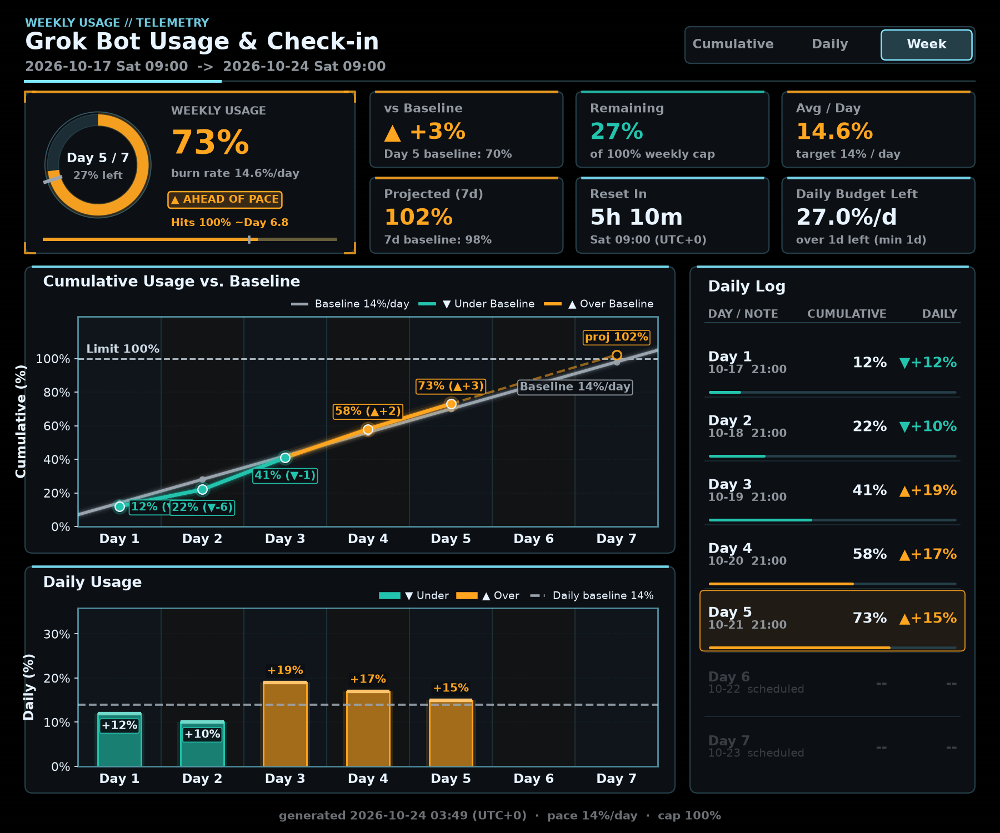

# Grok Bot Usage & Check-in

**Usage · Check-in · Search** (zh-TW: 用量・打卡・搜尋) — track weekly quota usage, log who works on what, and search
"which days did which things, and how much usage they cost". Formerly called *usage-hud*; folder, file, command,
config-key and API names are unchanged.

Recommended on Linux (your Grok Bot's computer); macOS should work but is untested; Windows is not yet fully tested. Nothing is sent anywhere; all data stays in a local folder.

A cross-platform, multi-panel sci-fi HUD dashboard renderer (`chart_hud.py`), bot-first idempotent recorder (`usage_record.py`), lightweight local web viewer (`usage_view.py`), and optional Grok Build `/usage` reader (`grok_usage_reader.py`) that tracks cumulative and daily weekly-quota usage percentages (`0%–100%+`) and outputs both a high-resolution PNG (`1800×1500 px`) and a machine-readable `latest.json` summary.

## Recommended: install it on your Grok Bot's computer (Linux)

The recommended setup is the **Linux version, installed on your Grok Bot's own computer**. This is the version that
has been used day to day: the bot reads `/usage` from Grok Build on its own machine every hour, with no model call and
no quota cost. You can simply ask your Grok Bot to do the install:

```bash
git clone https://github.com/yuehzhan/grokbot-usage-checkin.git
cd grokbot-usage-checkin
python3 -m pip install -r requirements.txt
sudo apt install -y tmux        # needed for automatic /usage reads on Linux
python3 service.py start        # page + hourly sampler in the background; stop with: python3 service.py stop
```

Grok Build must be installed and signed in once on that computer (see *Recommended Setup* below).

> **The Windows version has not been fully tested yet.** The steps below are provided for people who want to try it;
> manual entry of the weekly % is the reliable path there, and automatic reading is experimental.

## Linux vs Windows

- **Same features.** The difference is the platform and how well it's tested: automatic reading is tested on Linux, Windows is not yet fully tested. The Linux version can go on your Grok Bot's computer (recommended) or on your own Linux PC.
- **Check-ins are optional** on either version. If you only want to watch usage, you never need to check in. Check-ins are mainly for assistants to log what they did, for how long, and how much usage it took.
- **Importing an assistant's check-ins:** ask your Grok Bot to copy `usage-data/checkins.csv` from its computer into your dashboard's `usage-data` folder. If you already have that file, ask it to merge (dropping duplicate `id` rows) instead of overwriting. Stop the dashboard before copying and start it again afterwards; the Check-ins tab then shows and searches them.

## Windows quick start (not yet fully tested)

Needs Windows 10 (1809+) or 11 and [Python 3.10+](https://www.python.org/downloads/windows/) (tick "Add python.exe
to PATH"). No administrator rights. Everything stays on your PC; the page listens on `127.0.0.1` only.

> **Opening PowerShell:** press the Windows key, type `powershell`, press Enter. To open it in a specific folder, hold **Shift** and right-click an empty spot in that folder, then choose "Open PowerShell window here" (a plain right-click doesn't show it).

1. Install Python and Git if you don't have them (skip what you already have), then close and reopen PowerShell:
   ```powershell
   winget install -e --id Python.Python.3.12
   winget install -e --id Git.Git
   ```
2. Clone and start it:
   ```powershell
   git clone https://github.com/yuehzhan/grokbot-usage-checkin.git
   cd grokbot-usage-checkin
   powershell -ExecutionPolicy Bypass -File .\install.ps1    # add -Manual to always type the % yourself
   powershell -ExecutionPolicy Bypass -File .\start.ps1      # starts in the background and opens the page
   ```
   No Git? Use **Code → Download ZIP** instead, extract it, and first run `Get-ChildItem *.ps1 | Unblock-File`
   in that folder (Windows blocks scripts from downloaded ZIPs).
3. Stop it with `powershell -ExecutionPolicy Bypass -File .\stop.ps1`.
4. Optional, start at sign-in: `.\register-task.ps1` (undo: `.\register-task.ps1 -Uninstall`).
5. Update to a newer version (your data in `usage-data\` is kept):
   ```powershell
   powershell -ExecutionPolicy Bypass -File .\stop.ps1
   git pull
   powershell -ExecutionPolicy Bypass -File .\install.ps1
   powershell -ExecutionPolicy Bypass -File .\start.ps1
   ```
   On Linux: `python3 service.py stop && git pull && python3 -m pip install -r requirements.txt && python3 service.py start`.

**What works on Windows**

| Feature | Windows |
| :--- | :--- |
| Page, charts, check-ins, search, ledger, alerts | Works (same code as Linux/macOS). |
| Entering the weekly % yourself (page button **Enter manually**, or `usage_history.py sample --pct 42 --reset "Sat 09:00"`) | Works. This is the reliable way. |
| Automatic hourly reading of the `/usage` screen | **Experimental, not yet tested on a real Windows PC.** Needs Grok Build installed, signed in once and on `PATH` (or `GROK_BIN` set). It opens `grok` invisibly in a pseudo console (ConPTY, `pywinpty`), types `/usage`, reads the screen and closes it. If Grok Build shows an update or sign-in prompt, or its screen changes, the reading is recorded as *unavailable* (never as 0) and you can enter it manually. |
| Desktop alerts | Windows toast via PowerShell (no extra install). |
| Reading Grok Build's settings, sign-in data, cookies or tokens | **Never.** No such code exists; usage is only read from what the `/usage` screen shows, or what you type. |

There is no Grok Build command that prints usage without opening its screen, and `grok -p "/usage"` would be sent to
the model (it costs quota and does not show the panel), so the tool does not use it.

If the automatic read keeps failing, set `"pct_source": "manual"` in `usage_config.json` (install.ps1 does this when
`grok` is not on `PATH`): the sampler then stops starting Grok Build and the page asks you for the value.

中文說明：[README.zh-TW.md](./README.zh-TW.md)



---

### Windows troubleshooting (found during real setup)

- **"Open PowerShell window here" is missing:** hold **Shift** while right-clicking an empty spot in the folder. Or press the Windows key, type `powershell`, press Enter.
- **Grok Build's install folder looks empty:** normal. `irm https://x.ai/cli/install.ps1 | iex` installs to `C:\Users\<you>\.grok\bin` (not the folder you ran it from) and adds that to your user `PATH`.
- **install.ps1 says `"grok" is not on PATH` right after installing Grok Build:** the window was opened before the install, so it has the old `PATH`. Close it and open a new one.
- **Sign Grok Build in once:** in a new window run `grok`. A browser page asks for a code: it must match the code in the terminal. Check that the account shown is the one whose usage you want to track, then press **Allow**. Quit Grok Build with **Ctrl+Q**.
- **Switching from manual to automatic:** install.ps1 sets `"pct_source": "manual"` when it can't find `grok`, and it doesn't switch back by itself. After `grok` works, run `notepad usage_config.json`, change `manual` to `auto`, save, then stop and start the dashboard.
- **`cd /d` fails in PowerShell:** `/d` is a cmd option. In PowerShell use `cd E:\path\to\folder`. Every other command in this README works in both cmd and PowerShell.
- **Desktop shortcut:** ask your Grok Bot: "make a desktop shortcut for the dashboard". It creates one whose target is `C:\Windows\System32\WindowsPowerShell\v1.0\powershell.exe -ExecutionPolicy Bypass -File "<folder>\start.ps1"` with *Start in* set to the folder. To make it yourself: right-click the desktop, New, Shortcut, paste that target, then set *Start in* in the shortcut's Properties.
- **After updating, the page still looks old:** fixed in `adda5da` (the page is rebuilt on every start). On older versions, enter a reading once to rebuild it.

## Recommended Setup

1. **Install Grok Build & Sign In Once**:
   - **Windows (PowerShell)**:
     ```powershell
     irm https://x.ai/cli/install.ps1 | iex
     ```
   - **macOS / Linux**:
     ```bash
     curl -fsSL https://x.ai/cli/install.sh | bash
     ```
   Launch `grok` once and complete the one-time device authorization page in your browser with your own Grok account.
2. **Automatic `/usage` Reading (Zero Model/Quota Cost)**:
   - Once signed in, your bot or scheduled job can read `/usage` automatically via `usage_record.py` (opening `/usage` makes no model call and consumes zero usage quota).
   - It runs anywhere Grok Build is installed and signed in—your own desktop/laptop or your bot's machine; both read the same account-wide weekly usage `%`.
   - **Fallbacks**: If Grok Build is not installed on the recording machine, your bot can read the usage page itself and pass `--pct <N>`, or you can pass `--pct <N>` manually.
3. **Install Python & Terminal Dependencies**:
   - **Windows 10+**: run `install.ps1` (see the quick start above). It creates `.venv` and installs
     `requirements.txt` (`matplotlib`, `numpy`, `pywinpty`, `tzdata`).
   - **Linux / macOS**:
     ```bash
     python3 -m pip install -r requirements.txt
     # tmux is required on Linux/macOS for automatic Grok Build /usage reads:
     # sudo apt install tmux   (or: brew install tmux)
     python3 service.py start --open      # page + sampler in the background; stop with: python3 service.py stop
     ```

---

## Dashboard Panels & Colour Rule

### Panels
1. **Header Bar**: `WEEKLY USAGE // TELEMETRY` eyebrow, localized dashboard title (`Usage Dashboard` by default, customizable via `--title`), full weekly cycle window (`YYYY-MM-DD Sat 09:00 -> YYYY-MM-DD Sat 09:00`), and decorative segmented view tabs (`Cumulative | Daily | Week`).
2. **Row 1 — Hero Card & 6 Telemetry Stat Cards**:
   - **Hero Card (left ~1/3)**: Ring gauge (capped visually at `100%` with a grey tick at today's target baseline `pace × day`, showing `Day N / 7` and `% left` in the center), large current `%` readout, burn rate (`burn rate X.X%/day`), auto-sized status pill (`▼ ON PACE` in the cool colour or `▲ AHEAD OF PACE` in orange), time-to-cap forecast (`Hits 100% ~Day X.X` when projected usage exceeds `100%`), and a padded bottom multi-segment progress bar (used quota + pale forecast-to-reset + remaining track + grey baseline tick).
   - **6 Stat Cards (`2 × 3` grid)**: **vs Baseline** (`+/-%`), **Remaining** (`0%` and `+X% over cap` when `> 100%`), **Avg / Day**, **Projected (7d)**, **Reset In** (`Xd Yh`), and **Daily Budget Left** (`remaining / max(1, days_left)`).
3. **Row 2 Left — Cumulative Usage vs. Baseline Line Chart**: 7 framed daily cells (`x = 0..7`, points at `N - 0.5`), grey baseline `pace × (x + 0.5)`, segment-by-segment cool/orange usage line, dashed forecast to Day 7 (`proj X%`), `100%` limit line, `> 100%` cap triangle markers with anti-collision label placement, and `No Data` indicators in missing cells.
4. **Row 3 Left — Daily Usage Skyscraper Bar Chart**: Aligned with the 7 day-cells above, showing each day's increment (`pct - prev_pct`) in the cool colour (`<= pace × gap_days`) or orange (`> pace × gap_days`) against the dashed grey daily baseline (`14%`), with `(Nd)` gap tags on multi-day spans.
5. **Row 2+3 Right — Daily Log Card**: 7 daily rows (`Day 1..Day 7`) with date (`MM-DD`), note/timestamp, cumulative `%`, daily increment (`+N%`), and a clipped mini progress bar per row.
6. **Footer**: Generation timestamp, target daily pace, and weekly cap summary.

### Colour Rule & Palettes

- **Orange ▲ = over the baseline**, the palette's **cool colour ▼ = under**, **neutral grey = the baseline line itself**,
  **purple = notice** (no data, unavailable, stale, extra spend). Orange means nothing else.
- Deltas always carry ▲/▼, so the state never depends on colour alone.
- No colour is used to mean "bad"; "over" is never red.

| Preset (`palette`, `--palette`) | Over | Under | Baseline | Notice |
| :--- | :--- | :--- | :--- | :--- |
| `orange-teal` (default) | `#FFA51F` / `#C96A00` | `#23C4AE` / `#0B8A7E` | `#9AA4AE` / `#6B7480` | `#B48CFF` / `#7A4FC9` |
| `orange-blue` | `#FFA51F` / `#C96A00` | `#4D8DFF` / `#1F5FD1` | `#9AA4AE` / `#6B7480` | `#B48CFF` / `#7A4FC9` |
| `colorblind` (Okabe-Ito) | `#E69F00` / `#B87F00` | `#56B4E9` / `#0072B2` | `#9AA4AE` / `#6B7480` | `#CC79A7` / `#A8558A` |

Each cell is *dark background / light background*.

- PNGs (`chart_hud.py`, history and clock charts) and web pages follow the palette. `over_color`, `under_color` and
  `baseline_color` in the config still override single colours.
- The web pages have a palette dropdown; the choice is remembered in the browser (`localStorage` key `usage.palette`)
  and does not change the config. With `render_all_palettes: true` (default) the history page has every palette's PNGs
  ready (`history/pal/<name>/`), at the cost of slower rendering.
- Themes (`themes/muted.json`, `themes/light.json`) set background, text and accent colours; the palette picks its
  light variant automatically on light backgrounds. The cool accent is used only for frames and tabs, never for a state.
- Check-in name colours are chosen to stay clear of the state colours.

---

## Switchable Sources & Reset Time Auto-Detection

### 1. Switchable Sources (`pct_source` & `reset_source`)
Both the weekly usage percentage (`pct_source`) and the weekly reset timestamp (`reset_source`) default to `"auto"` and can be switched independently to `"manual"` via `usage_config.json` or CLI flags (`--pct-source auto|manual`, `--reset-source auto|manual`; `--source grok` is kept as a backward-compatible alias for `--pct-source auto`).

| `pct_source` | `reset_source` | Grok Build Launched? | How `pct` is Resolved (`pct_source` in JSON) | How `reset` is Resolved (`reset_source` in JSON) | Failure / Fallback Behavior |
| :--- | :--- | :--- | :--- | :--- | :--- |
| **`auto`** (default) | **`auto`** (default) | Yes (once) | From Grok Build (`"grok"`), or CLI `--pct` if explicitly given (`"cli"`, prints note on `stderr`) | From Grok Build (`"grok"`, updates `state.json`) | If Grok `pct` read fails (and no `--pct`) -> **exit `5`**. If Grok reset cannot be read -> **`WARNING` on `stderr`** and fallback to `cli` -> `config` -> `cache` (missing all -> **exit `3`**). |
| **`auto`** | **`manual`** | Yes (unless `--pct` given) | From Grok Build (`"grok"`), or CLI `--pct` (`"cli"`, note on `stderr`) | Always from `--reset-anchor` (`"cli"`) or config `"reset_anchor"` (`"config"`) | Ignores Grok's `Resets:` line and ignores `state.json`. Missing `--reset-anchor`/config `reset_anchor` -> **exit `3`**. Grok `pct` read failure -> **exit `5`**. |
| **`manual`** | **`auto`** | Yes (for reset only) | Requires CLI `--pct` (`"cli"`) | From Grok Build (`"grok"`, updates `state.json`) | Missing `--pct` -> **exit `2`**. If Grok cannot be run or reset cannot be read -> **`WARNING` on `stderr`** and fallback to `cli` -> `config` -> `cache` (missing all -> **exit `3`**). |
| **`manual`** | **`manual`** | **Never** (100% offline) | Requires CLI `--pct` (`"cli"`) | Always from `--reset-anchor` (`"cli"`) or config `"reset_anchor"` (`"config"`) | Missing `--pct` -> **exit `2`**. Missing `--reset-anchor`/config `reset_anchor` -> **exit `3`**. Never touches Grok Build or `state.json`. |

### 2. Reset Time Auto-Detection
Each account's weekly reset time differs, so the reset anchor is never hard-coded. When `reset_source` is `"auto"`, `grok_usage_reader.py` parses the `/usage` screen (`Usage limit` tab):
```text
│  Context usage  Usage limit  Session info      │
│  Weekly limit (SuperGrok)                      │
│  █████████████████████████░░░░░  84%           │
│  Resets: October 24, 09:00                     │
```
- **Parser (`parse_reset`)**: Matches `Resets: <Month> <day>, HH:MM` (supporting full and abbreviated English month names like `Oct`, optional `AM/PM`, and optional explicit year) using a locale-independent English month table.
- **Timezone & Year Rollover**: Interpreted in the machine's **LOCAL timezone** (the timezone Grok Build displays) or `--tz`. Infers the year from `now.year`, rolling forward to `year + 1` across `Dec -> Jan` boundaries (when the parsed date is `> 2` days in the past), rolling back to `year - 1` if `> 300` days in the future, and handling `Feb 29` leap years.
- **Period Window & Caching**: Sets `period_end = reset_at` and `period_start = reset_at - period_days` (rolling by `period_days` if stale), and atomically caches `reset_at` to `<data_dir>/state.json` (disable via `--no-cache` or `"cache_reset": false`). It never modifies your `usage_config.json`.
- **Fallback Config (`usage_config.json`) & Priority Order**:
  When `reset_source` is `"auto"` (fallback) or `"manual"` (required), `"reset_anchor"` accepts either a weekly weekday+time spec (`"Sat 09:00"`, `"Saturday 09:00"`) or an ISO datetime (`"2026-10-17T09:00"`) repeating every `period_days` in `"tz"`.
  - Priority in `"auto"` mode: **`grok`** → **`cli`** (`--reset-anchor`) → **`config`** (`"reset_anchor"`) → **`cache`** (`<data_dir>/state.json`) → **exit `3`**.
  - Priority in `"manual"` mode: **`cli`** (`--reset-anchor`) → **`config`** (`"reset_anchor"`) → **exit `3`**.

---

## Privacy Mode (`--privacy`)

Privacy mode produces a discreet, completely unbranded chart and JSON summary so nobody can tell which service, dashboard, or location is being used.

1. **Switch**: Pass `--privacy` on the CLI or set `"privacy": true` in `usage_config.json` (supported by `chart_hud.py`, `usage_record.py`, and `usage_view.py`). `--lang numeric` acts as an alias that also turns privacy mode on. Combine with `--theme themes/muted.json` for a low-saturation dark-grey palette.
2. **Word-Free, Unbranded Image**:
   - Contains **no** product/service names (`Grok`, `SuperGrok`, `Grok Build`, `xAI`), **no** `"Usage Dashboard"`, `"telemetry"`, `"weekly limit"`, `"usage"`, `"tokens"`, or `"AI"`, and **no** timezone or city names (IANA zone names or local city names); times show only a numeric UTC offset or none.
   - **Title**: Only the plain date range `"10-17 → 10-24"` (ignores any custom `--title`).
   - **Footer**: Only the generated timestamp numbers (`"2026-10-21 15:10"`, no timezone name).
   - **Labels & Legends**: Numbers, `%`, `D1..D7`, `MM-DD` dates, symbols (`▲`, `▼`, `Δ`, `↻`, `→`, `∑`, `Ø`, `÷`, `↓`), and color-only legend samples.
3. **Neutral Filenames**:
   - Output PNG defaults to `<data_dir>/chart-YYYYMMDD.png` (date of reading) unless `--out`, `"privacy_out"`, or `"out"` is specified. Auto-open opens that neutral file.
   - Weekly CSV files in `<data_dir>` remain named `week-YYYY-MM-DD.csv` (already generic), and the summary file remains `<data_dir>/latest.json`.
4. **Generic JSON Keys & Service-Neutral Errors**:
   - In privacy mode, `latest.json` and `stdout` use generic keys only, `"pct_source"` / `"reset_source"` use neutral `"a"` / `"m"` codes (never `"grok"`), and error messages omit service names (e.g. `"source read failed"`):
   ```json
   {"ok":true,"start":"2026-10-17","end":"2026-10-24","day":5,"days":7,"value":73.0,"step":14.0,"target":70.0,"delta":3.0,"trend":"up","projected":102.2,"left":27.0,"avg":14.6,"next":"2026-10-24T09:00+02:00","next_in_h":69.7,"pct_source":"a","reset_source":"a","updated_at":"2026-10-21T04:00+02:00","file":"usage-data/chart-20261021.png","csv":"usage-data/week-2026-10-17.csv","text":"D5/7 73 (70, +3) proj 102 next 2d 21h"}
   ```

---

## Refresh & Local Web Viewer (`usage_view.py`)

`usage_view.py` is a lightweight local web viewer built with the Python standard library only (`http.server` + `threading`). Static PNG generation via cron/Task Scheduler (`usage_record.py`) continues to work unchanged.

```bash
# Start local viewer on 127.0.0.1 with a random free port:
python3 usage_view.py [--config usage_config.json] [--host 127.0.0.1] [--port 0] [--no-open] [--privacy]

# Or via the usage_record.py convenience subcommand:
python3 usage_record.py serve --privacy --theme themes/muted.json
```

- **Security Note (Localhost-Only by Default)**:
  - Binds strictly to `127.0.0.1` by default. Non-loopback `--host` values are refused (exit `2`) unless `--allow-remote` is explicitly passed (which prints a warning on `stderr`).
  - Prints one JSON line on startup: `{"ok": true, "url": "http://127.0.0.1:PORT/"}` and auto-opens the browser unless `--no-open` is passed (skipped silently on headless Linux without `DISPLAY` / `WAYLAND_DISPLAY`).
- **Refresh Modes & Cooldown**:
  - `refresh_mode`: `"auto"` | `"manual"` (default `"auto"`, CLI `--refresh-mode`).
  - `refresh_interval_minutes`: Default `30`, minimum `5` (clamped to `5` with a `stderr` warning, CLI `--refresh-interval`).
  - In `"auto"` mode, a background thread triggers a refresh every `refresh_interval_minutes`, the page shows a live `"next auto refresh in mm:ss"` countdown (`"↻ mm:ss"` in privacy mode), and the browser polls `/api/latest` every `60 s` to reload the image when `updated_at` changes.
  - **Lock & Cooldown**: Concurrent requests while a refresh is running return HTTP `409` `{"ok": false, "error": "busy"}`. Manual Refresh button clicks enforce a 60 s cooldown (`manual_refresh_cooldown_seconds`, default `60`; UI disabled timer + server-side HTTP `429` `{"ok": false, "error": "cooldown", "retry_in": N}`); the cooldown does not apply to the automatic timer.
- **Routes**:
  - `GET /`: Self-contained HTML viewer (inline CSS/JS, no external CDNs; neutral `<title>` and symbol-only labels in privacy mode).
  - `GET /image`: Serves the current PNG (`Cache-Control: no-store`).
  - `GET /api/latest` & `GET /api/status`: Current `latest.json` + `next_refresh_at` / status fields.
  - `POST /api/refresh`: Runs one `usage_record.py --no-open` cycle as a subprocess and returns its JSON output. Needs the write token (see **Local Server Security**). `GET /api/refresh` returns `405`. A `pct` override is accepted only when the viewer runs with `--debug-pct-override` (or `"debug_pct_override": true`), otherwise `400`.

---

## Bot Contract (`usage_record.py`, `grok_usage_reader.py`, & `latest.json`)

> **Tip for AI Agents / Bots**: Read `<data_dir>/latest.json` (or run `usage_record.py ... --format text`) instead of passing the rendered PNG to a vision model—this saves token/quota usage while giving you exact numbers and a pre-formatted summary string.

### 1. `usage_record.py` Output (`latest.json` & One-Line `stdout` JSON)
- **Idempotent Atomic Upsert**: Each run upserts today's cycle day (`1..7`) into `<data_dir>/week-<period_start>.csv` atomically via temporary file + `os.replace`, writes `<data_dir>/latest.json`, renders the PNG (unless `--no-render`), and auto-opens the PNG (unless `--no-open` or `"open": false`).
- **Normal Mode JSON**:
  ```json
  {"ok":true,"period_start":"2026-10-17","period_end":"2026-10-24","day":5,"days_total":7,"pct":73.0,"pct_source":"grok","pace":14.0,"baseline":70.0,"delta":3.0,"status":"ahead","projected_end_pct":102.2,"remaining_pct":27.0,"avg_per_day":14.6,"reset_at":"2026-10-24T09:00+02:00","reset_in_hours":69.7,"reset_in_text":"2d 21h","reset_source":"grok","recorded_at":"2026-10-21T04:00+02:00","csv":"usage-data/week-2026-10-17.csv","image":"usage-data/usage-week.png","summary_text":"Day 5/7: 73% used (baseline 70%, +3) - ahead of pace; projected 102%; resets in 2d 21h"}
  ```
- **`--format text`**: Prints only `summary_text` (or `text` in privacy mode) to `stdout`.

### 2. `grok_usage_reader.py` CLI
```bash
# Live read from Grok Build /usage (prints one line of JSON):
python3 grok_usage_reader.py
# -> {"pct": 84.0, "reset_at": "2026-10-24T09:00:00+02:00"}

# Offline parser self-test (no grok launch):
python3 grok_usage_reader.py --parse-test "Weekly limit 84% Resets: October 24, 09:00" --now 2026-10-21T14:00:00+02:00
```

### 3. Exit Codes (`usage_record.py`)
| Exit Code | Meaning |
| :--- | :--- |
| `0` | Success (`"ok": true`) |
| `2` | Bad input (missing `--pct` when `pct_source="manual"`, non-numeric `--pct`, `< 0` or `> 200`, or invalid `--date` / `--time` / `--at`) |
| `3` | Configuration error (no reset anchor found, invalid `pct_source`/`reset_source`/`refresh_mode`, missing/invalid config JSON, or invalid timezone) |
| `4` | Render error (exception during Matplotlib PNG generation) |
| `5` | Source read error (failed to read weekly usage `%` from Grok Build when `pct_source="auto"` and `--pct` was not provided) |

---

## Scheduling (`--print-schedule`)

Print a ready-to-run daily schedule command for your OS without modifying system tasks automatically (we recommend passing `--config` with an absolute path; `--print-schedule` automatically includes `--config <abs_path>` when a config file is passed or found):
```bash
python3 usage_record.py --print-schedule --at 13:15 --config usage_config.json
```
- **Windows (`schtasks`)**: Uses `python.exe` (not `pythonw.exe`, so ConPTY works properly) and `/RL LIMITED`:
  ```bat
  schtasks /Create /SC DAILY /ST 13:15 /RL LIMITED /TN "UsageDashboard" /TR "\"C:\...\python.exe\" \"C:\...\usage_record.py\" --pct-source auto --config \"C:\...\usage_config.json\""
  ```
- **Linux / macOS (`cron`)**: Includes `--config <abs_path>` and `--no-open` for headless execution:
  ```cron
  15 13 * * * cd /path/to/usage-hud && /usr/bin/python3 usage_record.py --pct-source auto --config /path/to/usage-hud/usage_config.json --no-open >> /path/to/usage-data/cron.log 2>&1
  ```

---

## Languages, Fonts, & Standalone Renderer (`chart_hud.py`)

```bash
# Positional CLI (drop-in compatible with chart.py):
python3 chart_hud.py <week_csv> <out_png> <week_start_date YYYY-MM-DD>

# Standalone single-reading or override mode (no CSV required):
python3 chart_hud.py --pct 73 --day 5 [--lang auto|en|zh-TW|zh-CN|ja|ko|numeric] [--privacy]
```

- **Locale Auto-Detection (`--lang auto`, Default)**: `detect_lang()` checks Windows `ctypes.windll.kernel32.GetUserDefaultUILanguage()`, then `LC_ALL`, `LC_MESSAGES`, `LANG`, and `locale.getlocale()`, normalizing to `zh-TW`, `zh-CN` (idiomatic Mainland Simplified Chinese), `ja`, `ko`, or `en`.
- **Custom Locale Overlays**: Place a JSON file at `locales/<lang>.json` next to `chart_hud.py` to add or override any locale (missing keys fall back to `BASE_STRINGS` in English).
- **Cross-Platform Fonts & Cross-CJK Fallback**: Tries language-specific fonts first (`Noto Sans CJK TC/SC/JP/KR`, `Microsoft JhengHei`, `Microsoft YaHei`, `PingFang TC/SC`, `Heiti TC/SC`, `Yu Gothic`, `Meiryo`, `Hiragino Sans`, `Malgun Gothic`, `Apple SD Gothic Neo`) with cross-CJK fallback (`TC <-> SC <-> JP`) before falling back to English (`DejaVu Sans`, `Segoe UI`, `Arial`) with a `stderr` warning.

---

## Long-Range History, Sampler, Clock & Check-ins (`usage_history.py`)

`usage_history.py` adds long-range views on top of the existing `week-*.csv` files. It only **reads** files written by `usage_record.py` and writes its own files under `<data_dir>`, so existing behavior is unchanged. It uses the same `usage_config.json`, CLI-over-config precedence, `lang`, `privacy`, `tz` and `theme` conventions.

```bash
python3 usage_history.py history            # history/history-{1m,3m,6m,1y}.png + history/index.html
python3 usage_history.py clock              # history/clock-7d.png + history/clock-all.png
python3 usage_history.py sample             # one Grok Build read -> samples.csv, then regenerate
python3 usage_history.py sample --pct 42    # record a manual value (no Grok launch)
python3 usage_history.py sample --pct 42 --reset "Sat 09:00"   # ... and the next reset (also "Oct 31, 09:00" or ISO)
python3 usage_history.py sampler            # foreground interval loop (pidfile + lock, one instance)
python3 usage_history.py serve              # local viewer on 127.0.0.1 (random port by default)
python3 usage_history.py checkin "NAME" "optional note" [--category web]   # one-off check-in (phase "point")
python3 usage_history.py start "NAME" "task" --category code,writing      # start a session -> session id
python3 usage_history.py end "NAME" "reason" [--status interrupted] [--id ID]
python3 usage_history.py search WORDS... [--category code] [--from YYYY-MM-DD] [--to YYYY-MM-DD] [--json]
python3 usage_history.py status             # JSON: data_dir, interval, timezone, sampler pid, server URL
python3 usage_history.py ledger             # ledger freshness check (exit 0 fresh, 3 stale/missing)
```

All commands accept `--config`, `--data-dir`, `--tz`, `--lang`, `--theme`, `--palette`, `--pace` and `--privacy`, and print one line of JSON (except `search` without `--json`, which prints a readable day-by-day list).

### History Ranges

- Tabs for **1 month / 3 months / 6 months / 1 year** (`1m`, `3m`, `6m`, `1y`), one PNG each.
- Weekly peak bars: **orange ▲** = over pace, **cool colour ▼** = within pace, **grey dashed** = pace baseline, white line = daily cumulative usage.
- Summary cards: week count, average weekly peak, weeks at 100%, extra spend (from `extra_spend_csv`).
- Ranges with too few weeks (1m < 3, 3m < 10, 6m < 20, 1y < 40) still render, with an "insufficient data" badge.
- `* ` marks the current week (not complete yet).

### Interval Sampler (`sample_interval_minutes`)

- `sampler` takes one sample right away (skip with `--skip-first`), then sleeps until the next boundary. Intervals that divide a day (15, 30, 60, 90, 120 ...) are aligned to local midnight, others repeat every N minutes.
- The config is re-read every cycle, so you can change the interval without restarting.
- One instance only: `<data_dir>/.sampler.lock` + `<data_dir>/sampler.pid`; log in `<data_dir>/sampler.log`.
- Grok Build reads share `<data_dir>/.read.lock` with the manual refresh, so they never overlap. Each read uses its own unique `tmux` session (via `grok_usage_reader.py`), which is cleaned up afterwards.
- Run in the background with `service.py` (all platforms): `python3 service.py start [--open] [--no-sampler]`,
  `python3 service.py stop`, `python3 service.py status`. It starts a small supervisor that keeps the page server and
  the sampler running (restarting them if they crash, at most 5 times per hour), without console windows on Windows.
  `python3 service.py run` is the same supervisor in the foreground (used by `register-task.ps1`). Logs:
  `<data_dir>/service.log`, `server.log`, `sampler.log`. `stop` also removes stale pid/token files.
- With `"pct_source": "manual"` the sampler never starts Grok Build; it only logs that values are entered by hand.

### Clock Chart

- 24-hour polar chart of the average % increase per hour of day, for the last 7 days and for all samples.
- This chart is a magnitude scale, not an over/under state: colours run from the palette's cool colour (low) through purple to orange (high), so orange still means "more usage". Drops in % are treated as a quota reset (the new value counts). Long gaps are skipped.
- With fewer than 24 intervals, the chart shows a "collecting data" badge.
- Check-ins (one-off check-ins and session starts) are drawn as dots outside the rim, one colour per name (name colours avoid the state colours).

### Timezone (`tz`)

- `"local"` (default) uses the machine's timezone. An IANA name (e.g. `"Europe/Berlin"`) overrides it and is validated with `zoneinfo` (exit with an error if invalid).
- Every stored timestamp is ISO 8601 with offset (`2026-10-24T03:20:00+02:00`), so changing `tz` later only changes the display.
- Labels show the real offset, e.g. `Last update: 03:20 (UTC+2)` or `(Europe/Berlin UTC+2)`.
- The week boundary comes from the reset detected by Grok Build (`state.json` `reset_at`), then `reset_anchor`.

### Manual Refresh Server

```bash
python3 usage_history.py serve                 # 127.0.0.1, random free port
python3 usage_history.py serve --port 8765     # fixed port
cat usage-data/history_server.json             # {"url": "http://127.0.0.1:PORT/", "pid": ...}
```

| Route | Method | Description |
| :--- | :--- | :--- |
| `/` | GET | History page (tabs: ranges, clock, check-ins). |
| `/api/status` | GET | JSON with `ok`, `last_update`, `busy`, `timezone`, `sample_interval_minutes`, `pct_source`. |
| `/api/manual` | POST | Record a value you read yourself: JSON `{"pct": "42", "reset": "Sat 09:00"}` (`reset` optional; weekday+time, `Oct 31, 09:00` or ISO). Token required; `400 bad_manual_value` for a % outside 0–200 or an unreadable reset; `409` while another write runs. |
| `/api/refresh` | POST | Take a sample now and regenerate (token required). In manual mode it returns `400 {"code":"manual_mode"}`. `409 {"error":"busy"}` while a read runs, `429 {"error":"cooldown","retry_in":N}` within the cooldown (`manual_refresh_cooldown_seconds`, default 60). |
| `/api/checkin` | POST | Check in / start / end a session (token required, see below). `GET` returns `405`. |
| `/api/checkins` | GET | Sessions grouped by day plus per-category summary; same filters as search. |
| `/api/checkins/search` | GET | Read-only search (see below). |
| `/api/ledger`, `/ledger.json` | GET | The usage ledger (see below); `404` until the first sample. |

- Binds `127.0.0.1` by default. Any non-loopback `history_host`/`--host` is refused unless `--allow-remote` is passed.
- See **Local Server Security** below for the write token and Host/Origin checks.
- The page shows a **Refresh now** button (with spinner), an **Enter manually** button and the check-in form only when it is served by this server; opened as a plain file, it is read-only. In manual mode **Refresh now** is hidden.
- `history/index.html` is self-contained (PNGs embedded), so it can be copied or opened offline.

### Check-ins: sessions, categories and search

Check-ins live in `<data_dir>/checkins.csv` with the columns `timestamp,name,note,category,id,phase,status`.
No sample data is shipped; an empty file shows "no check-ins yet".

- `phase`: `start`, `end` or `point` (a one-off check-in). `status` (on `end` only): `done` or `interrupted`.
  "Interrupted" is an end status, not a category.
- `category`: 1 to `checkin_max_categories` (default 3) category ids joined with `|`, e.g. `code|writing`.
- Old three-column files (`timestamp,name,note`) still work: those rows count as `point` with category `other`, and
  the header is upgraded on the next write.
- Names are trimmed to 40 characters, notes/reasons to 200. The same name and phase within
  `checkin_cooldown_seconds` (default 5) gets `429`.

Default categories, in page order: `web`, `code`, `break`, `image`, `publish`, `daily`, `research`, `writing`,
`files`, `review`, `maintenance`, `comms`, `learning`, `other`. Labels are English, with zh-TW labels when `lang` is
`zh-TW`. Change the list with `checkin_categories` (`"id:Label"` sets a custom label). Unknown ids become `other`.

For each session the tool computes:

- **Duration** from start to end. A session still running shows "In progress"; one not ended within
  `checkin_open_limit_hours` (default 6) shows as **open** (zh-TW `未結束`). Only ended sessions add time to totals.
- **Usage Δ**: the weekly % from the samples nearest to the start and the end, in percentage points. If there is no
  successful sample near either end, the session has not ended, or a weekly reset happened in between, it is
  **unavailable** (never `0`).

**Per-category summary**: a session with several categories counts its full duration under each one, so category
totals **can overlap**; the overall total counts each session once. A category filter matches a session if any of its
categories matches.

Copy-paste examples (e.g. for an AI assistant to log its work). Replace `PORT` with the port from
`<data_dir>/history_server.json`; the token is in `<data_dir>/history_server.token` next to it:

```bash
# Shell (no server needed; uses the same write lock)
python3 usage_history.py start "YOUR_NAME" "refactor parser" --category code,writing   # prints the session id
python3 usage_history.py end "YOUR_NAME" "blocked by review" --status interrupted       # or --id SESSION_ID
python3 usage_history.py checkin "YOUR_NAME" "quick note" --category daily

# POST JSON
TOKEN=$(cat usage-data/history_server.token)
curl -s -X POST http://127.0.0.1:PORT/api/checkin -H "X-Usage-Token: $TOKEN" \
  -H 'Content-Type: application/json' \
  -d '{"name": "YOUR_NAME", "phase": "start", "categories": ["code", "writing"], "note": "refactor parser"}'
curl -s -X POST http://127.0.0.1:PORT/api/checkin -H "X-Usage-Token: $TOKEN" \
  -H 'Content-Type: application/json' \
  -d '{"name": "YOUR_NAME", "phase": "end", "id": "SESSION_ID", "status": "done"}'
```

Categories may be sent as a JSON array, a comma list, or a repeated `category=` form field. `end` without `id` closes
the latest open session for that name (preferring one with the same categories when given).
Errors are JSON with a `code`, e.g. `400 {"ok": false, "error": "...", "code": "too_many_categories"}` or
`"no_open_session"`.

**Search** — "which days did which things, and how much usage did they cost":

- One keyword box: case-insensitive substring match over name, note/reason and category labels; several words
  separated by spaces must all match (AND). Plus the category filter and an optional date range.
- Results are grouped by day, newest first. Each day lists its sessions (time, categories, note, duration, status,
  usage Δ or "unavailable") and a subtotal: session count, total time, and **that day's actual weekly-% rise** from the
  samples (not a sum of overlapping sessions).

```bash
python3 usage_history.py search parser review --from 2026-10-01 --to 2026-10-31 [--category code] [--json]
curl -s "http://127.0.0.1:PORT/api/checkins/search?q=parser&category=code&from=2026-10-01&to=2026-10-31"
```

The page's check-in tab has category chips (a 4th pick is blocked), Start / End buttons (the End dialog asks for
Done or Interrupted plus an optional reason), the search box with dates, the day-grouped list and the per-category
summary. The last name used is remembered in `localStorage`.

### Local Server Security

Both `usage_history.py serve` and `usage_view.py`:

- Accept writes only as **POST** (`GET /api/checkin`, `GET /api/refresh` → `405`).
- Create a random token at each start, saved with mode `600` to `<data_dir>/history_server.token` or
  `<data_dir>/view_server.token` and removed on exit. Every POST needs the header `X-Usage-Token: <token>`, else `403`.
  The served page embeds the token; CLI scripts read the token file.
- Require `Host` to be `127.0.0.1` or `localhost` (optionally with the port), else `421`. When you bind elsewhere
  with `--allow-remote`, list extra names in `history_allowed_hosts` / `view_allowed_hosts`.
- Reject writes whose `Origin`/`Referer` is another site (`403`).
- Accept a `pct` override only with `--debug-pct-override` / `"debug_pct_override": true`.

All writers (weekly CSVs, samples, check-ins, `state.json`, ledger) share one lock file, `<data_dir>/.write.lock`.

### Reading the Grok Build screen

- **Linux / macOS**: each read starts its own fixed-size `tmux` session, captures only the on-screen text
  (`tmux capture-pane`), has a timeout, always kills the session afterwards, and cleans up stale sessions left by
  earlier crashed reads.
- **Windows** (experimental): `grok` runs in an invisible pseudo console (`pywinpty`, ConPTY). ConPTY sends cursor
  movements instead of plain text, so the output is replayed on a small built-in terminal screen (`vt_screen.py`,
  which also answers the terminal's cursor-position query) and that screen is read, like `tmux capture-pane`.
- `grok` is found through `GROK_BIN` (full path) or `PATH`; `.cmd`/`.bat` launchers are started through `cmd.exe`.
  Nothing else of Grok Build is read: no settings, sign-in data, cookies, tokens or logs.
- A screen it does not recognise is recorded as **unavailable with a reason**, never as `0`.

`.gitignore` excludes the data folders (`usage-data/`, `data/`), logs, pid/port/token files, `history_server.json`,
`service.json`, `.venv/`, backups, `__pycache__/` and `usage_config.json`.

### Privacy Behavior

With `privacy: true` / `--privacy` (or `lang: "numeric"`), the history and clock PNGs use word-free numeric labels and symbols, omit timezone names and the header kicker, and show check-in names as `#1`, `#2` ... in the PNG legend, on the page and in the check-in/search API responses
(notes are hidden, category labels become numbers). The CSV files keep the real names locally.

---

## Usage Ledger, Unavailable State & Alerts (`usage_ledger.py`, `desktop_notify.py`)

Every live reading — `usage_history.py sample` / `sampler`, the viewer's **Refresh** button and `usage_record.py`
(not `--date`/`--time` backfills) — atomically rewrites one small JSON file, the **ledger**
(default `<data_dir>/ledger.json`, override with `ledger_path`). `<data_dir>/latest.json` stays the
`usage_record.py` summary described above.

### Reading it from an assistant or script (no extra LLM turn)

1. Read the ledger file (or `GET /api/ledger` / `/ledger.json` from `usage_history.py serve`).
2. If it is missing, or `asOf` is older than `stale_after_hours` (default `6`), take a fresh sample
   (`python3 usage_history.py sample`, or `POST /api/refresh` on the viewer) and read it again.
3. If `status` is `"unavailable"`, `weeklyPercentUsed` and `resetsAt` are `null`; quote `lastGood` with its time instead.

```bash
python3 usage_ledger.py read usage-data/ledger.json --max-age-hours 6 \
  || { python3 usage_history.py sample; python3 usage_history.py ledger; }
python3 usage_history.py ledger      # same check using the configured path; exit 0 fresh, 3 stale/missing
```

| Field | Meaning |
| :--- | :--- |
| `asOf` | Time of this sample or attempt (ISO 8601 with UTC offset). |
| `status` | `"ok"` or `"unavailable"` (the read failed). |
| `error` | Failure reason, `null` when ok. |
| `weeklyPercentUsed` | Weekly `%`; `null` when unavailable — **never `0`**. |
| `resetsAt` | Next reset as shown by Grok Build in this read; `null` when not shown — **never guessed**. |
| `periodStart` | Start of the current quota period (derived from a Grok-reported reset), or `null`. |
| `source` | `sampler`, `refresh`, `record` or `manual`. |
| `consecutiveFailures` | Failed reads in a row (reset to `0` on success). |
| `lastGood` | `{asOf, weeklyPercentUsed, resetsAt, periodStart, source}` of the last successful read. |
| `spike` | `{flag, points, since, threshold}` — rise vs. ~24 h earlier in the same period. |
| `overBudget` | `{flag, threshold}` — weekly `%` ≥ `over_budget_percent`. |
| `staleAfterHours`, `timezone` | Freshness limit and display offset (e.g. `UTC+2`). |
| `alerts` | Active alerts `[{id, kind, title, message}]`; ids are per day, e.g. `spike:YYYY-MM-DD`. |

### Unavailable, never fake

- A failed read appends `timestamp,unavailable` to `samples.csv`; those rows are excluded from charts,
  averages, the clock chart and spike baselines. The sample command exits with code `5`.
- The history page shows `⚠ Usage unavailable · tried … · reason … · last good X% (…) · reset unknown`
  (zh-TW: `無法取得` / `重置時間未知`; privacy mode: `∅` and no reason text).
- Test with `python3 usage_history.py --data-dir /tmp/scratch sample --simulate-fail "reason"` — use a scratch data dir.

### Alerts

| Alert | Condition | id |
| :--- | :--- | :--- |
| Daily spike | current `%` − value ~24 h earlier ≥ `daily_spike_points`. Same period only: a drop in `%` is treated as a reset (baseline `0` at the reset). No comparison when there is no sample 24–36 h back and the period did not start within 24 h. | `spike:<date>` |
| Over budget | weekly `%` ≥ `over_budget_percent` | `budget:<date>` |
| Unavailable | `consecutiveFailures` ≥ `unavailable_after_failures` | `unavailable:<date>` |

Each id fires **once per day** (display timezone): one JSON line in `<data_dir>/alerts.log` and one desktop
notification; sent ids are kept in `<data_dir>/alerts-state.json` for 14 days. Nothing happens when no alert
is active, and nothing is sent to any external service. The history page shows matching badges plus a
"data is N h old" badge when stale.

**Desktop toast** (`desktop_notify: true`), via `desktop_notify.py` (stdlib, never raises):

- **Windows 10/11:** PowerShell — BurntToast when installed, else the built-in `Windows.UI.Notifications` API.
  Text goes in as escaped single-quoted literals inside `-EncodedCommand` and as XML text nodes.
- **macOS:** `osascript` `display notification` (title/message passed as arguments, not as script text).
- **Linux/BSD:** `notify-send` when installed (needs a desktop session).
- Otherwise a silent no-op (`alerts.log` records `noop:<reason>`). `USAGE_NOTIFY_DISABLE=1` turns it off temporarily.
- Try it: `python3 desktop_notify.py "Usage" "Test message" [--dry-run]`.

**Browser notifications:** when the page is opened through `usage_history.py serve`, an
**Enable desktop notifications** button (zh-TW `開啟桌面通知`) asks for permission — never on page load.
While the page is open it polls `/api/ledger` every 3 minutes and shows each alert id once (seen ids in
`localStorage` key `usage.alertsSeen`). Opened as a plain file it does not poll. If the sampler runs on the same
machine you may get both an OS toast and a browser notification; disable one of them if you prefer.

### Tests

```bash
python3 -m unittest discover -s tests -v
```

Covers the notifier command builders (not executed), spike/ledger/dedupe, local-server security (token, Host,
Origin, POST-only, debug `pct`), the screen reader on recorded screens, palettes and the write lock, and check-in
sessions/categories/search, the Windows pieces that can be checked on any OS (terminal-screen replay of
ConPTY-style output, manual entry parsing, process helpers, the Windows lock branch with a stand-in `msvcrt`), and
`service.py` start/stop. Tests use temporary folders only.

## Configuration Keys (`usage_config.json`)

| Key | Default | Description |
| :--- | :--- | :--- |
| `pct_source` | `"auto"` | `"auto"` (read `%` from Grok Build `/usage` unless `--pct` given) or `"manual"` (`--pct` required; the sampler does not start Grok Build and the page offers **Enter manually**). |
| `reset_source` | `"auto"` | `"auto"` (read reset from Grok Build with fallback to `cli`/`config`/`cache`) or `"manual"` (`cli`/`config` only). |
| `reset_anchor` | `null` | Weekly weekday+time (`"Sat 09:00"`, `"Saturday 09:00"`) or ISO timestamp (`"2026-10-17T09:00"`). |
| `tz` | `"local"` | `"local"` (machine local timezone) or an IANA timezone name (e.g. `"Europe/Berlin"`). The weekly chart labels show its actual offset, e.g. `(UTC+2)`, or `(Europe/Berlin UTC+2)` when set explicitly. |
| `period_days` | `7` | Days per quota cycle. |
| `pace` | `14` | Daily target baseline percentage (`14%/day`). |
| `lang` | `"auto"` | `"auto"` (system locale), `"en"`, `"zh-TW"`, `"zh-CN"`, `"ja"`, `"ko"`, or `"numeric"`. |
| `privacy` | `false` | Enables word-free numeric rendering, neutral `chart-YYYYMMDD.png` filename, and generic JSON keys. |
| `refresh_mode` | `"auto"` | `"auto"` or `"manual"` refresh mode for `usage_view.py`. |
| `refresh_interval_minutes` | `30` | Background auto-refresh interval in minutes for `usage_view.py` (minimum `5`, clamped with warning). |
| `data_dir` | `"./usage-data"` | Directory for `week-*.csv`, `state.json`, `latest.json`, and rendered PNGs. |
| `out` | `<data_dir>/usage-week.png` | Custom output PNG path. |
| `privacy_out` | `<data_dir>/chart-YYYYMMDD.png` | Optional custom output PNG path when `privacy` is `true`. |
| `summary` | `<data_dir>/latest.json` | Output path for the machine-readable summary JSON. |
| `theme` | `null` | Optional theme JSON path (`"themes/muted.json"`, `"themes/light.json"`). |
| `open` | `true` | Auto-open rendered PNG / viewer browser window unless `--no-open` is passed. |
| `cache_reset` | `true` | Cache auto-detected `reset_at` to `<data_dir>/state.json` unless `--no-cache` is passed. |
| `sample_interval_minutes` | `60` | `usage_history.py sampler` interval (`15`–`1440`, clamped with warning). Re-read every cycle; aligned to clock boundaries when it divides a day. |
| `history_host` | `"127.0.0.1"` | Bind host for `usage_history.py serve`. Non-loopback hosts are refused unless `--allow-remote` is passed. |
| `history_port` | `0` | Port for `usage_history.py serve` (`0` = random free port; actual URL written to `<data_dir>/history_server.json`). |
| `manual_refresh_cooldown_seconds` | `60` | Minimum seconds between `POST /api/refresh` calls (`429` + `retry_in` otherwise). |
| `checkin_cooldown_seconds` | `5` | Minimum seconds between check-ins for the same name (`429` + `retry_in`). |
| `ledger_path` | `<data_dir>/ledger.json` | Where the shared usage ledger is written. |
| `daily_spike_points` | `20` | Daily spike alert threshold (points gained vs. ~24 h earlier). |
| `over_budget_percent` | `90` | Over-budget alert when weekly `%` reaches this value. |
| `unavailable_after_failures` | `3` | Unavailable alert after this many failed reads in a row. |
| `stale_after_hours` | `6` | Ledger age after which readers should refresh first. |
| `desktop_notify` | `true` | Show OS desktop toasts for new alerts (`false` = log only). |
| `extra_spend_csv` | `null` | Optional CSV of extra paid usage with at least the columns `time,usd_used` (`usd_used` = monthly running total; other columns are ignored); shown per month in the history view. |
| `palette` | `"orange-teal"` | Colour preset: `orange-teal`, `orange-blue`, `colorblind`. |
| `over_color`, `under_color`, `baseline_color` | `null` | Optional single-colour overrides for `chart_hud.py` (hex); `null` = take it from the palette. |
| `render_all_palettes` | `true` | Also render every palette's history/clock PNGs so the page dropdown can switch instantly. |
| `checkin_categories` | 14 defaults | Category ids in page order; `id:Label` sets a custom label. Unknown ids become `other`. |
| `checkin_max_categories` | `3` | Maximum categories per session (at least 1). |
| `checkin_open_limit_hours` | `6` | A session not ended after this many hours shows as "open". |
| `debug_pct_override` | `false` | Allow a `pct` override on refresh requests (testing only). |
| `history_allowed_hosts`, `view_allowed_hosts` | `[]` | Extra `Host` names accepted when bound to a non-loopback address. |

---

## Cross-Platform Verification Status

- **Tested on Linux** (automated tests + manual runs): everything below except the Windows/macOS-only parts.
- **Windows: written, not yet run on a Windows PC.** The PowerShell scripts were syntax-checked with PowerShell 7's
  parser and reviewed by hand; the Windows code paths (`pywinpty` reader, `msvcrt` lock, `ctypes` process checks,
  `taskkill`, hidden worker windows, toast) are covered by tests only where they can be simulated on Linux.
  Please report what happens on your machine (`usage-data\service.log`, `usage-data\sampler.log`).
- **macOS**: `tmux` reader, `open`, `osascript` notifications — written, not tested on a Mac.

### Details

- **Tested & Verified (Linux)**:
  - `chart_hud.py` multi-panel rendering, themes (`themes/light.json`, `themes/muted.json`), CJK & English typography, `detect_lang()`, `locales/<lang>.json` overlays, `--lang numeric` & `--privacy` modes, missing-day & `>100%` capped anti-collision labels.
  - `usage_record.py` atomic CSV upsert (`week-YYYY-MM-DD.csv`), idempotency, period rollover math, switchable `pct_source` & `reset_source` combinations, `state.json` caching, `latest.json` (normal & privacy schemas), `--format text`, `--print-schedule`, and exit codes (`0`, `2`, `3`, `4`, `5`).
  - `grok_usage_reader.py` ANSI stripping, `parse_weekly_pct()`, `parse_reset()` year rollover & `--parse-test`, and `tmux` session lifecycle.
  - `usage_view.py` localhost HTTP server, routes (`/`, `/image`, `/api/latest`, `/api/status`, `/api/refresh`), lock debounce (`409`), manual cooldown (`429`), and auto-refresh thread.
  - Local-server security in `usage_view.py` and `usage_history.py serve` (token, Host `421`, cross-site `403`, POST-only `405`, debug `pct`).
  - `usage_history.py` history/clock charts in every palette, sessions, multi-select categories and search (API + CLI).
  - `usage_ledger.py` ledger writing, staleness check, spike/over-budget/unavailable alerts and per-day dedupe.
  - `desktop_notify.py` command builders for every OS (built and checked in tests, not executed).
- **Written, Untested on Host (Windows / macOS specifics)**:
  - Windows `pywinpty` (`PtyProcess`) ConPTY reader in `grok_usage_reader.py`.
  - Windows `ctypes.windll.kernel32.GetUserDefaultUILanguage()` locale detection in `chart_hud.py`.
  - Windows `os.startfile` / macOS `open` image auto-launch.
  - `install.ps1`, `start.ps1`, `stop.ps1`, `register-task.ps1` (parsed, not executed).
