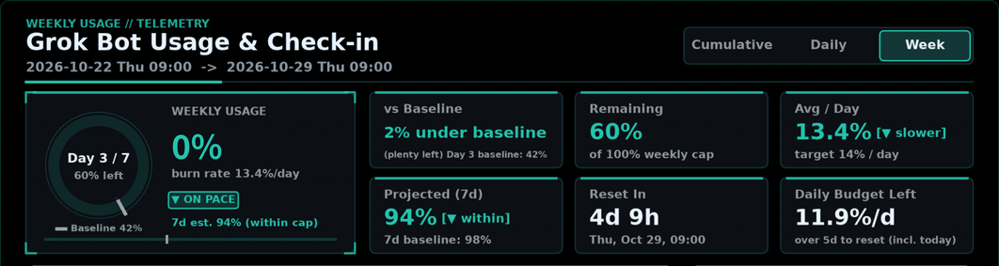
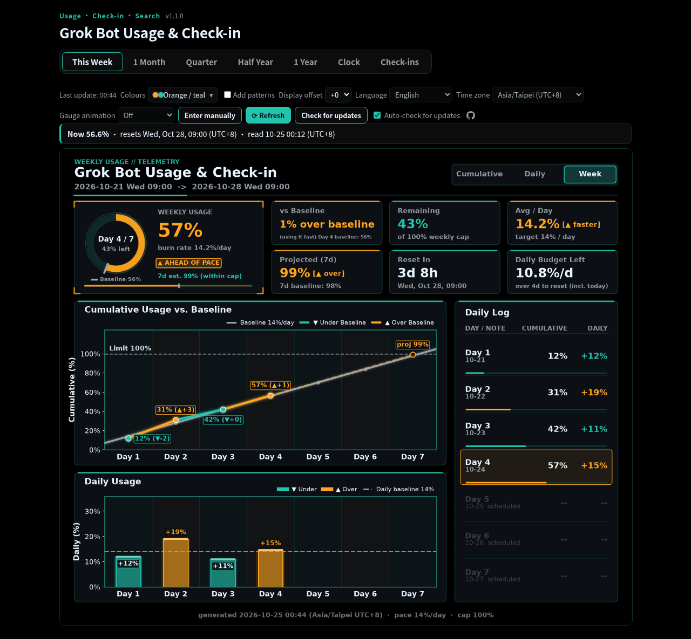
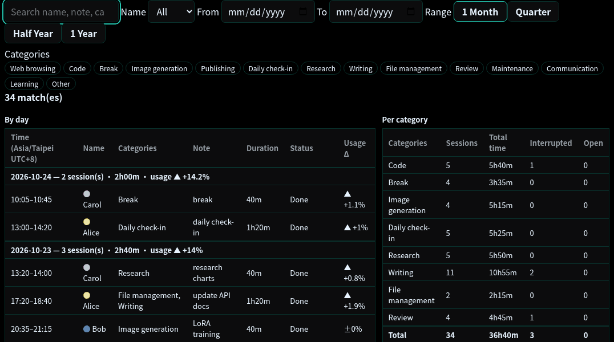

# Grok Bot Usage & Check-in

<p align="center">
  
</p>



*Animation and screenshot use made-up sample data.*

**Usage · Check-in · Search** (zh-TW: 用量・打卡・搜尋) — track weekly quota usage, log who works on what, and search
"which days did which things, and how much usage they cost". Formerly called *usage-hud*; folder, file, command,
config-key and API names are unchanged.

Recommended on Linux (your Grok Bot's computer); macOS should work but is untested; Windows is not yet fully tested. All usage and check-in data stays in a local folder and the page is served only on `127.0.0.1`. The one exception is the optional update check: about once a day it asks GitHub (`git fetch` from this repository) whether a newer version exists; turn it off with the page's **Auto-check for updates** switch or `"update_check": "off"`. No usage data is sent with it.

A cross-platform, multi-panel sci-fi HUD dashboard renderer (`chart_hud.py`), bot-first idempotent recorder (`usage_record.py`), lightweight local web viewer (`usage_view.py`), and optional Grok Build `/usage` reader (`grok_usage_reader.py`) that tracks cumulative and daily weekly-quota usage percentages (`0%–100%+`) and outputs both a high-resolution PNG (`1800×1500 px`) and a machine-readable `latest.json` summary.

**By design, there are no progress fields.** Check-ins are short notes of what was done, with no task progress,
percentages, deadlines or work-hour totals. The goal is to roughly see which time periods used how much quota and what
was going on then, not to supervise anyone. Requests to add progress or productivity tracking are out of scope.

## Recommended: install it on your Grok Bot's computer (Linux)

The recommended setup is the **Linux version, installed on your Grok Bot's own computer**. This is the version that
has been used day to day: the bot reads `/usage` from Grok Build on its own machine every hour, with no model call and
no quota cost. You can simply ask your Grok Bot to do the install:

```bash
git clone https://github.com/yuehzhan/grokbot-usage-checkin.git
cd grokbot-usage-checkin
python3 -m pip install -r requirements.txt
sudo apt install -y tmux        # needed for automatic /usage reads on Linux
python3 service.py start        # page + hourly sampler in the background; stop with: python3 service.py stop
```

Grok Build must be installed and signed in once on that computer (see *Recommended Setup* below).

> **The Windows version has not been fully tested yet.** The steps below are provided for people who want to try it;
> manual entry of the weekly % is the reliable path there, and automatic reading is experimental.

## Linux vs Windows

- **Same features.** The difference is the platform and how well it's tested: automatic reading is tested on Linux, Windows is not yet fully tested. The Linux version can go on your Grok Bot's computer (recommended) or on your own Linux PC.
- **Check-ins are optional** on either version. If you only want to watch usage, you never need to check in. Check-ins are mainly for assistants to log what they did, for how long, and how much usage it took.
- **Importing an assistant's check-ins:** ask your Grok Bot to copy `usage-data/checkins.csv` from its computer into your dashboard's `usage-data` folder. If you already have that file, ask it to merge (dropping duplicate `id` rows) instead of overwriting. Stop the dashboard before copying and start it again afterwards; the Check-ins tab then shows and searches them.

## Windows quick start (not yet fully tested)

Needs Windows 10 (1809+) or 11 and [Python 3.10+](https://www.python.org/downloads/windows/) (tick "Add python.exe
to PATH"). No administrator rights. Everything stays on your PC; the page listens on `127.0.0.1` only.

> **Opening PowerShell:** press the Windows key, type `powershell`, press Enter. To open it in a specific folder, hold **Shift** and right-click an empty spot in that folder, then choose "Open PowerShell window here" (a plain right-click doesn't show it).

1. Install Python and Git if you don't have them (skip what you already have), then close and reopen PowerShell:
   ```powershell
   winget install -e --id Python.Python.3.12
   winget install -e --id Git.Git
   ```
2. Clone and start it:
   ```powershell
   git clone https://github.com/yuehzhan/grokbot-usage-checkin.git
   cd grokbot-usage-checkin
   powershell -ExecutionPolicy Bypass -File .\install.ps1    # add -Manual to always type the % yourself
   powershell -ExecutionPolicy Bypass -File .\start.ps1      # starts in the background and opens the page
   ```
   No Git? Use **Code → Download ZIP** instead, extract it, and first run `Get-ChildItem *.ps1 | Unblock-File`
   in that folder (Windows blocks scripts from downloaded ZIPs).
3. Stop it with `powershell -ExecutionPolicy Bypass -File .\stop.ps1`.
4. Optional, start at sign-in: `.\register-task.ps1` (undo: `.\register-task.ps1 -Uninstall`).
5. Update to a newer version (your data in `usage-data\` is kept):
   - **On the page:** the dashboard checks GitHub for a newer version by itself (a minute after it starts, then about
     once a day), and you can press **Check for updates** at any time. If there is a newer version, the page shows it
     (for example `New version: abc1234 Fix the clock (2 behind)`) and a light-blue **Update** button. Press
     **Update**: the dashboard stops, updates, reinstalls and starts again by itself; the page shows *Updating…* and
     reloads when it is back (about 1–3 minutes). Nothing is installed unless you press **Update**.
   - To turn the automatic check off, untick **Auto-check for updates** on the page (saved as
     `"update_check": "off"` in `usage_config.json`, so it stays off after a restart), or set that key yourself.
     The **Check for updates** button keeps working.
   - This needs an install made with `git clone`. A ZIP install cannot update itself: download the new ZIP by hand
     (or reinstall with `git clone` and move your `usage-data` folder over).
   - It only does a plain `git pull --ff-only`. If you changed program files in the folder, or have your own
     commits, it says so and does not update; use the commands below. Each step is written to
     `usage-data\update.log`. If a step fails, the dashboard is started again anyway.
   - By hand (always works):
   ```powershell
   powershell -ExecutionPolicy Bypass -File .\stop.ps1
   git pull
   powershell -ExecutionPolicy Bypass -File .\install.ps1
   powershell -ExecutionPolicy Bypass -File .\start.ps1
   ```
   On Linux the page buttons work the same way. By hand: `python3 service.py stop && git pull && python3 -m pip install -r requirements.txt && python3 service.py start`.
   - **What changed:** every release is listed in [CHANGELOG.md](CHANGELOG.md), maintained in English only (the old CHANGELOG.zh-TW.md is no longer updated).
     When the page finds a newer version it shows the new entries (*What's new*) before you press **Update**. They come
     from the CHANGELOG that the update check's `git fetch` already downloaded (no extra connection), shown as plain
     English text in every page language, and nothing is shown or fetched when the update check is off and you do not press the button. The current
     version (`VERSION`) is shown small at the top of the page.
   - **Roll back:** right before an update the page saves the current commit and version in
     `usage-data\update_prev.json` (local, not in git). After the update a **Roll back to previous version** button
     appears; it asks for confirmation, stops the dashboard, moves the `main` branch back with `git reset --keep`
     (still on `main`, so the next **Update** is a normal fast-forward again), reinstalls if `requirements.txt`
     differs and starts again. Your `usage-data\` and `usage_config.json` are not touched. If program files were
     edited it refuses and says so instead of discarding the edits. Steps are logged in `usage-data\update.log`.
   - Roll back by hand (for example if the page does not start). Open the commit saved before the update
     (`"commit"` in `usage-data\update_prev.json`; without that file, `git reflog` lists the earlier commits) and run,
     in the install folder:
   ```powershell
   cd C:\path\to\grokbot-usage-checkin
   Get-Content usage-data\update_prev.json
   powershell -ExecutionPolicy Bypass -File .\stop.ps1
   git reset --keep <commit>
   powershell -ExecutionPolicy Bypass -File .\install.ps1
   powershell -ExecutionPolicy Bypass -File .\start.ps1
   ```
   On Linux: `cd ~/grokbot-usage-checkin && cat usage-data/update_prev.json`, then
   `python3 service.py stop && git reset --keep <commit> && python3 -m pip install -r requirements.txt && python3 service.py start`.
   `git reset --keep` stops with an error instead of overwriting changed files; to update again later, use **Update** or `git pull`.

**What works on Windows**

| Feature | Windows |
| :--- | :--- |
| Page, charts, check-ins, search, ledger, alerts | Works (same code as Linux/macOS). |
| Entering the weekly % yourself (page button **Enter manually**, or `usage_history.py sample --pct 42 --reset "Sat 09:00"`) | Works. This is the reliable way. |
| Automatic hourly reading of the `/usage` screen | **Experimental, not yet tested on a real Windows PC.** Needs Grok Build installed, signed in once and on `PATH` (or `GROK_BIN` set). It opens `grok` invisibly in a pseudo console (ConPTY, `pywinpty`), types `/usage`, reads the screen and closes it. If Grok Build shows an update or sign-in prompt, or its screen changes, the reading is recorded as *unavailable* (never as 0) and you can enter it manually. |
| Desktop alerts | Windows toast via PowerShell (no extra install). |
| Reading Grok Build's settings, sign-in data, cookies or tokens | **Never.** No such code exists; usage is only read from what the `/usage` screen shows, or what you type. |

There is no Grok Build command that prints usage without opening its screen, and `grok -p "/usage"` would be sent to
the model (it costs quota and does not show the panel), so the tool does not use it.

If the automatic read keeps failing, set `"pct_source": "manual"` in `usage_config.json` (install.ps1 does this when
`grok` is not on `PATH`): the sampler then stops starting Grok Build and the page asks you for the value.

中文說明：[README.zh-TW.md](./README.zh-TW.md)


---

### Windows troubleshooting (found during real setup)

- **"Open PowerShell window here" is missing:** hold **Shift** while right-clicking an empty spot in the folder. Or press the Windows key, type `powershell`, press Enter.
- **Grok Build's install folder looks empty:** normal. `irm https://x.ai/cli/install.ps1 | iex` installs to `C:\Users\<you>\.grok\bin` (not the folder you ran it from) and adds that to your user `PATH`.
- **install.ps1 says `"grok" is not on PATH` right after installing Grok Build:** the window was opened before the install, so it has the old `PATH`. Close it and open a new one.
- **Sign Grok Build in once:** in a new window run `grok`. A browser page asks for a code: it must match the code in the terminal. Check that the account shown is the one whose usage you want to track, then press **Allow**. Quit Grok Build with **Ctrl+Q**.
- **Switching from manual to automatic:** install.ps1 sets `"pct_source": "manual"` when it can't find `grok`, and it doesn't switch back by itself. After `grok` works, run `notepad usage_config.json`, change `manual` to `auto`, save, then stop and start the dashboard.
- **`cd /d` fails in PowerShell:** `/d` is a cmd option. In PowerShell use `cd E:\path\to\folder`. Every other command in this README works in both cmd and PowerShell.
- **Desktop shortcut:** ask your Grok Bot: "make a desktop shortcut for the dashboard". It creates one whose target is `C:\Windows\System32\WindowsPowerShell\v1.0\powershell.exe -ExecutionPolicy Bypass -File "<folder>\start.ps1"` with *Start in* set to the folder. To make it yourself: right-click the desktop, New, Shortcut, paste that target, then set *Start in* in the shortcut's Properties.
- **After updating, the page still looks old:** fixed in `adda5da` (the page is rebuilt on every start). On older versions, enter a reading once to rebuild it.

## Recommended Setup

1. **Install Grok Build & Sign In Once**:
   - **Windows (PowerShell)**:
     ```powershell
     irm https://x.ai/cli/install.ps1 | iex
     ```
   - **macOS / Linux**:
     ```bash
     curl -fsSL https://x.ai/cli/install.sh | bash
     ```
   Launch `grok` once and complete the one-time device authorization page in your browser with your own Grok account.
2. **Automatic `/usage` Reading (Zero Model/Quota Cost)**:
   - Once signed in, your bot or scheduled job can read `/usage` automatically via `usage_record.py` (opening `/usage` makes no model call and consumes zero usage quota).
   - It runs anywhere Grok Build is installed and signed in—your own desktop/laptop or your bot's machine; both read the same account-wide weekly usage `%`.
   - **Fallbacks**: If Grok Build is not installed on the recording machine, your bot can read the usage page itself and pass `--pct <N>`, or you can pass `--pct <N>` manually.
3. **Install Python & Terminal Dependencies**:
   - **Windows 10+**: run `install.ps1` (see the quick start above). It creates `.venv` and installs
     `requirements.txt` (`matplotlib`, `numpy`, `pywinpty`, `tzdata`).
   - **Linux / macOS**:
     ```bash
     python3 -m pip install -r requirements.txt
     # tmux is required on Linux/macOS for automatic Grok Build /usage reads:
     # sudo apt install tmux   (or: brew install tmux)
     python3 service.py start --open      # page + sampler in the background; stop with: python3 service.py stop
     ```

---

## Dashboard Panels & Colour Rule

### Panels
1. **Header Bar**: `WEEKLY USAGE // TELEMETRY` eyebrow, localized dashboard title (`Usage Dashboard` by default, customizable via `--title`), full weekly cycle window (`YYYY-MM-DD Sat 09:00 -> YYYY-MM-DD Sat 09:00`), and the clickable header tabs (`Week | Daily`; the old Cumulative tab is gone). **Week** (the default) shows rows 2–3 below; **Daily** shows the increments as one full-height card with a Day / Hour switch (per hour uses only real readings, a reading gap is a low neutral grey band at its average per hour, and a light user sees a "not enough readings" note) plus the matching log; the chart columns and the log share one selection (see below).
2. **Row 1 — Hero Card & 6 Telemetry Stat Cards**:
   - **Hero Card (left ~1/3)**: Ring gauge (capped visually at `100%` with a grey tick at today's target baseline `pace × day` and a small legend under the ring, e.g. `Baseline 42%`, showing `Day N / 7` and `% left` in the center), large current `%` readout, burn rate (`burn rate X.X%/day`; rates and averages drop a trailing `.0`, so `74%` rather than `74.0%`), auto-sized status pill (`▼ ON PACE` in the cool colour or `▲ AHEAD OF PACE` in orange), time-to-cap forecast (when the 7-day projection exceeds `100%`: `Runs out early, ~N days left`, with N = remaining % ÷ current average %/day, one decimal; under one day it is given in hours, e.g. `about 8 h left`), and a padded bottom multi-segment progress bar (used quota + pale forecast-to-reset + remaining track + grey baseline tick).
   - **6 Stat Cards (`2 × 3` grid)**: **vs Baseline** in words, no arrow (`16% under baseline` + `(plenty left)`, `5% over baseline` + `(using it fast)`; zh-TW 「落後基準 16%（用量充裕）」 / 「超前基準 5%（消耗較快）」), **Remaining** (`0%` and `+X% over cap` when `> 100%`), **Avg / Day** and **Projected (7d)** (the ▲/▼ sits in a small tag beside the number, e.g. `8.7% [▼ slower]`, `61% [▼ within]`, `[▲ over]`; past `100%` the projection card is titled **Projected run-out** and shows `Quota ~N d left [▲ running out]` when that fits beside the tag, otherwise the shorter `~N d left [▲ running out]`, and its small second line reads `Quota runs out early · raw 145%`), **Reset In** (`Xd Yh` plus the explicit date, e.g. `Sat, Oct 31, 01:41`), and **Daily Budget Left** (`remaining / days_left`, sub line `over N d to reset (incl. today)`; zh-TW 「距重置 N 天（含今天）」, so it is not mistaken for the projection card's days until the quota runs out).
   - **One day index**: today's day number and the days left both come from the reset time. While the cycle runs, `days_left = ceil(time to reset ÷ 24 h)` (today included) and `Day N / 7` uses `N = 8 − days_left`, so the two always add up to 8 (e.g. `Day 3 / 7`, reset in `4d 1h`, `over 5d to reset (incl. today)`). Outside the cycle (or without a reset time) the day of the latest reading is used. The baseline (`pace × day`) and the vs-Baseline card stay on the day of the latest reading, which their sub line names (`Day 2 baseline: 28%`).
   - **Mid-week reset**: if the cumulative % drops by more than 5 points between two readings in the same week (e.g. a plan upgrade resets the pool to ~0% while the week window stays), the pool is taken to restart at `0%` at the estimated reset time — the midpoint between the last reading before the drop and the first one after it (the exact time is unknown; with hourly readings the midpoint is within ~30 min). When the hourly `samples.csv` has readings inside that gap, the drop between two of those samples is used instead, so a week CSV with one row per day still gets an estimate within ~30 min. From then on **Avg / Day** = `% now ÷ days since the reset`, **Projected (7d)** = `% now + that rate × time left to the reset`, the baseline is `pace × days since the reset` (vs-Baseline sub line `Baseline since reset: 6.4%`), the avg and projection sub lines start with `since mid-week reset` (zh-TW 「週中重置後」), the chart's dashed forecast starts at the current point with that rate, and the day's increase counts from `0%` (so `+6%`, not `−78%`). Detection is by the size of the drop, not by a `0%` reading. The model lives in `usage_rate.py`; normal weeks are unchanged.
3. **Row 2 Left — Cumulative Usage vs. Baseline Line Chart**: 7 framed daily cells (`x = 0..7`, points at `N - 0.5`), grey baseline `pace × (x + 0.5)`, segment-by-segment cool/orange usage line, dashed forecast to Day 7 (`proj X%`; once the projection passes `100%` the dashed line keeps the same rate as the cards and stops where it crosses the `100%` line, with its marker and `out in ~N d` / `out in about N h` label at that point), `100%` limit line, `> 100%` cap triangle markers with anti-collision label placement, and `No Data` indicators in missing cells.
4. **Row 3 Left — Daily Usage Skyscraper Bar Chart**: Aligned with the 7 day-cells above, showing each day's increment (`pct - prev_pct`) in the cool colour (`<= pace × gap_days`) or orange (`> pace × gap_days`) against the dashed grey daily baseline (`14%`), with `(Nd)` gap tags on multi-day spans.
5. **Row 2+3 Right — Daily Log Card**: 7 daily rows (`Day 1..Day 7`) with date (`MM-DD`), note/timestamp, cumulative `%`, daily increment (plain `+N%`, coloured; ▲/▼ are added only with **Add patterns**), and a clipped mini progress bar per row. Every value is the shown value (display offset included).
6. **Footer**: Generation timestamp, target daily pace, and weekly cap summary.

### Colour Rule & Palettes

- **Orange ▲ = over the baseline**, the palette's **cool colour ▼ = under**, **neutral grey = the baseline line itself**,
  **purple = notice** (no data, unavailable, stale, extra spend). Orange means nothing else.
- Deltas always carry ▲/▼, so the state never depends on colour alone.
- No colour is used to mean "bad"; "over" is never red.

| Preset (`palette`, `--palette`) | Menu label | Over | Under | Notice |
| :--- | :--- | :--- | :--- | :--- |
| `orange-teal` (default) | Orange / teal | `#FFA51F` / `#C96A00` | `#23C4AE` / `#0B8A7E` | `#B48CFF` / `#7A4FC9` |
| `orange-blue` | Orange / blue | `#FFA51F` / `#C96A00` | `#4D8DFF` / `#1F5FD1` | `#B48CFF` / `#7A4FC9` |
| `amber-purple` | Golden orange / purple | `#FFB000` / `#B37A00` | `#9B7BFF` / `#6A4BD6` | `#F28CC8` / `#B0487F` |
| `pink-green` | Pink / green | `#FF5FA2` / `#C2306E` | `#3DDC84` / `#138A4C` | `#B48CFF` / `#7A4FC9` |
| `gold-sky` | Gold / sky blue | `#FFD23F` / `#9A7400` | `#5EC8FF` / `#0A78B8` | `#C59BFF` / `#7A4FC9` |
| `orange-purple` | Orange / purple | `#FF8C1A` / `#C25E00` | `#B07CFF` / `#7A45D6` | `#7FD8C8` / `#1F8A7A` |
| `magenta-teal` | Magenta / teal | `#FF4FD8` / `#B8269A` | `#2EC4B6` / `#0E857A` | `#A8B4FF` / `#4F5FC9` |
| `yellow-indigo` | Yellow / indigo | `#F5E14B` / `#8F7F00` | `#6C7BFF` / `#3E4CD1` | `#FF9ECF` / `#A8558A` |
| `peach-mint` | Peach / mint | `#FFB38A` / `#C0602F` | `#7FE0B0` / `#1E8A5A` | `#B48CFF` / `#7A4FC9` |
| `tangerine-cyan` | Tangerine / cyan | `#FF8A3D` / `#C55A12` | `#3FD0FF` / `#0A7FAF` | `#C59BFF` / `#7A4FC9` |
| `rose-lime` | Rose / lime | `#FF6FB5` / `#C23A7E` | `#A8E063` / `#4E8A12` | `#9EC5FF` / `#3F64C2` |
| `orange-deepblue` ★ (was `colorblind`) | Orange / deep blue ★ | `#E69F00` / `#B87F00` | `#3171C4` / `#1D3972` | `#CC79A7` / `#A8558A` |
| `sunflower-navy` ★ | Sunflower / navy ★ | `#FFC93C` / `#9C7200` | `#3A6BD9` / `#00219E` | `#E59BFF` / `#A8558A` |
| `safety-ultramarine` ★ | Safety orange / ultramarine ★ | `#FF832B` / `#EB6100` | `#2A68DE` / `#002599` | `#B48CFF` / `#7A4FC9` |
| `tangerine-violet` ★ | Tangerine / violet ★ | `#FF9100` / `#CC7400` | `#6C5CE7` / `#3814B8` | `#F28CC8` / `#B0487F` |
| `amber-cobalt` ★ | Amber orange / cobalt ★ | `#EE7733` / `#EB5500` | `#0077BB` / `#003A66` | `#C59BFF` / `#7A4FC9` |
| `teal-mono` | All teal | `#8FF5E4` / `#109C8B` | `#178A7D` / `#07443E` | `#B48CFF` / `#7A4FC9` |
| `pink-mono` | All pink | `#FFB8DC` / `#D63F8E` | `#B84381` / `#58163D` | `#9EC5FF` / `#3F64C2` |
| `purple-mono` | All purple | `#D9CCFF` / `#8E63F0` | `#7C5CD6` / `#361D84` | `#F28CC8` / `#B0487F` |
| `blue-mono` | All blue | `#B3D7FF` / `#2D7BEF` | `#2F6BD6` / `#0B2D75` | `#C59BFF` / `#7A4FC9` |
| `green-mono` | All green | `#A8F0BC` / `#1E9A45` | `#288C48` / `#0A431F` | `#B48CFF` / `#7A4FC9` |
| `custom` | Custom… | your *over* colour | your *under* colour | picked automatically |

Each cell is *dark background / light background*. The baseline line is the same neutral grey in every preset
(`#9AA4AE` / `#6B7480`). "Over" is always a warm colour (orange, gold, pink or yellow), never red, brown, grey,
black or aqua; every preset has its own notice colour.

**Solid colours** (their own section in the menu, below the ★ note: `teal-mono`, `pink-mono`, `purple-mono`, `blue-mono`, `green-mono`):
one hue for both states — over is the bright light shade, under the deep muted shade (at least 3:1 apart on both
backgrounds), so they differ by lightness only. The ▲ / ▼ tags still mark the state, and *Add patterns* adds hatching
on "over". `all-teal` is also accepted for `teal-mono`.

The menu lists the two-colour presets with the ★ ones as one block at the end, then the ★ note, then the solid
colours and *Custom…*. `high-contrast` (yellow `#FFFF00` / sky blue `#00BFFF`) is no longer in the menu; it is a legacy
key that configs, theme files and `--palette` still accept and draw. A browser that had it saved falls back to the
configured palette.

**Custom…** (the very last item in the menu) shows two colour pickers, *Under baseline* and *Over baseline*. The charts are
redrawn in your two colours (each nudged lighter or darker when needed so it stays readable on the dark / light
background; the notice colour is picked automatically). The choice is remembered in the browser
(`usage.customColors`). If the two colours are very close, a short note says the ▲ / ▼ tags and *Add patterns* still
tell them apart. In the config: `"palette": "custom", "custom_colors": {"under": "#336699", "over": "#FFCC00"}`
(`#RRGGBB` only; anything else falls back to orange / teal). The same works for the PNG renderer and
`--palette custom`, and `--palette custom-336699ffcc00` (under, then over) sets both on the command line.
Custom colours are yours to choose, so the "never red" rule above covers the presets only.

- **★ palettes** — `orange-deepblue`, `sunflower-navy`, `safety-ultramarine`, `tangerine-violet` and `amber-cobalt` —
  were checked with colour-blindness (colour vision deficiency) simulation using [DaltonLens](https://daltonlens.org/)
  (Machado 2009 model) for protanopia, deuteranopia, tritanopia, protanomaly and deuteranomaly: in every simulated view,
  and on both dark and light backgrounds, over, under and the grey baseline stay at least **CIEDE2000 ΔE 20** apart.
  The menu shows ★ after their names, with the note "★ = stronger contrast, easy to tell apart for every kind of colour
  vision". The old name `colorblind` (and `okabe-ito`) still works in the config, theme files and saved browser choices
  and means `orange-deepblue`. The check is not part of the test suite (DaltonLens is not a dependency).
- **Add patterns** (page checkbox next to **Colours**, off by default, works with every preset): over-baseline bars
  are hatched (`///`) and under bars plain; over line segments are dashed with ▲ markers, under ones solid with ▼;
  daily-increase bars and stat values carry ▲/▼; over badges on the page get a light stripe and a ▲. The choice is
  remembered in the browser (`usage.patterns`) and saved as `"patterns": true` / `false` in `usage_config.json` (or
  `<data_dir>/page_settings.json` without a config file) so refreshes draw the default charts the same way; hatched
  images are drawn on first use into `history/pal/<palette>-pat/` and cached like palettes. A theme file with
  `"patterns": true` also turns them on.

**Display offset** (`display_offset`, menu **Display offset** next to **Add patterns**: −2 … +2, default +0). The Grok
desktop app may show a slightly higher weekly % than `/usage` for the same moment, because the two round a fractional
value differently; the gap is not constant (often 0 or 1 %), so the offset stays a manual choice from −2 to +2. To be on
the safe side, pick +1 or +2. The offset is only
added when values are shown or calculated (current %, Δ vs baseline, remaining, average, projection, over/under
colouring, the weekly HUD and history charts, the ledger line); `samples.csv`, the week CSVs and `latest.json` stay
raw, and differences between two readings (check-in start/end, the clock dial's hourly increases) are unchanged
because the offset cancels. Shown values never go below 0, and a small `(+1)` next to the main % shows that an offset
is on. The choice is saved in `usage_config.json` (or `<data_dir>/page_settings.json`) and in the browser
(`usage.displayOffset`); changing it redraws the charts (the offset is part of the image cache key, e.g.
`history/pal/orange-teal-o+1/`).

**Language** and **Time zone** menus (next to **Display offset**). Language: Auto (system), 繁體中文, 简体中文,
English, 日本語, 한국어, Bahasa Indonesia, Deutsch, Español, Français, Português (each by its native name) or, last, `123456` (numeric-only); time zone: Auto (system) or a common IANA zone, each shown with its current UTC
offset. They use the existing `lang` / `tz` keys (saved in `usage_config.json`, or `<data_dir>/page_settings.json`
without a config file, plus the browser keys `usage.lang` / `usage.tz`), take effect at once without a restart (charts,
labels, reset and period dates are redrawn; a non-auto choice is part of the image cache key, e.g. `-Lja-Zasia_tokyo`),
and never change the stored CSV/JSON data. An explicit `--lang` / `--tz` flag still wins and the menu is disabled. With
only `page_settings.json`, week files keep using the CLI/config zone (machine local otherwise), so the menu changes
what is shown, not how weeks are filed. The Avg / Day and Projected cards always show ▲ / ▼, in a small tag next to
the number. All percentages, including the 24-hour spike notice, are shown as `%`. While a menu change is being
applied the page shows **Applying…**, updates the shown numbers at once (offset) and swaps in the redrawn charts when
they are ready.

**Gauge animation** (menu next to **Time zone**: Off / Once / Continuous, default Once; config key `anim` =
`"off"` | `"once"` | `"continuous"`, flag `--anim`, browser key `usage.anim`, endpoint `POST /api/anim` with the same
token and Host/Origin checks as `/api/lang`). On page open, refresh and display-offset change the ring sweeps from 0 to
the value with a small overshoot and settles (about 1 s) while the big % counts up and the progress bar fills in step.
Continuous then keeps a tiny idle jitter on the ring's leading edge; the numbers never move.
It is an HTML/SVG/CSS overlay on the served page (geometry from `history/week-current.json`), CSS transforms and
opacity only, paused while the tab is hidden; the PNG itself is unchanged, so static exports stay still. With the
system setting **reduce motion** (`prefers-reduced-motion`) there is no sweep and no jitter: Once behaves as Off, and an
explicit Continuous keeps only a static glow on the leading edge. A `--anim` flag wins over the menu (menu disabled);
opened as a plain file the menu only changes the browser's choice.

**Read interval** (menu right after **Gauge animation**: 15 / 30 / 60 / 120 min, default 60; config key
`sample_interval_minutes`, endpoint `POST /api/interval` with the same token and Host/Origin checks as `/api/lang`).
The choice is saved like the other page menus (into `usage_config.json` when it exists, else
`<data_dir>/page_settings.json`; a value in the config wins). Any other configured value (e.g. 45) is listed as an
extra option, and the 15–1440 clamp still applies. The sampler re-reads it every minute and uses it from its next cycle;
no restart needed. With `pct_source: "manual"` nothing is read automatically, so the menu is shown disabled. Opened as a
plain file the menu is disabled (it needs the server).

**Mascot** (menu right after **Read interval**: Auto (theme accent) / Brown / Black / Grey / Teal / Orange / Pink /
Purple / Blue / Green / Maroon / Off (hidden), default Off (hidden, opt-in); config key `mascot`, browser key `usage.mascot`, endpoint
`POST /api/mascot` with the same token and Host/Origin checks as `/api/lang`). A small round blob drawn as inline SVG
right after the page title. Auto uses the theme accent (orange / teal → teal) and follows the **Colours** menu; the eyes
and mouth are always dark with a small white highlight, so they stay visible on every colour. It blinks in place when clicked or tapped, on mouse
hover, with Enter / Space (it is a button), and now and then by itself (every 10–20 s, only while the tab is visible).
With **reduce motion** (`prefers-reduced-motion`) it does not blink. It is not shown in privacy mode (like the GitHub
icon). The menu applies at once and only rebuilds the page; opened as a plain file it changes the browser's choice.

**Your own mascot image** (optional): put an SVG file named `mascot.svg` in your data folder (`<data_dir>`, by default
`usage-data/` next to the program, the same folder as `page_settings.json`). The **Mascot** menu then gets a **Custom**
option (right before Off) that shows your image in the same spot and size instead of the blob. `usage-data/` is never
touched by self-update, so your file stays. The file must be an SVG of at most 200 KB (no `<!ENTITY>` declarations);
otherwise the option is not shown and a saved Custom choice reads as Off. It is shown as an image
(``), never inlined into the page, so scripts inside it do not run; the blink
and colour options do not apply to it. Hidden in privacy mode like the built-in mascot. A new or changed file shows up
the next time the page is rebuilt (the next reading, any page menu change, or a restart); then reload the page.

**Seasonal accessories** (menu right after **Mascot**: Auto (by date) / Off, default Auto; config key `seasonal`,
browser key `usage.seasonal`, endpoint `POST /api/seasonal` with the same token and Host/Origin checks as `/api/lang`).
On a few holidays the built-in mascot wears a small accessory, drawn as original inline SVG with its own fixed colours:

| Holiday | Accessory | Dates (both days included) |
|---|---|---|
| New Year | firework sparkles around it | Dec 31 – Jan 2 |
| Valentine's Day | a floating heart | Feb 13 – Feb 15 |
| Children's Day | a small pole with two carp streamers (koinobori) | May 1 – May 5 |
| Halloween | a jack-o'-lantern hat | Oct 25 – Nov 1 |
| Christmas | a Santa hat | Dec 20 – Dec 26 |

The date is the dashboard's display date (the page's **Time zone**), checked when the page is built (every reading,
any page menu change, or a restart). The sparkles twinkle and the streamers sway; both stay still with **reduce motion**,
and blinking works as before. Never on a custom `mascot.svg`; hidden with the mascot when it is Off and in privacy
mode (the menu is hidden then too). Choosing Off or Auto rebuilds and reloads the page.

- PNGs (`chart_hud.py`, history and clock charts) and web pages follow the palette. `over_color`, `under_color` and
  `baseline_color` in the config still override single colours.
- The web pages have a **Colours** menu (a list of all presets, two colour dots each; arrow keys, Home/End, Enter and
  Esc work). The choice is remembered in the browser (`localStorage` key `usage.palette`) and does not change the config.
- The page chrome follows the palette too: the accent (tab underline, frames, links, focus ring, the **⟳ Refresh**
  button) is the palette's cool colour, via CSS variables (`--accent`, `--over`, `--under`, `--notice`). Images and
  colours switch together, after the new images have loaded. The **Update** button keeps its fixed light-blue colour.
- Only the configured palette is drawn on each refresh. Another palette is drawn the first time the page asks for it
  (`POST /api/palette/render`, about 1–2 s) and then reused until the next refresh (`history/pal/<name>/`).
  `render_all_palettes: true` draws every preset on every refresh instead (switching is instant, refreshes are slower).
- Themes (`themes/muted.json`, `themes/light.json`) set background and text colours; the palette picks its light
  variant automatically on light backgrounds. A theme's explicit `accent_color` / `over_color` / `under_color` wins over
  the palette. The cool accent is used only for frames and tabs, never for a state.
- Check-in name colours are chosen to stay clear of the state colours.

---

## Switchable Sources & Reset Time Auto-Detection

### 1. Switchable Sources (`pct_source` & `reset_source`)
Both the weekly usage percentage (`pct_source`) and the weekly reset timestamp (`reset_source`) default to `"auto"` and can be switched independently to `"manual"` via `usage_config.json` or CLI flags (`--pct-source auto|manual`, `--reset-source auto|manual`; `--source grok` is kept as a backward-compatible alias for `--pct-source auto`).

| `pct_source` | `reset_source` | Grok Build Launched? | How `pct` is Resolved (`pct_source` in JSON) | How `reset` is Resolved (`reset_source` in JSON) | Failure / Fallback Behavior |
| :--- | :--- | :--- | :--- | :--- | :--- |
| **`auto`** (default) | **`auto`** (default) | Yes (once) | From Grok Build (`"grok"`), or CLI `--pct` if explicitly given (`"cli"`, prints note on `stderr`) | From Grok Build (`"grok"`, updates `state.json`) | If Grok `pct` read fails (and no `--pct`) -> **exit `5`**. If Grok reset cannot be read -> **`WARNING` on `stderr`** and fallback to `cli` -> `config` -> `cache` (missing all -> **exit `3`**). |
| **`auto`** | **`manual`** | Yes (unless `--pct` given) | From Grok Build (`"grok"`), or CLI `--pct` (`"cli"`, note on `stderr`) | Always from `--reset-anchor` (`"cli"`) or config `"reset_anchor"` (`"config"`) | Ignores Grok's `Resets:` line and ignores `state.json`. Missing `--reset-anchor`/config `reset_anchor` -> **exit `3`**. Grok `pct` read failure -> **exit `5`**. |
| **`manual`** | **`auto`** | Yes (for reset only) | Requires CLI `--pct` (`"cli"`) | From Grok Build (`"grok"`, updates `state.json`) | Missing `--pct` -> **exit `2`**. If Grok cannot be run or reset cannot be read -> **`WARNING` on `stderr`** and fallback to `cli` -> `config` -> `cache` (missing all -> **exit `3`**). |
| **`manual`** | **`manual`** | **Never** (100% offline) | Requires CLI `--pct` (`"cli"`) | Always from `--reset-anchor` (`"cli"`) or config `"reset_anchor"` (`"config"`) | Missing `--pct` -> **exit `2`**. Missing `--reset-anchor`/config `reset_anchor` -> **exit `3`**. Never touches Grok Build or `state.json`. |

### 2. Reset Time Auto-Detection
Each account's weekly reset time differs, so the reset anchor is never hard-coded. When `reset_source` is `"auto"`, `grok_usage_reader.py` parses the `/usage` screen (`Usage limit` tab):
```text
│  Context usage  Usage limit  Session info      │
│  Weekly limit (SuperGrok)                      │
│  █████████████████████████░░░░░  84%           │
│  Resets: October 24, 09:00                     │
```
- **Parser (`parse_reset`)**: Matches `Resets: <Month> <day>, HH:MM` (supporting full and abbreviated English month names like `Oct`, optional `AM/PM`, and optional explicit year) using a locale-independent English month table.
- **Timezone & Year Rollover**: Interpreted in the machine's **LOCAL timezone** (the timezone Grok Build displays) or `--tz`. Infers the year from `now.year`, rolling forward to `year + 1` across `Dec -> Jan` boundaries (when the parsed date is `> 2` days in the past), rolling back to `year - 1` if `> 300` days in the future, and handling `Feb 29` leap years.
- **Period Window & Caching**: Sets `period_end = reset_at` and `period_start = reset_at - period_days` (rolling by `period_days` if stale), and atomically caches `reset_at` to `<data_dir>/state.json` (disable via `--no-cache` or `"cache_reset": false`). It never modifies your `usage_config.json`.
- **Fallback Config (`usage_config.json`) & Priority Order**:
  When `reset_source` is `"auto"` (fallback) or `"manual"` (required), `"reset_anchor"` accepts either a weekly weekday+time spec (`"Sat 09:00"`, `"Saturday 09:00"`) or an ISO datetime (`"2026-10-17T09:00"`) repeating every `period_days` in `"tz"`.
  - Priority in `"auto"` mode: **`grok`** → **`cli`** (`--reset-anchor`) → **`config`** (`"reset_anchor"`) → **`cache`** (`<data_dir>/state.json`) → **exit `3`**.
  - Priority in `"manual"` mode: **`cli`** (`--reset-anchor`) → **`config`** (`"reset_anchor"`) → **exit `3`**.

---

## Privacy Mode (`--privacy`)

Privacy mode produces a discreet, completely unbranded chart and JSON summary so nobody can tell which service, dashboard, or location is being used.

1. **Switch**: Pass `--privacy` on the CLI or set `"privacy": true` in `usage_config.json` (supported by `chart_hud.py`, `usage_record.py`, and `usage_view.py`). `--lang numeric` acts as an alias that also turns privacy mode on. Combine with `--theme themes/muted.json` for a low-saturation dark-grey palette.
2. **Word-Free, Unbranded Image**:
   - Contains **no** product/service names (`Grok`, `SuperGrok`, `Grok Build`, `xAI`), **no** `"Usage Dashboard"`, `"telemetry"`, `"weekly limit"`, `"usage"`, `"tokens"`, or `"AI"`, and **no** timezone or city names (IANA zone names or local city names); times show only a numeric UTC offset or none.
   - **Title**: Only the plain date range `"10-17 → 10-24"` (ignores any custom `--title`).
   - **Footer**: Only the generated timestamp numbers (`"2026-10-21 15:10"`, no timezone name).
   - **Labels & Legends**: Numbers, `%`, `D1..D7`, `MM-DD` dates, symbols (`▲`, `▼`, `Δ`, `↻`, `→`, `∑`, `Ø`, `÷`, `↓`), and color-only legend samples.
3. **Neutral Filenames**:
   - Output PNG defaults to `<data_dir>/chart-YYYYMMDD.png` (date of reading) unless `--out`, `"privacy_out"`, or `"out"` is specified. Auto-open opens that neutral file.
   - Weekly CSV files in `<data_dir>` remain named `week-YYYY-MM-DD.csv` (already generic), and the summary file remains `<data_dir>/latest.json`.
4. **Generic JSON Keys & Service-Neutral Errors**:
   - In privacy mode, `latest.json` and `stdout` use generic keys only, `"pct_source"` / `"reset_source"` use neutral `"a"` / `"m"` codes (never `"grok"`), and error messages omit service names (e.g. `"source read failed"`):
   ```json
   {"ok":true,"start":"2026-10-17","end":"2026-10-24","day":5,"days":7,"value":73.0,"step":14.0,"target":70.0,"delta":3.0,"trend":"up","projected":102.2,"left":27.0,"avg":14.6,"next":"2026-10-24T09:00+02:00","next_in_h":69.7,"pct_source":"a","reset_source":"a","updated_at":"2026-10-21T04:00+02:00","file":"usage-data/chart-20261021.png","csv":"usage-data/week-2026-10-17.csv","text":"D5/7 73 (70, +3) proj 102 next 2d 21h"}
   ```

---

## Refresh & Local Web Viewer (`usage_view.py`)

`usage_view.py` is a lightweight local web viewer built with the Python standard library only (`http.server` + `threading`). Static PNG generation via cron/Task Scheduler (`usage_record.py`) continues to work unchanged.

```bash
# Start local viewer on 127.0.0.1 with a random free port:
python3 usage_view.py [--config usage_config.json] [--host 127.0.0.1] [--port 0] [--no-open] [--privacy]

# Or via the usage_record.py convenience subcommand:
python3 usage_record.py serve --privacy --theme themes/muted.json
```

- **Security Note (Localhost-Only by Default)**:
  - Binds strictly to `127.0.0.1` by default. Non-loopback `--host` values are refused (exit `2`) unless `--allow-remote` is explicitly passed (which prints a warning on `stderr`).
  - Prints one JSON line on startup: `{"ok": true, "url": "http://127.0.0.1:PORT/"}` and auto-opens the browser unless `--no-open` is passed (skipped silently on headless Linux without `DISPLAY` / `WAYLAND_DISPLAY`).
- **Refresh Modes & Cooldown**:
  - `refresh_mode`: `"auto"` | `"manual"` (default `"auto"`, CLI `--refresh-mode`).
  - `refresh_interval_minutes`: Default `30`, minimum `5` (clamped to `5` with a `stderr` warning, CLI `--refresh-interval`).
  - In `"auto"` mode, a background thread triggers a refresh every `refresh_interval_minutes`, the page shows a live `"next auto refresh in mm:ss"` countdown (`"↻ mm:ss"` in privacy mode), and the browser polls `/api/latest` every `60 s` to reload the image when `updated_at` changes.
  - **Lock & Cooldown**: Concurrent requests while a refresh is running return HTTP `409` `{"ok": false, "error": "busy"}`. Manual Refresh button clicks enforce a 60 s cooldown (`manual_refresh_cooldown_seconds`, default `60`; UI disabled timer + server-side HTTP `429` `{"ok": false, "error": "cooldown", "retry_in": N}`); the cooldown does not apply to the automatic timer.
- **Routes**:
  - `GET /`: Self-contained HTML viewer (inline CSS/JS, no external CDNs; neutral `<title>` and symbol-only labels in privacy mode).
  - `GET /image`: Serves the current PNG (`Cache-Control: no-store`).
  - `GET /api/latest` & `GET /api/status`: Current `latest.json` + `next_refresh_at` / status fields.
  - `POST /api/refresh`: Runs one `usage_record.py --no-open` cycle as a subprocess and returns its JSON output. Needs the write token (see **Local Server Security**). `GET /api/refresh` returns `405`. A `pct` override is accepted only when the viewer runs with `--debug-pct-override` (or `"debug_pct_override": true`), otherwise `400`.

---

## Bot Contract (`usage_record.py`, `grok_usage_reader.py`, & `latest.json`)

> **Tip for AI Agents / Bots**: Read `<data_dir>/latest.json` (or run `usage_record.py ... --format text`) instead of passing the rendered PNG to a vision model—this saves token/quota usage while giving you exact numbers and a pre-formatted summary string.

### 1. `usage_record.py` Output (`latest.json` & One-Line `stdout` JSON)
- **Idempotent Atomic Upsert**: Each run upserts today's cycle day (`1..7`) into `<data_dir>/week-<period_start>.csv` atomically via temporary file + `os.replace`, writes `<data_dir>/latest.json`, renders the PNG (unless `--no-render`), and auto-opens the PNG (unless `--no-open` or `"open": false`).
- **Normal Mode JSON**:
  ```json
  {"ok":true,"period_start":"2026-10-17","period_end":"2026-10-24","day":5,"days_total":7,"pct":73.0,"pct_source":"grok","pace":14.0,"baseline":70.0,"delta":3.0,"status":"ahead","projected_end_pct":102.2,"remaining_pct":27.0,"avg_per_day":14.6,"reset_at":"2026-10-24T09:00+02:00","reset_in_hours":69.7,"reset_in_text":"2d 21h","reset_source":"grok","recorded_at":"2026-10-21T04:00+02:00","csv":"usage-data/week-2026-10-17.csv","image":"usage-data/usage-week.png","summary_text":"Day 5/7: 73% used (baseline 70%, +3) - ahead of pace; projected 102%; resets in 2d 21h (Sat, Oct 24, 09:00)"}
  ```
- **`--format text`**: Prints only `summary_text` (or `text` in privacy mode) to `stdout`.

### 2. `grok_usage_reader.py` CLI
```bash
# Live read from Grok Build /usage (prints one line of JSON):
python3 grok_usage_reader.py
# -> {"pct": 84.0, "reset_at": "2026-10-24T09:00:00+02:00"}

# Offline parser self-test (no grok launch):
python3 grok_usage_reader.py --parse-test "Weekly limit 84% Resets: October 24, 09:00" --now 2026-10-21T14:00:00+02:00
```

### 3. Exit Codes (`usage_record.py`)
| Exit Code | Meaning |
| :--- | :--- |
| `0` | Success (`"ok": true`) |
| `2` | Bad input (missing `--pct` when `pct_source="manual"`, non-numeric `--pct`, `< 0` or `> 200`, or invalid `--date` / `--time` / `--at`) |
| `3` | Configuration error (no reset anchor found, invalid `pct_source`/`reset_source`/`refresh_mode`, missing/invalid config JSON, or invalid timezone) |
| `4` | Render error (exception during Matplotlib PNG generation) |
| `5` | Source read error (failed to read weekly usage `%` from Grok Build when `pct_source="auto"` and `--pct` was not provided) |

---

## Scheduling (`--print-schedule`)

Print a ready-to-run daily schedule command for your OS without modifying system tasks automatically (we recommend passing `--config` with an absolute path; `--print-schedule` automatically includes `--config <abs_path>` when a config file is passed or found):
```bash
python3 usage_record.py --print-schedule --at 13:15 --config usage_config.json
```
- **Windows (`schtasks`)**: Uses `python.exe` (not `pythonw.exe`, so ConPTY works properly) and `/RL LIMITED`:
  ```bat
  schtasks /Create /SC DAILY /ST 13:15 /RL LIMITED /TN "UsageDashboard" /TR "\"C:\...\python.exe\" \"C:\...\usage_record.py\" --pct-source auto --config \"C:\...\usage_config.json\""
  ```
- **Linux / macOS (`cron`)**: Includes `--config <abs_path>` and `--no-open` for headless execution:
  ```cron
  15 13 * * * cd /path/to/usage-hud && /usr/bin/python3 usage_record.py --pct-source auto --config /path/to/usage-hud/usage_config.json --no-open >> /path/to/usage-data/cron.log 2>&1
  ```

---

## Languages, Fonts, & Standalone Renderer (`chart_hud.py`)

```bash
# Positional CLI (drop-in compatible with chart.py):
python3 chart_hud.py <week_csv> <out_png> <week_start_date YYYY-MM-DD>

# Standalone single-reading or override mode (no CSV required):
python3 chart_hud.py --pct 73 --day 5 [--lang auto|en|zh-TW|zh-CN|ja|ko|es|pt|fr|de|id|numeric] [--privacy]
```

- **Locale Auto-Detection (`--lang auto`, Default)**: `detect_lang()` checks Windows `ctypes.windll.kernel32.GetUserDefaultUILanguage()`, then `LC_ALL`, `LC_MESSAGES`, `LANG`, and `locale.getlocale()`, normalizing to `zh-TW`, `zh-CN` (idiomatic Mainland Simplified Chinese), `ja`, `ko`, `es`, `pt`, `fr`, `de`, `id` (any region, e.g. `pt_BR` / `pt_PT`, `es_419`, `fr_CA`, plus the legacy Indonesian code `in` and Windows UI language ids such as `0x0416` pt-BR or `0x580a` es-419), or `en` for anything else.
- **Custom Locale Overlays**: Place a JSON file at `locales/<lang>.json` next to `chart_hud.py` to add or override any locale (missing keys fall back to `BASE_STRINGS` in English).
- **Cross-Platform Fonts & Cross-CJK Fallback**: Tries language-specific fonts first (`Noto Sans CJK TC/SC/JP/KR`, `Microsoft JhengHei`, `Microsoft YaHei`, `PingFang TC/SC`, `Heiti TC/SC`, `Yu Gothic`, `Meiryo`, `Hiragino Sans`, `Malgun Gothic`, `Apple SD Gothic Neo`) with cross-CJK fallback (`TC <-> SC <-> JP`) before falling back to English (`DejaVu Sans`, `Segoe UI`, `Arial`) with a `stderr` warning. Spanish, Portuguese, French, German and Indonesian use the English list (`DejaVu Sans` first), which has every accented letter they need (é ñ ç ü ã ß …).

---

## Long-Range History, Sampler, Clock & Check-ins (`usage_history.py`)

`usage_history.py` adds long-range views on top of the existing `week-*.csv` files. It only **reads** files written by `usage_record.py` and writes its own files under `<data_dir>`, so existing behavior is unchanged. It uses the same `usage_config.json`, CLI-over-config precedence, `lang`, `privacy`, `tz` and `theme` conventions.

```bash
python3 usage_history.py history            # history/history-{1m,3m,6m,1y}.png + history/index.html
python3 usage_history.py clock              # history/clock-1d.png + history/clock-wk-ot.png
python3 usage_history.py sample             # one Grok Build read -> samples.csv, then regenerate
python3 usage_history.py sample --pct 42    # record a manual value (no Grok launch)
python3 usage_history.py sample --pct 42 --reset "Sat 09:00"   # ... and the next reset (also "Oct 31, 09:00" or ISO)
python3 usage_history.py sampler            # foreground interval loop (pidfile + lock, one instance)
python3 usage_history.py serve              # local viewer on 127.0.0.1 (random port by default)
python3 usage_history.py checkin "NAME" "optional note" [--category web]   # one-off check-in (phase "point")
python3 usage_history.py start "NAME" "task" --category code,writing      # start a session -> session id
python3 usage_history.py end "NAME" "reason" [--status interrupted] [--id ID]
python3 usage_history.py search WORDS... [--category code] [--from YYYY-MM-DD] [--to YYYY-MM-DD] [--json]
python3 usage_history.py status             # JSON: data_dir, interval, timezone, sampler pid, server URL
python3 usage_history.py ledger             # ledger freshness check (exit 0 fresh, 3 stale/missing)
```

All commands accept `--config`, `--data-dir`, `--tz`, `--lang`, `--theme`, `--palette`, `--pace` and `--privacy`, and print one line of JSON (except `search` without `--json`, which prints a readable day-by-day list).

### History Ranges

- Tabs for **1 month / 3 months / 6 months / 1 year** (`1m`, `3m`, `6m`, `1y`), one PNG each.
- Weekly peak bars: **orange ▲** = over pace, **cool colour ▼** = within pace, **grey dashed** = pace baseline, white line = daily cumulative usage.
- Summary cards: week count, average weekly peak, weeks at 100%, extra spend (from `extra_spend_csv`).
- Ranges with too few weeks (1m < 3, 3m < 10, 6m < 20, 1y < 40) still render, with an "insufficient data" badge.
- `* ` marks the current week (not complete yet).
- **This week** has two tabs drawn in its header: **Week** (the overview, shown on a first visit) and **Daily** (increments, per day or per hour from the real readings; per hour opens by default once the week has 12+ hourly readings). The page remembers the last tab and the per-day / per-hour choice in the browser (`usage.wkTab`, `usage.incUnit`), so a heavy user who left on per hour lands straight on it. In both views the chart columns and the log cards / rows share **one selection**: it starts on today (or the latest hour), clicking either side moves a light mask on the chart column and the highlight on the list, days not yet recorded can be selected too, and it is not remembered across a reload.

### Interval Sampler (`sample_interval_minutes`)

- `sampler` takes one sample right away (skip with `--skip-first`), then sleeps until the next boundary. Intervals that divide a day (15, 30, 60, 90, 120 ...) are aligned to local midnight, others repeat every N minutes.
- The config is re-read every cycle, so you can change the interval without restarting, also from the page's **Read interval** menu.
- One instance only: `<data_dir>/.sampler.lock` + `<data_dir>/sampler.pid`; log in `<data_dir>/sampler.log`.
- Grok Build reads share `<data_dir>/.read.lock` with the manual refresh, so they never overlap. Each read uses its own unique `tmux` session (via `grok_usage_reader.py`), which is cleaned up afterwards.
- Run in the background with `service.py` (all platforms): `python3 service.py start [--open] [--no-sampler]`,
  `python3 service.py stop`, `python3 service.py status`. It starts a small supervisor that keeps the page server and
  the sampler running (restarting them if they crash, at most 5 times per hour), without console windows on Windows.
  `python3 service.py run` is the same supervisor in the foreground (used by `register-task.ps1`). Logs:
  `<data_dir>/service.log`, `server.log`, `sampler.log`. `stop` also removes stale pid/token files.
- With `"pct_source": "manual"` the sampler never starts Grok Build; it only logs that values are entered by hand.

### Clock Chart

- 24-hour polar charts of the % increase per hour of day; 0:00 is at the top and hours run clockwise.
- **Left: the last 24 hours**, one bar per hour. This is a magnitude scale, not an over/under state: colours run from the palette's cool colour (low) to orange (high), with a colour bar underneath.
- **Right: the current reset week** by default. A **Range** menu above it switches to This week / Last month / Last quarter / Last 6 months / Last year / All. This week = since the last reset; Last month / quarter / 6 months / year are rolling windows of the last 30 / 90 / 180 / 365 days counted back from now; All = every sample. In this chart **colour = period, length = % increase in that hour**:
  - This week: one colour per day (up to 8 days touched by the week); Last month: per reset week; Last quarter and Last 6 months: per month; Last year: per quarter; All: per quarter, or per year when that would be more than 8 quarters (latest 8 kept).
  - For weeks / months / quarters / years the length is the average % increase in that hour over the period's days.
  - A legend under the dial lists the periods oldest first (e.g. `Sat 10/24 (today)` / `10/24 週六（今天）`, `Wk 1 10/03–10/09`); the current period is bold, periods without data are dimmed.
  - Period colours are a set of up to 8 distinct colours per palette (dark and light versions), starting with the palette's cool colour and leaving out hues close to its "over" colour; `orange-deepblue` uses the Okabe-Ito colours.
- **Layout** menu: **Overlay** (default) draws every period's bar at the same angle, full width, longest first so a shorter bar is never hidden behind a taller one; **Fill** = **Translucent** (default, ~40 % fill with a solid outline) or **Solid**. **Side by side** splits each hour into thin wedges, one per period (the Fill menu is hidden).
- **Hours** menu (left of Range, applies to both clocks): **Last 24 h** (default, the 24-slot dial above), **Last 12 h** (automatic: AM before 12:00 local time, PM from 12:00 on, decided again on every refresh or pick, so it flips at noon and midnight; otherwise exactly like AM / PM), **AM 12 h** = only hours 0–11 on a 12-hour clock face (12 at the top, 1–11 clockwise), **PM 12 h** = only hours 12–23 on the same face. The other half is left out, not folded in; the peak / average / interval count and the check-in dots cover only the shown half. The half is named in three places: **on the dial face** (a small hub in the centre says AM / PM, localized — 上午 / 下午, es a. m. / p. m., pt, fr and de 0–12 h style spans, ja and ko fall back to English, numeric mode `0–11` / `12–23`; the bars start outside the hub so none is covered; the 24-hour dial has no hub), **the title** (the left dial says what it covers, 12 hours: `Usage Clock — AM 12 hours` / `PM 12 hours`, and `Usage Clock — last 12 hours (AM)` for Last 12 h; the range dial reads `Usage Clock — this week (AM)`; the 24-hour titles are unchanged) and the subtitle / summary. The left dial's subtitle gives the real span: the last 24 h cut to that half is exactly 12 clock hours, shown as one or two stretches (`10/27 02:37–12:00 + 10/28 00:00–02:37`); the range dial keeps its date range plus the half (`AM 0:00–12:00`). Last 12 h draws its own left-dial image (`clock-1d-auto-am.png`), since only its title differs from AM / PM. Remembered in the browser (`usage.clockDial`; older stored `24` / `am` / `pm` values still work); the halves are drawn when first picked (`clock-1d-am.png`, `clock-<range>-<layout>-pm.png`, ...; Last 12 h uses the same files for the half it resolved to).
- Range, layout and fill are remembered in the browser (`usage.clockRange`, `usage.clockLayout`, `usage.clockFill`). Only the default view (week, overlay, translucent) is drawn on every refresh; other views are drawn when first picked (`history/pal/<palette>/clock-<range>-<ot|os|sd>.png`) and reused until the next refresh.
- Drops in % are treated as a quota reset (the new value counts). Long gaps are skipped.
- With fewer than 24 intervals, the chart shows a "collecting data" badge.
- Check-ins (one-off check-ins and session starts) are drawn as dots outside the rim, one colour per name (name colours avoid the state colours).
- **Hover a check-in dot** (tap on a phone; Tab to the dial, then arrow keys and Enter on a keyboard) for a tooltip with the name, local time with its UTC offset (`10-26 13:22 (UTC+8)`), categories, note, and whether it was a one-off check-in or a session start. Dots that overlap (e.g. the same person at the same time on several days) share one tooltip that lists every check-in, newest first (up to 8, then "+N more"). Tap again or tap outside to close. Privacy mode shows `#1`, `#2` … and no notes. The PNG is unchanged; the dot positions are written next to it (`clock-*.json`) and embedded in the page, so it also works when `index.html` is opened as a file (ranges other than the default week need the served page).

### Timezone (`tz`)

- `"local"` (default) uses the machine's timezone. An IANA name (e.g. `"Europe/Berlin"`) overrides it and is validated with `zoneinfo` (exit with an error if invalid).
- Every stored timestamp is ISO 8601 with offset (`2026-10-24T03:20:00+02:00`), so changing `tz` later only changes the display.
- Labels show the real offset, e.g. `Last update: 03:20 (UTC+2)` or `(Europe/Berlin UTC+2)`.
- The week boundary comes from the reset detected by Grok Build (`state.json` `reset_at`), then `reset_anchor`.

### Manual Refresh Server

```bash
python3 usage_history.py serve                 # 127.0.0.1, random free port
python3 usage_history.py serve --port 8765     # fixed port
cat usage-data/history_server.json             # {"url": "http://127.0.0.1:PORT/", "pid": ...}
```

| Route | Method | Description |
| :--- | :--- | :--- |
| `/` | GET | History page (tabs: ranges, clock, check-ins). |
| `/api/status` | GET | JSON with `ok`, `last_update`, `busy`, `timezone`, `sample_interval_minutes`, `pct_source`, `boot` (changes on every start; the page uses it to see that an update has finished), `updating`. |
| `/api/manual` | POST | Record a value you read yourself: JSON `{"pct": "42", "reset": "Sat 09:00"}` (`reset` optional; weekday+time, `Oct 31, 09:00` or ISO). Token required; `400 bad_manual_value` for a % outside 0–200 or an unreadable reset; `409` while another write runs. |
| `/api/refresh` | POST | Take a sample now and regenerate (token required). In manual mode it returns `400 {"code":"manual_mode"}`. `409 {"error":"busy"}` while a read runs, `429 {"error":"cooldown","retry_in":N}` within the cooldown (`manual_refresh_cooldown_seconds`, default 60). |
| `/api/palette/render` | POST | Draw (or reuse) one palette's images for the page: JSON `{"name": "gold-sky", "clock": "1m", "mode": "ot"}` (`clock` = `wk`/`1m`/`3m`/`6m`/`1y`/`all`, `mode` = `ot` overlay translucent, `os` overlay solid, `sd` side by side; both optional). Token required. Returns `{"ok", "name", "v", "cached", "seconds"}`; `v` is added to the image URLs (`pal/<name>/<file>?v=…`) so the browser caches each version. `400` for an unknown palette, range or mode. |
| `/api/update/check` | POST | Check for updates (token required): runs `git fetch --quiet origin main` (20 s timeout) and compares `HEAD` with `origin/main`. Returns `state` = `up_to_date`, `behind` (`can_update: true`, `behind`, `latest.hash`, `latest.subject`), `local_changes`, `diverged`, `wrong_branch`, `not_git` (e.g. a ZIP install), `no_git`, `no_remote` or `fetch_failed`. A repeat within 30 s returns the last answer (`cached: true`). In privacy mode the commit subject and git messages are left out. |
| `/api/update/state` | GET | Read-only: `auto` (the switch), `result` (last check, same fields as above, or `null`) and `checked_at`. Never runs git. |
| `/api/update/settings` | POST | Turn the automatic check on/off: JSON `{"auto": false}` (token required). Saved to `usage_config.json` (`update_check`), or to `<data_dir>/update_check.json` when there is no config file. |
| `/api/update/apply` | POST | Start the updater (token required, loopback clients only, only when the last check said `behind`). It runs detached: stop → `git pull --ff-only origin main` → install (Windows: `install.ps1`; elsewhere `pip install -r requirements.txt` with the same Python, only when `requirements.txt` changed) → start, logging to `<data_dir>/update.log`. Never forces, resets or touches the data folder; your `usage_config.json` is kept as it was. If a step fails it still starts the dashboard. `409` when an update is already running or the check no longer allows it. |
| `/api/checkin` | POST | Check in / start / end a session (token required, see below). `GET` returns `405`. |
| `/api/checkins` | GET | Sessions grouped by day plus per-category summary; same filters as search. |
| `/api/checkins/search` | GET | Read-only search (see below). |
| `/api/ledger`, `/ledger.json` | GET | The usage ledger (see below); `404` until the first sample. |
| `/api/lang`, `/api/tz`, `/api/anim`, `/api/mascot`, `/api/seasonal` | POST | Page menus: JSON `{"lang": …}`, `{"tz": …}`, `{"anim": "off"\|"once"\|"continuous"}`, `{"mascot": "auto"\|"brown"\|…\|"off"}`, `{"seasonal": "auto"\|"off"}` (token required; `400` for an unknown value). `anim`, `mascot` and `seasonal` only rebuild the page, no chart redraw. |
| `/week-current.json`, `/pal/<key>/week-current.json` | GET | Gauge geometry and colours for the animation overlay (shown % only). |

- Binds `127.0.0.1` by default. Any non-loopback `history_host`/`--host` is refused unless `--allow-remote` is passed.
- See **Local Server Security** below for the write token and Host/Origin checks.
- The page shows a **⟳ Refresh** button (accent colour, with spinner; it reads the usage again; while it runs it is disabled and counts the seconds, e.g. "⟳ Refreshing… 12 s"), an **Enter manually** button and the check-in form only when it is served by this server; opened as a plain file, it is read-only. In manual mode **⟳ Refresh** is hidden.
- A refresh usually takes about 10–60 seconds depending on the computer and network, mostly waiting for Grok Build to read the usage; the button shows the elapsed seconds. The server log (`server.log`) records how long the read and the drawing took for each refresh.
- When served, the page also shows **Check for updates**, the **Auto-check for updates** switch, and a light-blue **Update** button when a newer version exists (see step 5 of the Windows quick start). After an update the server comes back on the same port, so the open page can reload itself.
- `history/index.html` is self-contained (PNGs embedded), so it can be copied or opened offline.

### Check-ins: sessions, categories and search

Check-ins live in `<data_dir>/checkins.csv` with the columns `timestamp,name,note,category,id,phase,status`.
No sample data is shipped; an empty file shows "no check-ins yet".

- `phase`: `start`, `end` or `point` (a one-off check-in). `status` (on `end` only): `done` or `interrupted`.
  "Interrupted" is an end status, not a category.
- `category`: 1 to `checkin_max_categories` (default 3) category ids joined with `|`, e.g. `code|writing`.
- Old three-column files (`timestamp,name,note`) still work: those rows count as `point` with category `other`, and
  the header is upgraded on the next write.
- Names are trimmed to 40 characters, notes/reasons to 200. The same name and phase within
  `checkin_cooldown_seconds` (default 5) gets `429`.

Default categories, in page order: `web`, `code`, `break`, `image`, `publish`, `daily`, `research`, `writing`,
`files`, `review`, `maintenance`, `comms`, `learning`, `other`. Labels are English, with zh-TW labels when `lang` is
`zh-TW`. Change the list with `checkin_categories` (`"id:Label"` sets a custom label). Unknown ids become `other`.

For each session the tool computes:

- **Duration** from start to end. A session still running shows "In progress"; one not ended within
  `checkin_open_limit_hours` (default 6) shows as **open** (zh-TW `未結束`). Only ended sessions add time to totals.
- **Usage Δ**: the weekly % from the samples nearest to the start and the end, in percentage points. If there is no
  successful sample near either end, the session has not ended, or a weekly reset happened in between, it is
  **unavailable** (never `0`).

**Per-category summary**: a session with several categories counts its full duration under each one, so category
totals **can overlap**; the overall total counts each session once. A category filter matches a session if any of its
categories matches.

Copy-paste examples (e.g. for an AI assistant to log its work). Replace `PORT` with the port from
`<data_dir>/history_server.json`; the token is in `<data_dir>/history_server.token` next to it:

```bash
# Shell (no server needed; uses the same write lock)
python3 usage_history.py start "YOUR_NAME" "refactor parser" --category code,writing   # prints the session id
python3 usage_history.py end "YOUR_NAME" "blocked by review" --status interrupted       # or --id SESSION_ID
python3 usage_history.py checkin "YOUR_NAME" "quick note" --category daily

# POST JSON
TOKEN=$(cat usage-data/history_server.token)
curl -s -X POST http://127.0.0.1:PORT/api/checkin -H "X-Usage-Token: $TOKEN" \
  -H 'Content-Type: application/json' \
  -d '{"name": "YOUR_NAME", "phase": "start", "categories": ["code", "writing"], "note": "refactor parser"}'
curl -s -X POST http://127.0.0.1:PORT/api/checkin -H "X-Usage-Token: $TOKEN" \
  -H 'Content-Type: application/json' \
  -d '{"name": "YOUR_NAME", "phase": "end", "id": "SESSION_ID", "status": "done"}'
```

Categories may be sent as a JSON array, a comma list, or a repeated `category=` form field. `end` without `id` closes
the latest open session for that name (preferring one with the same categories when given).
Errors are JSON with a `code`, e.g. `400 {"ok": false, "error": "...", "code": "too_many_categories"}` or
`"no_open_session"`.

**Search** — "which days did which things, and how much usage did they cost":

- One keyword box: case-insensitive substring match over name, note/reason and category labels; several words
  separated by spaces must all match (AND). Plus the category filter and an optional date range.
- Results are grouped by day, newest first. Each day lists its sessions (time, categories, note, duration, status,
  usage Δ or "unavailable") and a subtotal: session count, total time, and **that day's actual weekly-% rise** from the
  samples (not a sum of overlapping sessions).

```bash
python3 usage_history.py search parser review --from 2026-10-01 --to 2026-10-31 [--category code] [--json]
curl -s "http://127.0.0.1:PORT/api/checkins/search?q=parser&category=code&from=2026-10-01&to=2026-10-31"
```

The page's check-in tab has category chips (a 4th pick is blocked), Start / End buttons (the End dialog asks for
Done or Interrupted plus an optional reason), the search box with dates, the day-grouped list and the per-category
summary. The last name used is remembered in `localStorage`.



*Check-in search demo with made-up sample data.*

### Check-in categories and "break" (放風)

A **break** (放風) is a stretch of time when your Grok Bot takes no tasks and decides for itself what to do, such as browsing, reading something it's curious about, tidying its own notes, or a small creative project. You agree on the time in advance (for example a few tens of minutes a week), and it checks in at the start and end, so you can see how long it took and how much usage it used.

Breaks in moderation help a Grok Bot balance work and rest:
- **Work and free time stay apart:** routine work gets done as usual, and free activity happens in the agreed slot instead of creeping into tasks.
- **Usage stays predictable:** breaks have a fixed time cap and are checked in, so they can't quietly eat the week's allowance. When usage is tight, breaks are the first thing to shorten or pause.
- **Its personality and interests stay alive:** time with things outside work keeps conversations and output from turning into pure routine, and often brings back ideas useful for work.
- **You can see what it's up to:** break check-ins are searchable, so you can see what it has been interested in lately.

Other categories:
- **web** (網頁): working on websites (signing in, filling forms, browsing).
- **code** (代碼): writing or changing code.
- **image** (畫圖): generating or editing images.
- **publish** (發佈): posting work to a site or social account.
- **daily** (簽到): daily check-ins and point claims on sites.
- **research** (研究): looking things up, comparing, summarising.
- **writing** (寫作): articles, docs, posts.
- **files** (檔案整理): moving, sorting, backing up files.
- **review** (檢查驗收): testing and checking results.
- **maintenance** (維護): fixing and updating tools.
- **comms** (溝通): talking with the user or other assistants.
- **learning** (學習): reading docs, learning a new tool.
- **other** (其他): anything else.

A session can have up to 3 categories.

### Local Server Security

Both `usage_history.py serve` and `usage_view.py`:

- Accept writes only as **POST** (`GET /api/checkin`, `GET /api/refresh` → `405`).
- Create a random token at each start, saved with mode `600` to `<data_dir>/history_server.token` or
  `<data_dir>/view_server.token` and removed on exit. Every POST needs the header `X-Usage-Token: <token>`, else `403`.
  The served page embeds the token; CLI scripts read the token file.
- Require `Host` to be `127.0.0.1` or `localhost` (optionally with the port), else `421`. When you bind elsewhere
  with `--allow-remote`, list extra names in `history_allowed_hosts` / `view_allowed_hosts`.
- Reject writes whose `Origin`/`Referer` is another site (`403`).
- Accept a `pct` override only with `--debug-pct-override` / `"debug_pct_override": true`.

All writers (weekly CSVs, samples, check-ins, `state.json`, ledger) share one lock file, `<data_dir>/.write.lock`.

### Viewing on Your Phone (Tailscale, not yet tested on a phone)

[Tailscale](https://tailscale.com/download) puts your PC and phone on a private network, so you can open the dashboard from your phone without exposing it to the internet.

1. Install Tailscale on the PC and on the phone and sign in with the same account: [Android (Google Play)](https://play.google.com/store/apps/details?id=com.tailscale.ipn), [iOS (App Store)](https://apps.apple.com/us/app/tailscale/id1470499037).
2. In `usage_config.json`, set `history_host` to the PC's Tailscale IP, a fixed `history_port` (e.g. `8765`), and list the PC's Tailscale name and IP in `history_allowed_hosts`.
3. Start the server with `--allow-remote`, then open `http://<pc-name>:8765` on the phone. The PC must be on and the server running.

The served page embeds the write token, so any device on your tailnet can refresh and check in. Keep the tailnet to your own devices.

### Reading the Grok Build screen

- **Linux / macOS**: each read starts its own fixed-size `tmux` session, captures only the on-screen text
  (`tmux capture-pane`), has a timeout, always kills the session afterwards, and cleans up stale sessions left by
  earlier crashed reads.
- **Windows** (experimental): `grok` runs in an invisible pseudo console (`pywinpty`, ConPTY). ConPTY sends cursor
  movements instead of plain text, so the output is replayed on a small built-in terminal screen (`vt_screen.py`,
  which also answers the terminal's cursor-position query) and that screen is read, like `tmux capture-pane`.
- `grok` is found through `GROK_BIN` (full path) or `PATH`; `.cmd`/`.bat` launchers are started through `cmd.exe`.
  Nothing else of Grok Build is read: no settings, sign-in data, cookies, tokens or logs.
- A screen it does not recognise is recorded as **unavailable with a reason**, never as `0`.

`.gitignore` excludes the data folders (`usage-data/`, `data/`), logs, pid/port/token files, `history_server.json`,
`service.json`, `.venv/`, backups, `__pycache__/` and `usage_config.json`.

### Privacy Behavior

With `privacy: true` / `--privacy` (or `lang: "numeric"`), the history and clock PNGs use word-free numeric labels and symbols, omit timezone names and the header kicker, and show check-in names as `#1`, `#2` ... in the PNG legend, on the page and in the check-in/search API responses
(notes are hidden, category labels become numbers). The CSV files keep the real names locally.

---

## Usage Ledger, Unavailable State & Alerts (`usage_ledger.py`, `desktop_notify.py`)

Every live reading — `usage_history.py sample` / `sampler`, the viewer's **Refresh** button and `usage_record.py`
(not `--date`/`--time` backfills) — atomically rewrites one small JSON file, the **ledger**
(default `<data_dir>/ledger.json`, override with `ledger_path`). `<data_dir>/latest.json` stays the
`usage_record.py` summary described above.

### Reading it from an assistant or script (no extra LLM turn)

1. Read the ledger file (or `GET /api/ledger` / `/ledger.json` from `usage_history.py serve`).
2. If it is missing, or `asOf` is older than `stale_after_hours` (default `6`), take a fresh sample
   (`python3 usage_history.py sample`, or `POST /api/refresh` on the viewer) and read it again.
3. If `status` is `"unavailable"`, `weeklyPercentUsed` and `resetsAt` are `null`; quote `lastGood` with its time instead.

```bash
python3 usage_ledger.py read usage-data/ledger.json --max-age-hours 6 \
  || { python3 usage_history.py sample; python3 usage_history.py ledger; }
python3 usage_history.py ledger      # same check using the configured path; exit 0 fresh, 3 stale/missing
```

| Field | Meaning |
| :--- | :--- |
| `asOf` | Time of this sample or attempt (ISO 8601 with UTC offset). |
| `status` | `"ok"` or `"unavailable"` (the read failed). |
| `error` | Failure reason, `null` when ok. |
| `weeklyPercentUsed` | Weekly `%`; `null` when unavailable — **never `0`**. |
| `resetsAt` | Next reset as shown by Grok Build in this read; `null` when not shown — **never guessed**. |
| `periodStart` | Start of the current quota period (derived from a Grok-reported reset), or `null`. |
| `source` | `sampler`, `refresh`, `record` or `manual`. |
| `consecutiveFailures` | Failed reads in a row (reset to `0` on success). |
| `lastGood` | `{asOf, weeklyPercentUsed, resetsAt, periodStart, source}` of the last successful read. |
| `spike` | `{flag, points, since, threshold}` — rise vs. ~24 h earlier in the same period. |
| `overBudget` | `{flag, threshold}` — weekly `%` ≥ `over_budget_percent`. |
| `staleAfterHours`, `timezone` | Freshness limit and display offset (e.g. `UTC+2`). |
| `alerts` | Active alerts `[{id, kind, title, message}]`; ids are per day, e.g. `spike:YYYY-MM-DD`. |

### Next reset: explicit date, exactly as Grok Build shows it

Wherever the next reset appears (history page status line, HUD **Reset In** card, viewer card, desktop
notifications, `summary_text`, privacy/numeric mode) it is shown as an explicit local date and time, never as
"next week" or a weekday alone: `Sat, Oct 31, 01:41` (zh-TW `10月31日（週六）01:41`, zh-CN `10月31日（周六）01:41`,
es `sáb 31 oct, 01:41`, pt `sáb, 31 out, 01:41`, fr `sam. 31 oct. 01:41`, de `Sa., 31. Okt., 01:41`,
id `Sab, 31 Okt, 01:41`, numeric `10/31 01:41`). The countdown (`6d 7h`) stays next to it. When `/usage` printed `Resets: …`, that time is
shown exactly as given (only converted to the local zone if it carried one), even if it looks past or odd; it is not
rolled forward or corrected (`latest.json` `reset_at`, `state.json` and the ledger's `resetsAt` keep it too; week
boundaries are still worked out from it as before). Only when `/usage` gave no reset is the fallback used
(`--reset-anchor`, config `reset_anchor`, or the cached `state.json`); the ledger then says *reset unknown*.

### Unavailable, never fake

- A failed read appends `timestamp,unavailable` to `samples.csv`; those rows are excluded from charts,
  averages, the clock chart and spike baselines. The sample command exits with code `5`.
- The history page shows `⚠ Usage unavailable · tried … · reason … · last good X% (…) · reset unknown`
  (zh-TW: `無法取得` / `重置時間未知`; privacy mode: `∅` and no reason text).
- Test with `python3 usage_history.py --data-dir /tmp/scratch sample --simulate-fail "reason"` — use a scratch data dir.

### Alerts

| Alert | Condition | id |
| :--- | :--- | :--- |
| Daily spike | current `%` − value ~24 h earlier ≥ `daily_spike_points`. Same period only: a drop in `%` is treated as a reset (baseline `0` at the reset). No comparison when there is no sample 24–36 h back and the period did not start within 24 h. | `spike:<date>` |
| Over budget | weekly `%` ≥ `over_budget_percent` | `budget:<date>` |
| Unavailable | `consecutiveFailures` ≥ `unavailable_after_failures` | `unavailable:<date>` |

Each id fires **once per day** (display timezone): one JSON line in `<data_dir>/alerts.log` and one desktop
notification; sent ids are kept in `<data_dir>/alerts-state.json` for 14 days. Nothing happens when no alert
is active, and nothing is sent to any external service. The history page shows matching badges plus a
"data is N h old" badge when stale.

**Desktop toast** (`desktop_notify: true`), via `desktop_notify.py` (stdlib, never raises):

- **Windows 10/11:** PowerShell — BurntToast when installed, else the built-in `Windows.UI.Notifications` API.
  Text goes in as escaped single-quoted literals inside `-EncodedCommand` and as XML text nodes.
- **macOS:** `osascript` `display notification` (title/message passed as arguments, not as script text).
- **Linux/BSD:** `notify-send` when installed (needs a desktop session).
- Otherwise a silent no-op (`alerts.log` records `noop:<reason>`). `USAGE_NOTIFY_DISABLE=1` turns it off temporarily.
- Try it: `python3 desktop_notify.py "Usage" "Test message" [--dry-run]`.

**Browser notifications:** when the page is opened through `usage_history.py serve`, an
**Enable desktop notifications** button (zh-TW `開啟桌面通知`) asks for permission — never on page load.
While the page is open it polls `/api/ledger` every 3 minutes and shows each alert id once (seen ids in
`localStorage` key `usage.alertsSeen`). Opened as a plain file it does not poll. If the sampler runs on the same
machine you may get both an OS toast and a browser notification; disable one of them if you prefer.

### Tests

```bash
python3 -m unittest discover -s tests -v
```

Covers the notifier command builders (not executed), spike/ledger/dedupe, local-server security (token, Host,
Origin, POST-only, debug `pct`), the screen reader on recorded screens, palettes and the write lock, and check-in
sessions/categories/search, the Windows pieces that can be checked on any OS (terminal-screen replay of
ConPTY-style output, manual entry parsing, process helpers, the Windows lock branch with a stand-in `msvcrt`),
`service.py` start/stop, and the update check and updater steps (on throw-away local git repositories: up to date,
behind, local changes, diverged, not a repository, no git, fetch failed). Tests use temporary folders only and no
network.

## Configuration Keys (`usage_config.json`)

| Key | Default | Description |
| :--- | :--- | :--- |
| `pct_source` | `"auto"` | `"auto"` (read `%` from Grok Build `/usage` unless `--pct` given) or `"manual"` (`--pct` required; the sampler does not start Grok Build and the page offers **Enter manually**). |
| `reset_source` | `"auto"` | `"auto"` (read reset from Grok Build with fallback to `cli`/`config`/`cache`) or `"manual"` (`cli`/`config` only). |
| `reset_anchor` | `null` | Weekly weekday+time (`"Sat 09:00"`, `"Saturday 09:00"`) or ISO timestamp (`"2026-10-17T09:00"`). |
| `tz` | `"local"` | `"local"` (machine local timezone) or an IANA timezone name (e.g. `"Europe/Berlin"`). The weekly chart labels show its actual offset, e.g. `(UTC+2)`, or `(Europe/Berlin UTC+2)` when set explicitly. |
| `period_days` | `7` | Days per quota cycle. |
| `pace` | `14` | Daily target baseline percentage (`14%/day`). An exact even split would be 100 ÷ 7 ≈ 14.3% per day, but the default uses a whole 14% per day (day 7 = 98%), leaving about 2% headroom. Change it with `pace` in the config or `--pace`. |
| `lang` | `"auto"` | `"auto"` (system locale), `"en"`, `"zh-TW"`, `"zh-CN"`, `"ja"`, `"ko"`, `"es"`, `"pt"`, `"fr"`, `"de"`, `"id"`, or `"numeric"`. |
| `privacy` | `false` | Enables word-free numeric rendering, neutral `chart-YYYYMMDD.png` filename, and generic JSON keys. |
| `refresh_mode` | `"auto"` | `"auto"` or `"manual"` refresh mode for `usage_view.py`. |
| `refresh_interval_minutes` | `30` | Background auto-refresh interval in minutes for `usage_view.py` (minimum `5`, clamped with warning). |
| `data_dir` | `"./usage-data"` | Directory for `week-*.csv`, `state.json`, `latest.json`, and rendered PNGs. |
| `out` | `<data_dir>/usage-week.png` | Custom output PNG path. |
| `privacy_out` | `<data_dir>/chart-YYYYMMDD.png` | Optional custom output PNG path when `privacy` is `true`. |
| `summary` | `<data_dir>/latest.json` | Output path for the machine-readable summary JSON. |
| `theme` | `null` | Optional theme JSON path (`"themes/muted.json"`, `"themes/light.json"`). |
| `open` | `true` | Auto-open rendered PNG / viewer browser window unless `--no-open` is passed. |
| `cache_reset` | `true` | Cache auto-detected `reset_at` to `<data_dir>/state.json` unless `--no-cache` is passed. |
| `sample_interval_minutes` | `60` | `usage_history.py sampler` interval (`15`–`1440`, clamped with warning). Re-read every cycle; aligned to clock boundaries when it divides a day. Also set by the page's **Read interval** menu. |
| `history_host` | `"127.0.0.1"` | Bind host for `usage_history.py serve`. Non-loopback hosts are refused unless `--allow-remote` is passed. |
| `history_port` | `0` | Port for `usage_history.py serve` (`0` = random free port; actual URL written to `<data_dir>/history_server.json`). |
| `manual_refresh_cooldown_seconds` | `60` | Minimum seconds between `POST /api/refresh` calls (`429` + `retry_in` otherwise). |
| `update_check` | `"auto"` | `"auto"`: the page server checks GitHub for a newer version a minute after start and then about once a day (a restart within the day does not fetch again; the last result is kept in `<data_dir>/update_last.json`). `"off"`: only the **Check for updates** button checks. Either way nothing is installed until you press **Update**. The page's switch writes this key. |
| `checkin_cooldown_seconds` | `5` | Minimum seconds between check-ins for the same name (`429` + `retry_in`). |
| `ledger_path` | `<data_dir>/ledger.json` | Where the shared usage ledger is written. |
| `daily_spike_points` | `20` | Daily spike alert threshold (points gained vs. ~24 h earlier). |
| `over_budget_percent` | `90` | Over-budget alert when weekly `%` reaches this value. |
| `unavailable_after_failures` | `3` | Unavailable alert after this many failed reads in a row. |
| `stale_after_hours` | `6` | Ledger age after which readers should refresh first. |
| `desktop_notify` | `true` | Show OS desktop toasts for new alerts (`false` = log only). |
| `extra_spend_csv` | `null` | Optional CSV of extra paid usage with at least the columns `time,usd_used` (`usd_used` = monthly running total; other columns are ignored); shown per month in the history view. |
| `palette` | `"orange-teal"` | Colour preset: `orange-teal`, `orange-blue`, `orange-deepblue` (old name `colorblind` still accepted), `amber-purple`, `pink-green`, `gold-sky`, `orange-purple`, `magenta-teal`, `yellow-indigo`, `peach-mint`, `tangerine-cyan`, `rose-lime`, `sunflower-navy`, `safety-ultramarine`, `tangerine-violet`, `amber-cobalt`, solid colours `teal-mono`, `pink-mono`, `purple-mono`, `blue-mono`, `green-mono`, or `custom` (with `custom_colors`). |
| `custom_colors` | (none) | With `"palette": "custom"`: `{"under": "#RRGGBB", "over": "#RRGGBB"}`. |
| `patterns` | `false` | **Add patterns**: hatching, dashed over-line and ▲/▼ on charts and badges, for any palette. Set by the page checkbox too. |
| `display_offset` | `0` | Whole number −2…+2 added to the shown weekly % (clamped; `1` matches the desktop app's rounding). Stored data stays raw. Set by the page menu too. |
| `over_color`, `under_color`, `baseline_color` | `null` | Optional single-colour overrides for `chart_hud.py` (hex); `null` = take it from the palette. |
| `render_all_palettes` | `false` | `true` = draw every palette's history/clock PNGs on every refresh (instant switching, slower refreshes). `false` = draw other palettes only when the page asks, then reuse them until the next refresh. |
| `checkin_categories` | 14 defaults | Category ids in page order; `id:Label` sets a custom label. Unknown ids become `other`. |
| `checkin_max_categories` | `3` | Maximum categories per session (at least 1). |
| `checkin_open_limit_hours` | `6` | A session not ended after this many hours shows as "open". |
| `debug_pct_override` | `false` | Allow a `pct` override on refresh requests (testing only). |
| `history_allowed_hosts`, `view_allowed_hosts` | `[]` | Extra `Host` names accepted when bound to a non-loopback address. |

---

## Cross-Platform Verification Status

- **Tested on Linux** (automated tests + manual runs): everything below except the Windows/macOS-only parts.
- **Windows: written, not yet run on a Windows PC.** The PowerShell scripts were syntax-checked with PowerShell 7's
  parser and reviewed by hand; the Windows code paths (`pywinpty` reader, `msvcrt` lock, `ctypes` process checks,
  `taskkill`, hidden worker windows, toast) are covered by tests only where they can be simulated on Linux.
  Please report what happens on your machine (`usage-data\service.log`, `usage-data\sampler.log`).
- **macOS**: the automated tests run on macOS on GitHub (Actions, every push to `main`), but the hourly automatic
  `/usage` read (`tmux` reader), `open` and `osascript` notifications are still untested on a real Mac.
- **Automated tests on GitHub**: [`.github/workflows/test.yml`](.github/workflows/test.yml) runs the full suite on
  Linux, macOS and Windows with Python 3.10 and 3.12 (the Windows job is informational for now). No tmux, Grok
  Build, display or network is needed.

### Details

- **Tested & Verified (Linux)**:
  - `chart_hud.py` multi-panel rendering, themes (`themes/light.json`, `themes/muted.json`), CJK & English typography, `detect_lang()`, `locales/<lang>.json` overlays, `--lang numeric` & `--privacy` modes, missing-day & `>100%` capped anti-collision labels.
  - `usage_record.py` atomic CSV upsert (`week-YYYY-MM-DD.csv`), idempotency, period rollover math, switchable `pct_source` & `reset_source` combinations, `state.json` caching, `latest.json` (normal & privacy schemas), `--format text`, `--print-schedule`, and exit codes (`0`, `2`, `3`, `4`, `5`).
  - `grok_usage_reader.py` ANSI stripping, `parse_weekly_pct()`, `parse_reset()` year rollover & `--parse-test`, and `tmux` session lifecycle.
  - `usage_view.py` localhost HTTP server, routes (`/`, `/image`, `/api/latest`, `/api/status`, `/api/refresh`), lock debounce (`409`), manual cooldown (`429`), and auto-refresh thread.
  - Local-server security in `usage_view.py` and `usage_history.py serve` (token, Host `421`, cross-site `403`, POST-only `405`, debug `pct`).
  - `usage_history.py` history/clock charts in every palette, sessions, multi-select categories and search (API + CLI).
  - `usage_ledger.py` ledger writing, staleness check, spike/over-budget/unavailable alerts and per-day dedupe.
  - `desktop_notify.py` command builders for every OS (built and checked in tests, not executed).
- **Written, Untested on Host (Windows / macOS specifics)**:
  - Windows `pywinpty` (`PtyProcess`) ConPTY reader in `grok_usage_reader.py`.
  - Windows `ctypes.windll.kernel32.GetUserDefaultUILanguage()` locale detection in `chart_hud.py`.
  - Windows `os.startfile` / macOS `open` image auto-launch.
  - `install.ps1`, `start.ps1`, `stop.ps1`, `register-task.ps1` (parsed, not executed).
  - The page's **Update** button on Windows (`self_update.py` running `stop.ps1` → `git pull --ff-only` → `install.ps1` → `start.ps1` hidden); the same flow with `service.py` was run end to end on Linux.
  - The page's **Roll back to previous version** button on Windows (same scripts, with `git reset --keep <saved commit>` instead of the pull); the rollback logic itself is covered by tests against a temporary git repository on Linux.


## Credits

This tool was built mainly by Grok Bot (琥珀, "Amber"), with Gemini 3.8 and Gemini 4 assisting. The original author only coordinated the work and provided the ideas. Future maintenance and updates will be adjusted as circumstances change.

## Third-party notices

- The page's toolbar ends with a small GitHub mark that only links to this project's repository. The mark is
  the Octicons `mark-github` icon, © GitHub, Inc., MIT License (https://github.com/primer/octicons), inlined
  unmodified. The GitHub logo and mark are trademarks of GitHub, Inc.; they are used here only to link to the
  repository, in white/grey, as GitHub's logo policy allows (https://github.com/logos). This project is not
  affiliated with or endorsed by GitHub.
