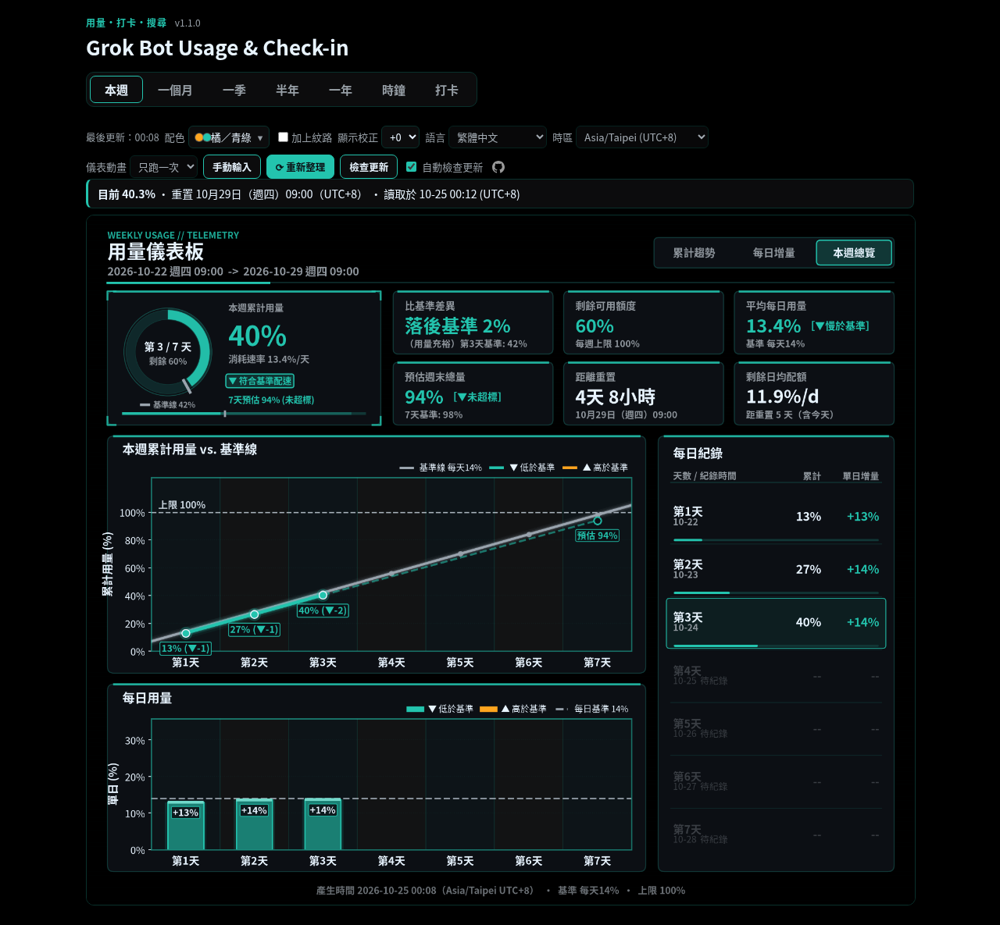
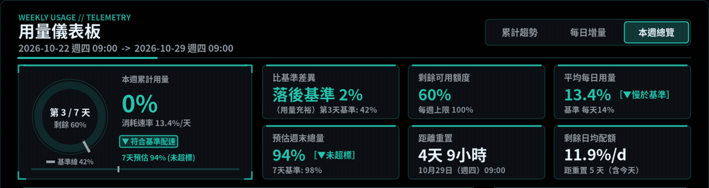
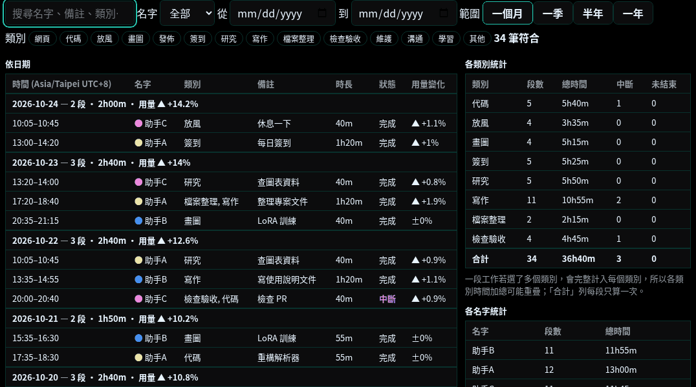
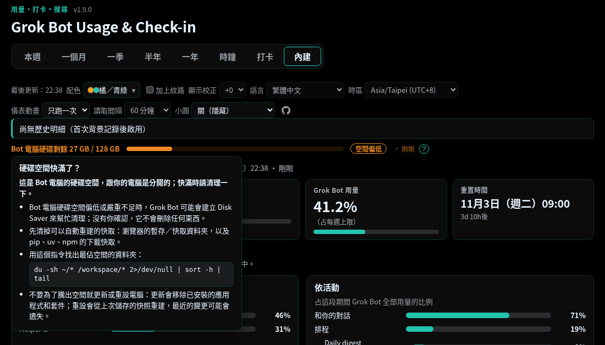

# Grok Bot Usage & Check-in（用量・打卡・搜尋）

在自己電腦上記錄 Grok 每週用量 %、誰在做什麼（打卡），並能搜尋「哪幾天做了哪些事、花了多少用量」。資料只存在本機。



*截圖使用虛構的範例資料。*

## 一鍵安裝（Windows、Mac、Linux）

1. 下載這個專案：在 GitHub 按 **Code → Download ZIP**，再整個解壓縮（Windows：對 ZIP 按右鍵選 **全部解壓縮**，不能在 ZIP 預覽視窗裡直接執行）（或用 `git clone`；只有 `git clone` 裝的版本能在網頁上自動更新）。
2. 依你的電腦，雙擊對應的檔案：
   - **Windows：**`Install-Windows.cmd`（如果出現「Windows 已保護您的電腦」，按 **其他資訊 → 仍要執行**）
   - **Mac（測試版，還沒在真正的 Mac 上測過；用得如何請到 GitHub issue 回報）：**`Install-Mac.command`（第一次請按右鍵選 **打開**，再按一次 **打開**）
     - 如果雙擊被拒絕，請看下面的 **Mac／Linux：雙擊打不開？**
   - **Linux：**`install.sh`（選「在終端機執行」），或在終端機輸入 `bash install.sh`
3. 它會列出要安裝的東西，然後直接一次做完，不會問任何問題（Windows 用 winget 裝 Python、Grok Build、`tmux`、Python 套件）。Windows 可能會跳出系統自己的許可視窗，Linux／macOS 裝 `tmux` 時可能要輸入電腦密碼，那是系統要求的。
4. 看到 **Done** 時，儀表板會在瀏覽器打開，畫面上也會顯示網址。它還會在桌面放一個 **Grok Usage Dashboard** 捷徑（Windows 是 `.lnk`、Mac 是 `.command`、Linux 只有在有 `~/Desktop` 資料夾時才會放 `.desktop`），並印出放在哪裡；之後雙擊就能再次啟動儀表板。捷徑建立失敗不會讓安裝失敗。
5. 如果這次才剛裝好 Grok Build，請登入一次：開一個**新的**終端機／PowerShell 視窗，輸入 `grok`，在瀏覽器確認是你的帳號，按 **Allow**，再按 **Ctrl+Q** 離開。安裝程式只有在找不到 Grok Build 的登入檔時才會顯示這個提醒（只檢查檔案是否存在，不會打開它）。

> **Mac／Linux：雙擊打不開？** 從 GitHub 下載的 `.command`、`.sh` 檔案可能少了「可執行」權限，所以雙擊會被拒絕（出現「權限」或「無法執行」）。檔案本身沒問題：打開 **終端機**，輸入 `bash `（後面要有一個空格），把檔案拖進視窗，再按 Enter 就能執行。想改回可以雙擊，在專案資料夾的終端機輸入一次 `chmod +x Install-Mac.command install.sh start-dashboard.sh`。Windows 不受影響。

<details>
<summary><b>安裝程式做了什麼，以及選項</b></summary>

它會做的事：只安裝缺少的東西（用 xAI 官方安裝程式裝 Grok Build、Linux／macOS 的 `tmux`、Python 套件；Linux／macOS 若系統不讓你用 `pip` 裝到全系統，就改裝在專案資料夾裡的私人 `.venv`），把
`usage_config.json` 的讀取方式設成 `auto`，並把 Grok Build 的預設權限模式存成 **auto**（在 `~/.grok/config.toml`
寫入 `[ui] permission_mode = "auto"`，那裡只改這一行；登入資料完全不會打開），最後在 `127.0.0.1` 啟動儀表板。
auto 模式下，Grok Build 會讓安全檢查自動放行一般操作，不必每次問你；有風險的操作仍會先問你。如果 Grok Build
原本就設成「全部自動核准」（always-approve），會保持原樣。

隨時可以再執行一次：做完的步驟會跳過；如果 auto 被關掉了，會自動改回來。選項：`--dry-run`
（只列出計畫）、`--manual`（自己輸入每週 %，不安裝也不更動 Grok Build）、`--no-grok-auto`（不動 Grok Build 的模式）、
`--no-start`、`--no-shortcut`（不要在桌面放捷徑）、`--ask`（安裝前先問「Continue? [y/N]」，預設關閉；舊的 `--yes` 仍可用，但沒有作用）。Windows 的 `one-click-install.ps1` 用 `-DryRun`、`-Ask`、`-Manual`、`-NoGrokAuto`、`-NoStart`、`-NoShortcut`。

</details>

## 解除安裝

沒有一鍵解除安裝的腳本，只要三個小步驟：

1. **先停止背景的儀表板**（不然資料夾還在使用中，儀表板也會繼續跑）。在專案資料夾裡執行：
   - Windows：`.venv\Scripts\python.exe service.py stop`
   - Mac / Linux：`.venv/bin/python service.py stop`

   如果你曾經執行過 `register-task.ps1`（登入時自動啟動），也要執行
   `powershell -ExecutionPolicy Bypass -File .\register-task.ps1 -Uninstall`。
2. **刪除桌面上的「Grok Usage Dashboard」捷徑**（如果有；一鍵安裝程式會做一個，Windows 的那個指向 `start.ps1`）。
3. **刪除整個專案資料夾。** 儀表板、`.venv` 和已存的讀數都會一起消失。

Grok Build 是 xAI 官方的程式（Grok Bot 也在用），所以**不會**被移除。安裝程式寫進 `~/.grok/config.toml` 的那一行
（`permission_mode = "auto"`）很小也無害，可以留著。

## 手動安裝（Linux，給工程師：三步驟）

1. **下載**
   ```bash
   git clone https://github.com/yuehzhan/grokbot-usage-checkin.git
   cd grokbot-usage-checkin
   ```
2. **安裝**
   ```bash
   python3 -m pip install -r requirements.txt
   sudo apt install -y tmux        # Linux 自動讀取 /usage 需要 tmux
   ```
3. **啟動**（接著開啟它印出的網址；停止：`python3 service.py stop`）
   ```bash
   python3 service.py start --open
   ```

那台電腦需要先安裝 Grok Build 並登入過一次（見英文 README 的 *Recommended Setup*）。更多內容（Windows 細節、手機、設定等）都在下方可展開的區塊裡。完整說明（英文）：[README.md](./README.md)


<details>
<summary><b>專案簡介：用途、範圍與隱私</b></summary>

<p align="center">
  
</p>


*動畫和截圖都是虛構的範例資料。*



*打卡搜尋示範，使用虛構的範例資料。*

在自己電腦上記錄 Grok 每週用量 %、誰在做什麼（打卡），並能搜尋「哪幾天做了哪些事、花了多少用量」。
用量和打卡資料只存在本機資料夾，網頁只在 `127.0.0.1` 開。唯一的例外是可關閉的「自動檢查更新」：大約每天一次向 GitHub
（對這個專案 `git fetch`）查詢有沒有新版本，不會附帶任何用量資料；可在網頁上取消勾選「自動檢查更新」，或設定 `"update_check": "off"` 關閉。完整說明（英文）見 [README.md](./README.md)。

**刻意不做進度欄位。** 打卡只是一句「做了什麼」的筆記，沒有任務進度、百分比、截止日或工時統計。目的只是大略看出哪個時段用了多少用量、那時在做什麼，不是用來監工的。加進度或生產力追蹤的需求不在本專案範圍內。

</details>

<details>
<summary><b>建議：安裝在 Grok Bot 的電腦上（Linux 版）</b></summary>

建議使用 **Linux 版，安裝在你的 Grok Bot 自己的電腦上**。這是平常實際在用的版本：Grok Bot 每小時在自己的電腦上用
Grok Build 讀 `/usage`，不會呼叫模型，也不扣用量。可以直接請你的 Grok Bot 幫你安裝：

```bash
git clone https://github.com/yuehzhan/grokbot-usage-checkin.git
cd grokbot-usage-checkin
python3 -m pip install -r requirements.txt
sudo apt install -y tmux        # Linux 自動讀取 /usage 需要 tmux
python3 service.py start        # 背景啟動網頁與每小時取樣；停止：python3 service.py stop
```

那台電腦需要先安裝 Grok Build 並登入過一次（見英文 README 的 *Recommended Setup*）。

> **Windows 版尚未經過充分測試。** 下面的步驟提供給想試用的人；在 Windows 上，手動輸入每週 % 是可靠的方式，自動讀取仍屬實驗性。

> **macOS**：GitHub 上的自動測試會在 macOS 跑一遍（每次推送到 `main`），但每小時自動讀取 `/usage` 還沒在真正的 Mac 上試過。

</details>

<details>
<summary><b>Linux 版和 Windows 版差在哪</b></summary>

- **功能一樣**，差別在系統和測試程度：Linux 版的自動讀取已實測，Windows 版還沒充分測試。Linux 版可以裝在 Grok Bot 的電腦上（建議），也可以裝在你自己的 Linux 電腦上。
- **打卡是選用的**：只想看用量就不用打卡，不管哪個版本都一樣。打卡主要是給助手記錄做了什麼、花多少時間、用掉多少用量。
- **匯入助手的打卡紀錄**：請你的 Grok Bot 把它電腦上的 `usage-data/checkins.csv` 複製到你儀表板的 `usage-data` 資料夾。你那邊如果已經有這個檔案，請它合併（以 `id` 欄去掉重複），不要整個蓋掉。複製前先停止儀表板，複製完再啟動，打開「打卡」分頁就能看和搜尋。

</details>

<details>
<summary><b>Windows 快速開始（尚未充分測試）</b></summary>

需要 Windows 10（1809 以上）或 11，以及 [Python 3.10 以上](https://www.python.org/downloads/windows/)
（安裝時勾選「Add python.exe to PATH」）。不需要系統管理員權限。

> **怎麼開 PowerShell：**按鍵盤上的 Windows 鍵，輸入 `powershell` 再按 Enter。想在某個資料夾裡開，就在那個資料夾的空白處**按住 Shift 再按右鍵**，選「在這裡開啟 PowerShell 視窗」（只按右鍵不會出現這個選項）。

1. 還沒裝 Python 和 Git 的話先安裝（已有的跳過），裝完關掉 PowerShell 再重開：
   ```powershell
   winget install -e --id Python.Python.3.12
   winget install -e --id Git.Git
   ```
2. 下載並啟動：
   ```powershell
   git clone https://github.com/yuehzhan/grokbot-usage-checkin.git
   cd grokbot-usage-checkin
   powershell -ExecutionPolicy Bypass -File .\install.ps1    # 想一律手動輸入 % 就加 -Manual
   powershell -ExecutionPolicy Bypass -File .\start.ps1      # 背景啟動並打開網頁
   ```
   沒有 Git 的話，也可以按 **Code → Download ZIP** 解壓縮，在該資料夾先執行 `Get-ChildItem *.ps1 | Unblock-File`
   （從網路下載的 ZIP，Windows 會封鎖腳本）。
3. 停止：`powershell -ExecutionPolicy Bypass -File .\stop.ps1`
4. （選用）登入 Windows 時自動啟動：`.\register-task.ps1`；取消：`.\register-task.ps1 -Uninstall`
5. 更新到新版（`usage-data\` 裡的資料會保留）：
   - **在網頁上：**儀表板會自己到 GitHub 檢查有沒有新版本（啟動約 1 分鐘後一次，之後大約每天一次），你也可以隨時按「檢查更新」。
     有新版本時會顯示，例如「有新版本：abc1234 修正時鐘圖（落後 2 個）」，並出現淺藍色的「更新」按鈕。
     按「更新」後，儀表板會自己停止、更新、重新安裝再啟動；頁面顯示「更新中…」，好了會自動重新整理（大約 1–3 分鐘）。
     不按「更新」就不會安裝任何東西。
   - 不想自動檢查：取消勾選網頁上的「自動檢查更新」（會存成 `usage_config.json` 裡的 `"update_check": "off"`，重新啟動後也維持關閉），
     也可以自己改這個設定。關掉後「檢查更新」按鈕還是可以用。
   - 網頁上的「⟳ 重新整理」按鈕是重新讀取用量，和更新版本無關。
   - 重新整理通常要 10–60 秒，看電腦和網路而定，大部分時間是在等 Grok Build 讀取用量；按鈕會顯示已經過的秒數（例如「⟳ 更新中… 12 秒」）。
     每次讀取和畫圖各花多久會記在 `server.log`。
   - 需要是用 `git clone` 安裝的。用 ZIP 安裝的不能自動更新，請手動下載新的 ZIP（或改用 `git clone` 重新安裝，再把 `usage-data` 資料夾搬過去）。
   - 只會做一般的 `git pull --ff-only`。如果你改過資料夾裡的程式檔，或有自己的提交，頁面會說明原因並且不更新，請改用下面的指令。
     每個步驟都會寫進 `usage-data\update.log`；某個步驟失敗時，仍會把儀表板重新啟動。
   - 手動更新（一定可用）：
   ```powershell
   powershell -ExecutionPolicy Bypass -File .\stop.ps1
   git pull
   powershell -ExecutionPolicy Bypass -File .\install.ps1
   powershell -ExecutionPolicy Bypass -File .\start.ps1
   ```
   Linux 上網頁按鈕的用法一樣。手動：`python3 service.py stop && git pull && python3 -m pip install -r requirements.txt && python3 service.py start`
   - **每次改了什麼：**都寫在 [CHANGELOG.md](CHANGELOG.md)（只用英文維護；舊的 CHANGELOG.zh-TW.md 不再更新）。網頁發現新版本時，
     按「更新」之前會先顯示「這次更新的內容」，內容一律是英文。內容取自檢查更新時 `git fetch` 已經下載的更新紀錄（不會另外連線），以純文字顯示；
     關掉自動檢查又沒按「檢查更新」時，什麼都不會下載或顯示。目前的版本號（`VERSION`）小小地顯示在網頁最上方。
   - **回到上一版：**更新前，網頁會先把目前的版本記在 `usage-data\update_prev.json`（只存在本機，不在 git 裡）。更新後會出現
     「回到上一版」按鈕；按下並確認後，儀表板會停止、用 `git reset --keep` 把 `main` 分支移回原本的版本（仍在 `main` 上，
     之後按「更新」一樣是一般的快轉更新）、`requirements.txt` 不同時重新安裝，再重新啟動。`usage-data\` 和 `usage_config.json`
     都不會動到。如果程式檔被改過，會說明原因並拒絕，不會蓋掉你的修改。每個步驟都記在 `usage-data\update.log`。
   - 手動回到上一版（例如網頁打不開時）：先看更新前存下的版本（`usage-data\update_prev.json` 裡的 `"commit"`；沒有這個檔案時，
     `git reflog` 會列出之前的版本），然後在安裝資料夾執行：
   ```powershell
   cd C:\path\to\grokbot-usage-checkin
   Get-Content usage-data\update_prev.json
   powershell -ExecutionPolicy Bypass -File .\stop.ps1
   git reset --keep <commit>
   powershell -ExecutionPolicy Bypass -File .\install.ps1
   powershell -ExecutionPolicy Bypass -File .\start.ps1
   ```
   Linux：`cd ~/grokbot-usage-checkin && cat usage-data/update_prev.json`，再執行
   `python3 service.py stop && git reset --keep <commit> && python3 -m pip install -r requirements.txt && python3 service.py start`。
   `git reset --keep` 遇到被改過的檔案會直接報錯停止，不會覆蓋；之後要再更新，按「更新」或執行 `git pull` 即可。

</details>

<details>
<summary><b>Windows 常見問題（實際安裝時遇到的）</b></summary>

- **右鍵選單沒有「在這裡開啟 PowerShell 視窗」：**要按住 **Shift** 再在資料夾空白處按右鍵。也可以按 Windows 鍵，輸入 `powershell` 再按 Enter。
- **Grok Build 的資料夾是空的：**正常。`irm https://x.ai/cli/install.ps1 | iex` 會裝到 `C:\Users\<你的帳號>\.grok\bin`（不是你執行指令的那個資料夾），並自動加進路徑。
- **剛裝好 Grok Build，install.ps1 卻說 `"grok" is not on PATH`：**那個視窗是在安裝前開的，還不知道新路徑。關掉、重開一個新視窗就好。
- **Grok Build 要先登入一次：**在新視窗輸入 `grok`，瀏覽器會要你輸入一組代碼，要和視窗裡顯示的一樣。確認上方登入的帳號就是你要追蹤用量的那個，再按 **Allow**。用 **Ctrl+Q** 離開 Grok Build。
- **從手填改成自動讀取：**install.ps1 找不到 `grok` 時會把設定改成 `"pct_source": "manual"`，之後不會自己改回來。`grok` 能用後，輸入 `notepad usage_config.json`，把 `manual` 改成 `auto`，存檔，再停止並重新啟動儀表板。
- **在 PowerShell 打 `cd /d` 會報錯：**`/d` 只有 cmd 認得，PowerShell 請用 `cd E:\資料夾路徑`。說明裡其他指令在 cmd 和 PowerShell 都能用。
- **桌面捷徑（只有手動安裝才需要；一鍵安裝已經會做）：**可以直接請你的 Grok Bot「在桌面幫我做儀表板的捷徑」。捷徑的目標是 `C:\Windows\System32\WindowsPowerShell\v1.0\powershell.exe -ExecutionPolicy Bypass -File "<資料夾>\start.ps1"`，開始位置設成那個資料夾。想自己做的話：桌面按右鍵 → 新增 → 捷徑，貼上這個目標，再到捷徑的「內容」把「開始位置」改成那個資料夾。之後雙擊捷徑就會啟動並打開頁面。
- **更新後頁面還是舊的：**`adda5da` 起已修正（每次啟動都會重建頁面）。更舊的版本先輸入一次用量就會重建。

</details>

<details>
<summary><b>配色與時鐘圖</b></summary>

**配色**（網頁上的「配色」選單，或設定 `palette`）：橘色系 ▲ = 超過基準、冷色 ▼ = 低於基準、灰色 = 基準線本身、紫色等 = 提醒。
「超過」一律是暖色，不用紅色、棕色、灰色、黑色或水藍色。每格是「深色背景 / 淺色背景」，基準線都是 `#9AA4AE` / `#6B7480`。

| 設定值 | 選單名稱 | 超過 | 低於 | 提醒 |
| :--- | :--- | :--- | :--- | :--- |
| `orange-teal`（預設） | 橘／青綠 | `#FFA51F` / `#C96A00` | `#23C4AE` / `#0B8A7E` | `#B48CFF` / `#7A4FC9` |
| `orange-blue` | 橘／藍 | `#FFA51F` / `#C96A00` | `#4D8DFF` / `#1F5FD1` | `#B48CFF` / `#7A4FC9` |
| `amber-purple` | 金橘／紫 | `#FFB000` / `#B37A00` | `#9B7BFF` / `#6A4BD6` | `#F28CC8` / `#B0487F` |
| `pink-green` | 桃紅／綠 | `#FF5FA2` / `#C2306E` | `#3DDC84` / `#138A4C` | `#B48CFF` / `#7A4FC9` |
| `gold-sky` | 金／天藍 | `#FFD23F` / `#9A7400` | `#5EC8FF` / `#0A78B8` | `#C59BFF` / `#7A4FC9` |
| `orange-purple` | 橘／紫 | `#FF8C1A` / `#C25E00` | `#B07CFF` / `#7A45D6` | `#7FD8C8` / `#1F8A7A` |
| `magenta-teal` | 洋紅／青綠 | `#FF4FD8` / `#B8269A` | `#2EC4B6` / `#0E857A` | `#A8B4FF` / `#4F5FC9` |
| `yellow-indigo` | 黃／靛藍 | `#F5E14B` / `#8F7F00` | `#6C7BFF` / `#3E4CD1` | `#FF9ECF` / `#A8558A` |
| `peach-mint` | 蜜桃／薄荷 | `#FFB38A` / `#C0602F` | `#7FE0B0` / `#1E8A5A` | `#B48CFF` / `#7A4FC9` |
| `tangerine-cyan` | 橘紅／青 | `#FF8A3D` / `#C55A12` | `#3FD0FF` / `#0A7FAF` | `#C59BFF` / `#7A4FC9` |
| `rose-lime` | 玫瑰／萊姆 | `#FF6FB5` / `#C23A7E` | `#A8E063` / `#4E8A12` | `#9EC5FF` / `#3F64C2` |
| `orange-deepblue` ★（舊名 `colorblind`） | 橘／深藍 ★ | `#E69F00` / `#B87F00` | `#3171C4` / `#1D3972` | `#CC79A7` / `#A8558A` |
| `sunflower-navy` ★ | 向日葵／深藍 ★ | `#FFC93C` / `#9C7200` | `#3A6BD9` / `#00219E` | `#E59BFF` / `#A8558A` |
| `safety-ultramarine` ★ | 安全橘／群青 ★ | `#FF832B` / `#EB6100` | `#2A68DE` / `#002599` | `#B48CFF` / `#7A4FC9` |
| `tangerine-violet` ★ | 亮橘／紫羅蘭 ★ | `#FF9100` / `#CC7400` | `#6C5CE7` / `#3814B8` | `#F28CC8` / `#B0487F` |
| `amber-cobalt` ★ | 琥珀橘／鈷藍 ★ | `#EE7733` / `#EB5500` | `#0077BB` / `#003A66` | `#C59BFF` / `#7A4FC9` |
| `teal-mono` | 全青綠 | `#8FF5E4` / `#109C8B` | `#178A7D` / `#07443E` | `#B48CFF` / `#7A4FC9` |
| `pink-mono` | 全粉紅 | `#FFB8DC` / `#D63F8E` | `#B84381` / `#58163D` | `#9EC5FF` / `#3F64C2` |
| `purple-mono` | 全紫 | `#D9CCFF` / `#8E63F0` | `#7C5CD6` / `#361D84` | `#F28CC8` / `#B0487F` |
| `blue-mono` | 全藍 | `#B3D7FF` / `#2D7BEF` | `#2F6BD6` / `#0B2D75` | `#C59BFF` / `#7A4FC9` |
| `green-mono` | 全綠 | `#A8F0BC` / `#1E9A45` | `#288C48` / `#0A431F` | `#B48CFF` / `#7A4FC9` |
| `custom` | 自訂顏色… | 你選的「高於基準」色 | 你選的「低於基準」色 | 自動挑選 |

- **純色**（選單裡 ★ 說明下方的獨立區塊：`teal-mono` 全青綠、`pink-mono` 全粉紅、`purple-mono` 全紫、`blue-mono` 全藍、`green-mono` 全綠）：
  超過和低於用同一個色系，「超過」是明亮的淺色、「低於」是較深較沉的色（兩者在深色和淺色背景上對比都至少 3:1），只靠深淺區分；
  ▲／▼ 標籤照樣標出狀態，勾「加上紋路」還會在超過的部分加斜線。`teal-mono` 也可寫成 `all-teal`。
- 選單順序：雙色配色在前，★ 配色集中在雙色區的最後，接著是 ★ 說明，再來是純色和「自訂顏色…」。`high-contrast`（黃 `#FFFF00`／天藍 `#00BFFF`）
  已從選單拿掉，但設定檔、主題檔和 `--palette` 寫它仍然有效、照樣畫；瀏覽器裡記著它的話，會改用設定的配色。
- **自訂顏色…**（選單最後一項）：旁邊會出現「低於基準」「高於基準」兩個取色器，圖表會改用你選的兩個顏色重畫（太暗或太亮時會自動調深或調淺，
  讓它在深色／淺色背景上都看得清楚；提醒色自動挑）。選擇記在瀏覽器（`usage.customColors`）。兩個顏色太接近時，會出現一行小提示：
  ▲／▼ 標籤和「加上紋路」仍能分辨。設定檔寫 `"palette": "custom", "custom_colors": {"under": "#336699", "over": "#FFCC00"}`
  （只接受 `#RRGGBB`，其他寫法會改用橘／青綠）；PNG 圖和 `--palette custom` 也一樣，命令列也可以直接寫 `--palette custom-336699ffcc00`（先低於、後高於）。
  自訂顏色由你決定，所以上面「不用紅色」的規則只適用於內建配色。
- **★ 配色**：`orange-deepblue`、`sunflower-navy`、`safety-ultramarine`、`tangerine-violet`、`amber-cobalt`。
  這幾組用 [DaltonLens](https://daltonlens.org/)（Machado 2009 模型）做過色盲／色弱模擬：第一型色盲、第二型色盲、第三型色盲、
  第一型色弱、第二型色弱，在每種模擬下、深色和淺色背景都一樣，「超過」、「低於」和灰色基準線兩兩之間的 **CIEDE2000 ΔE 至少 20**。
  選單在這幾組名稱後面加 ★，下方有一行說明「★ = 對比較強，各種色覺都容易分辨」。舊名 `colorblind`（和 `okabe-ito`）在設定檔、
  主題檔和瀏覽器記住的選擇裡仍然有效，等於 `orange-deepblue`。這項檢查不在測試裡（DaltonLens 不是本專案的依賴套件）。
- **加上紋路**（配色選單旁的勾選框，預設不勾，任何配色都能用）：超過基準的長條加斜線（`///`），未超過的是實心；超過的折線段是
  虛線加 ▲，未超過是實線加 ▼；每日增量長條和數值都標 ▲/▼；網頁上「超過」的標籤加淡淡的斜紋和 ▲。選擇記在瀏覽器（`usage.patterns`），
  也存成 `usage_config.json` 的 `"patterns": true` / `false`（沒有設定檔時存在 `<data_dir>/page_settings.json`），所以重新整理畫的
  預設圖也一樣；有紋路的圖第一次用到時才畫（`history/pal/<配色>-pat/`），之後和配色一樣沿用。主題檔加 `"patterns": true` 也會開啟。
- 選單是一長串清單，每列有兩個色點；可用方向鍵、Home/End、Enter、Esc 操作。選擇只記在瀏覽器（`usage.palette`），不會改設定檔。
- 整個頁面（分頁底線、外框、連結、焦點框、「⟳ 重新整理」按鈕）都跟著配色的冷色變，圖片載入好才一起切換。「更新」按鈕固定是淺藍色。
- 每次重新整理只畫設定裡的配色；其他配色在網頁第一次選到時才畫（約 1–2 秒），之後到下次重新整理前都直接沿用。
  `render_all_palettes: true` 則每次都畫全部配色（切換即時，但重新整理較慢）。
- **顯示校正**（設定 `display_offset`，「加上紋路」旁的選單：−2～+2，預設 +0）。Grok 桌面版顯示的本週用量可能比 `/usage`
  高一點，因為兩邊對小數的四捨五入方式不同；差距不是固定的（常見是 0 或 1%），所以 −2～+2 維持手動選擇。想保守一點可以調 +1 或 +2。校正值只在顯示和計算時加上（目前用量、
  與基準差、剩餘、平均、預估、超過／低於的顏色、本週和歷史圖、ledger 那一行）；`samples.csv`、每週 CSV 和 `latest.json`
  都保持原始值，兩次讀數之間的差（打卡開始／結束、時鐘圖每小時增量）不受影響（校正值會互相抵消）。顯示值不會低於 0；
  有校正時主要百分比旁會有小小的 `(+1)`。設定存在 `usage_config.json`（沒有設定檔時存在 `<data_dir>/page_settings.json`）
  和瀏覽器（`usage.displayOffset`）；改了會重畫圖（校正值是圖片快取的一部分，例如 `history/pal/orange-teal-o+1/`）。
- **語言**和**時區**選單（「顯示校正」旁）。語言：自動（跟系統）、繁體中文、简体中文、English、日本語、한국어、Bahasa Indonesia、Deutsch、Español、Français、Português（一律顯示原文名稱），最後是 `123456`；
  時區：自動（跟系統）或常用的 IANA 時區，每個都標出目前的 UTC 時差。沿用原本的設定 `lang` / `tz`（存在 `usage_config.json`，
  沒有設定檔時存在 `<data_dir>/page_settings.json`，瀏覽器另存 `usage.lang` / `usage.tz`），不用重開服務就生效（圖、標籤、
  重置和週期日期都會重畫；非自動的選擇是圖片快取的一部分，例如 `-Lja-Zasia_tokyo`），原始 CSV／JSON 不會改變。
  啟動時明確給了 `--lang` / `--tz` 參數時以參數為準，選單會變成不能選。只有 `page_settings.json` 時，每週檔案仍依參數／設定檔的
  時區（否則用本機時區）歸檔，選單只改變顯示方式。「平均每日用量」和「預估週末總量」卡片一律顯示 ▲／▼，放在數字旁的小標籤裡，
  例如「8.7% ［▼慢於基準］」、「61% ［▼未超標］」、「［▲超標］」。切換選單時頁面會先顯示「套用中…」，校正值的數字立刻更新，
  重畫好的圖準備好再換上。所有百分比（包括「24 小時內用量激增 +56%」）都用 % 表示。
- **儀表動畫**（「時區」旁的選單：關／只跑一次／持續，預設只跑一次；設定 `anim` = `"off"`／`"once"`／`"continuous"`，
  參數 `--anim`，瀏覽器另存 `usage.anim`，`POST /api/anim` 和 `/api/lang` 一樣要 token、檢查 Host／Origin）。開啟頁面、重新整理、
  改顯示校正時，環形圖從 0 掃到目前值、稍微衝過頭再回穩（約 1 秒），大字百分比和下方進度條同步跑。「持續」在掃完後讓環的前緣
  輕微抖動，數字不會跳動。這是網頁上的 HTML／SVG／CSS 疊層（位置取自 `history/week-current.json`），只用 CSS
  transform／opacity，分頁在背景時暫停；PNG 本身不變，所以匯出的靜態圖不受影響。系統開了「減少動態效果」（`prefers-reduced-motion`）
  時不掃描也不抖動：「只跑一次」等於關閉，明確選了「持續」則前緣保持靜止。啟動參數 `--anim` 優先（選單不能選）。
- **讀取間隔**（「儀表動畫」右邊的選單：15／30／60／120 分鐘，預設 60；設定 `sample_interval_minutes`，`POST /api/interval`
  和 `/api/lang` 一樣要 token、檢查 Host／Origin）。和其他頁面選單一樣存檔（有 `usage_config.json` 就寫進去，否則寫
  `<data_dir>/page_settings.json`；設定檔裡的值優先）。設定檔若是其他值（例如 45）會多列一個選項，仍限制在 15–1440 分鐘。
  背景讀取（sampler）每分鐘重讀設定，從下一輪起套用，不必重新啟動。`pct_source: "manual"`（手動輸入模式）不會自動讀取，
  選單顯示為不能選；直接開 HTML 檔時也不能選（需要伺服器）。
- **小圓**（「讀取間隔」右邊的選單：自動（主題強調色）／棕／黑／灰／青綠／橘／粉紅／紫／藍／綠／酒紅／關（隱藏），預設關（隱藏），想要再打開；設定 `mascot`，
  瀏覽器另存 `usage.mascot`，`POST /api/mascot` 和 `/api/lang` 一樣要 token、檢查 Host／Origin）。頁面標題右邊的一隻圓圓小吉祥物，
  用內嵌 SVG 畫成。「自動」跟著主題的強調色（橘／青綠配色 → 青綠），也會跟著「配色」選單變；眼睛和嘴巴一律是深色（加一點白色亮點），
  每種顏色都看得清楚。點一下（手機輕觸）、滑鼠移上去、或按 Enter／空白鍵（它是一個按鈕）會原地眨眼，分頁在前景時每 10–20 秒也會
  自己眨一下。系統開了「減少動態效果」（`prefers-reduced-motion`）就不眨眼。隱私模式不顯示（和 GitHub 圖示一樣）。選單立即套用，
  只重建頁面；直接開 HTML 檔時只改這個瀏覽器的選擇。
- **換成自己的小圓圖片**（選用）：在資料資料夾（`<data_dir>`，預設是程式旁邊的 `usage-data/`，和 `page_settings.json`
  同一個資料夾）放一個叫 `mascot.svg` 的 SVG 檔，「小圓」選單就會多一個「自訂」選項（在「關（隱藏）」前面），選了之後
  標題旁同一個位置、同樣大小會顯示你的圖片。自動更新不會動 `usage-data/`，所以檔案會保留。檔案必須是 SVG、最大 200 KB
  （不能有 `<!ENTITY>` 宣告）；不符合時不會出現這個選項，已存的「自訂」會當成「關」。圖片以 ``
  （`data:image/svg+xml;base64,…`）顯示，不會直接嵌進網頁，所以檔案裡的腳本不會執行；眨眼和顏色選項不適用於自訂圖片。
  隱私模式一樣不顯示。新增或換掉檔案後，要等下次重建頁面（下一次讀取、改任一個頁面選單或重新啟動）才會出現，再重新整理頁面即可。
- **節日裝扮**（「小圓」右邊的選單：自動（依日期）／關，預設自動；設定 `seasonal`，瀏覽器另存 `usage.seasonal`，
  `POST /api/seasonal` 和 `/api/lang` 一樣要 token、檢查 Host／Origin）。在幾個節日，內建的小圓會戴上小配件，都是自己畫的
  內嵌 SVG，配件用固定的顏色：元旦（12/31–1/2）身邊有煙火亮光、情人節（2/13–2/15）旁邊飄著愛心、兒童節（5/1–5/5）
  旁邊插著一支掛兩條鯉魚旗的小旗竿、萬聖節（10/25–11/1）頭戴南瓜燈、聖誕節（12/20–12/26）戴聖誕帽（頭尾兩天都算）。
  日期以儀表板顯示用的日期為準（頁面的「時區」），在重建頁面時判斷（每次讀取、改任一個頁面選單或重新啟動）。煙火會閃、
  鯉魚旗會飄；開了「減少動態效果」就靜止，眨眼照舊。自訂的 `mascot.svg` 不會戴配件；小圓設成「關」或隱私模式時一起隱藏
  （選單也會藏起來）。改成「關」或「自動」會重建並重新整理頁面。
- **卡片文字**：「比基準差異」改成文字，不加箭頭，例如「落後基準 16%（用量充裕）」、「超前基準 5%（消耗較快）」。7 天預估超過 100% 時，
  主卡片寫「預估額度提前耗盡，剩約 N 天」（N = 剩餘 % ÷ 目前每日平均 %，取到小數一位；不到一天時改用小時，例如「剩約 8 小時」），這時「預估週末總量」卡片的標題改成「預估耗盡時間」，顯示「額度剩約 N 天 ［▲即將用罄］」
  （和標籤放不下時改成較短的「剩約 N 天」），下方小字寫「額度提前耗盡 · 原始預估 145%」。「剩餘日均配額」卡片的小字是
  「距重置 N 天（含今天）」，和「額度剩約 N 天」（到額度用完）區分開來。累計圖的預估虛線和卡片用同一個速率，在穿過 100% 線的地方停住，圓點和「約 N 天後耗盡」標籤也畫在那裡。速率和平均值只有不是整數時才顯示一位小數（74% 而不是 74.0%）。每日紀錄的單日增量只寫 +/−數字（用顏色分超過／低於；勾「加上紋路」時才加 ▲／▼），
  累計值也套用顯示校正。折線圖上不再浮貼「基準線 每天14%」標籤（會擋到資料點），上方圖例、環形圖下的「基準線 N%」、主卡片底部進度條
  和頁尾「基準 每天14% ‧ 上限 100%」都保留。
- **週中重置**：同一週內兩筆紀錄之間累計用量下降超過 5 個百分點（例如升級方案讓額度歸零、但週期不變）時，視為額度在估計的重置時間從 `0%` 重新開始；重置時間取「下降前最後一筆」和「下降後第一筆」紀錄的中點（確切時間無從得知；每小時紀錄時誤差約 30 分鐘內）。如果每小時的 `samples.csv` 在這段空檔內有讀數，就改用其中下降發生的那兩筆讀數的中點，所以週 CSV 一天只有一筆時也能準到約 30 分鐘。之後「平均每日用量」= 目前 % ÷ 重置後經過的天數，「預估週末總量」= 目前 % + 這個速率 × 到重置的剩餘時間，基準改成「每天基準 × 重置後天數」（小字「週中重置後基準: 6.4%」），平均和預估卡片的小字前面加上「週中重置後」，累計圖的預估虛線從目前這一點用新速率畫起，當天的單日增量也從 0% 起算（顯示 +6%，不是 −78%）。判斷依據是下降幅度，不是讀數變成 0%。計算在 `usage_rate.py`；一般週的數字完全不變。
- **天數只算一次**：今天是第幾天和剩幾天都從重置時間推算。週期進行中，剩餘天數 = 距離重置的時間 ÷ 24 小時、無條件進位（含今天），
  「第 N / 7 天」的 N = 8 − 剩餘天數，所以兩者相加一定是 8（例如「第 3/7 天」、「距離重置 4天1小時」、「距重置 5 天（含今天）」）。
  週期外或沒有重置時間時，用最新一筆紀錄的天數。基準（每天基準 × 第幾天）和「比基準差異」仍以最新紀錄那天為準，卡片小字會寫出是第幾天。
- **每日基準**（設定 `pace` 或參數 `--pace`，預設每天 14%）：環形圖上的基準刻度是「每天基準 × 第幾天」，環形圖下方的小圖例
  會寫出當天的值，例如「基準線 42%」。平均分配的話是 100 ÷ 7 ≈ 每天 14.3%，預設取整數每天 14%（第 7 天 = 98%），保留約 2% 的餘裕；
  想要不同的值可以改設定 `pace` 或用 `--pace`。

**本週圖的兩個分頁**：**本週總覽**（第一次開啟時顯示）和 **每日增量**（可切換 每日／每小時；每小時長條只用實際讀數，本週有 12 個以上每小時讀數時預設顯示每小時）。網頁會在瀏覽器記住上次看的分頁和 每日／每小時（`usage.wkTab`、`usage.incUnit`），重度使用者上次停在每小時，下次打開就直接是每小時。每日和每小時兩種畫面裡，圖上的長條和下方的紀錄卡片／列共用**同一個選取**：一開始選今天（每小時則是最新的一小時），點任一邊，圖上那一欄會出現淡淡的遮罩、清單上對應的項目會跟著高亮；還沒有紀錄的日子也能選；重新載入頁面後不會記住。每小時畫面中，長時間沒有讀數的空檔畫成低矮的中性灰色帶（高度是每小時平均）；右邊的清單會列出 7 天圖上**每一個小時**（最新的在最上面），可以捲動（右側有一直顯示的捲軸），點長條會捲到並高亮對應的那一列。清單標題旁有一個小切換鈕，可在「最新在上」（預設，每日和每小時都一樣）與「最舊在上」之間切換，每日和每小時各自記住自己的選擇（`usage.listOrder`、`usage.listOrder.hourly`）。上方的增量圖表也跟著同一個順序：最新在上時，最新的一天／一小時在圖的最左邊（本週總覽不受影響）。

**時鐘圖**（「時鐘」分頁，0 時在上、順時針）：
- 左圖：近 24 小時，每小時一根，顏色和長度都代表該小時用量增加多少（下方有色條）。
- 右圖：預設是本週（目前的重置週）。上方「範圍」選單可切換 本週／近一月／近一季／近半年／近一年／全部。本週＝上次重置到現在；近一月／近一季／近半年／近一年是從現在往回算的最近 30／90／180／365 天；全部＝所有紀錄。
  **顏色 = 不同天（或週／月／季），對照下方圖例；長度 = 該小時用量增加**。
  本週：每天一色；近一月：每個重置週一色；近一季、近半年：每月一色；近一年：每季一色；全部：每季一色，超過 8 季就改成每年一色（最多 8 個）。
  週／月／季／年的長度是該期間各天在這個小時的平均增加。圖例依時間排列，例如「10/24 週六（今天）」、「第1週 10/03–10/09」；目前這一期是粗體，沒有資料的會變淡。
  顏色組每種配色最多 8 色（深淺背景各一套），第一色是配色的冷色，並避開接近「超過」的顏色；`orange-deepblue` 使用 Okabe-Ito 色組。
- 「排列」選單：**疊加**（預設）把每一期畫在同一個角度、全寬，**由長到短**畫，短的不會被長的蓋住；「填色」可選 **半透明**（預設，約 40% 填色加實線外框）或 **實心**。
  **並排** 則把每個小時切成細扇形，每期一片（此時不顯示「填色」）。
- 「時制」選單（在「範圍」左邊，兩個時鐘一起切換）：**近 24 小時**（預設，就是上面的 24 格錶盤）、**近 12 小時**（自動：本地時間 12:00 前就是上午、12:00 起就是下午，每次重新整理或重新選擇時重新判斷，所以中午和午夜會自動換；之後的行為和上午／下午完全一樣）、**上午 12 小時** = 只顯示 0–11 時，畫成一般 12 小時鐘面（12 在上、1–11 順時針）、**下午 12 小時** = 只顯示 12–23 時，同樣的鐘面。另一半直接不顯示，不會疊進來；尖峰、平均、區間數和打卡圓點都只算顯示的那一半。是哪一半會寫在三個地方：**錶盤中央**（小圓心裡寫「上午」／「下午」，長條從圓心外面開始，不會被蓋住；24 小時盤沒有）、**標題**（左圖寫它涵蓋的 12 小時：「用量時鐘 — 上午 12 小時」／「下午 12 小時」，選「近 12 小時」則是「用量時鐘 — 近 12 小時（上午）」；右圖是「用量時鐘 — 本週（下午）」、「…近一月（上午）」；各語言用同樣的詞，數字模式用 0–11／12–23；近 24 小時的標題不變）、副標題和摘要。左圖副標題寫實際涵蓋的時段：近 24 小時只取那一半，剛好是 12 個鐘頭，分成一段或兩段（「10/27 02:37–12:00 + 10/28 00:00–02:37」）；右圖維持日期範圍加上半天（「上午 0:00–12:00」）。近 12 小時的左圖另存一張（`clock-1d-auto-am.png`），因為只有標題和上午／下午不同。記在瀏覽器（`usage.clockDial`，舊的 `24`／`am`／`pm` 值照舊可用），第一次選到時才畫（`clock-1d-am.png`、`clock-<範圍>-<排列>-pm.png`…，近 12 小時依判斷結果用同樣的檔案）。
- 範圍、排列、填色都記在瀏覽器（`usage.clockRange`、`usage.clockLayout`、`usage.clockFill`）。每次重新整理只畫預設（本週、疊加、半透明），
  其他組合第一次選到時才畫（`history/pal/<配色>/clock-<範圍>-<ot|os|sd>.png`），之後沿用到下次重新整理。
- **滑鼠移到打卡圓點上**（手機用點的；鍵盤可 Tab 到圖上再用方向鍵、Enter）會顯示小提示：名字、當地時間和 UTC 時差（`10-26 13:22 (UTC+8)`）、類別、備註，以及是單次打卡還是工作段開始。
  疊在一起的點（例如同一個人好幾天都在同一時間打卡）會在同一個提示裡全部列出，新的在前（最多 8 筆，其餘顯示「還有 N 筆」）。再點一次或點旁邊就關閉。
  隱私模式只顯示 `#1`、`#2`…，不顯示備註。PNG 圖不變；圓點位置另存在旁邊的 `clock-*.json` 並嵌入網頁，所以直接用檔案開 `index.html` 也能用（本週以外的範圍要用本機服務開啟）。

**下次重置時間**：凡是顯示下次重置的地方（歷史頁狀態列、本週圖「距離重置」卡、檢視頁、桌面通知、數字模式）都寫明確的
當地日期和時間，不寫「下週」或只寫星期：`10月31日（週六）01:41`（簡體 `10月31日（周六）01:41`、英文 `Sat, Oct 31, 01:41`、
數字模式 `10/31 01:41`），倒數（`6天 7小時`）照樣留著。Grok Build 的 `/usage` 有給 `Resets: …` 時就照它顯示，
不重算、不往後推、不「修正」，就算看起來已經過了或怪怪的也一樣（只有它自帶時區時才換成當地時區）；
只有 `/usage` 沒給時才用備援（`--reset-anchor`、設定的 `reset_anchor` 或 `state.json`），ledger 這時顯示「重置時間未知」。

</details>

<details>
<summary><b>打卡類別與「放風（break）」</b></summary>

**放風（break）**是 Grok Bot 不接任務、自己決定要做什麼的時段，例如逛網頁、讀有興趣的東西、整理自己的筆記，或做一點自己想做的小創作。時間由你事先約好（例如每週固定幾十分鐘），開始和結束都打卡，所以用了多久、用掉多少用量都看得到。

適度放風對 Grok Bot 的勞逸平衡有幫助：
- **工作和自由時間分開：**例行工作照常完成，自由活動放在約好的時段，不會臨時插進工作裡。
- **用量可預期：**放風有固定時間上限，又會打卡，不會在不知不覺中吃掉一週的額度。用量吃緊時，也可以先減少或暫停放風。
- **保持 Grok Bot 的個性和興趣：**有時間接觸工作以外的東西，對話和作品比較不會只剩重複的例行公事，也常會帶回對工作有用的新點子。
- **你看得到它在做什麼：**放風紀錄可以搜尋，想知道它最近對什麼有興趣，看打卡就知道。

其他類別：
- **網頁（web）**：在網站上操作，例如登入、填表、瀏覽。
- **代碼（code）**：寫程式或改程式。
- **畫圖（image）**：產生或修圖。
- **發佈（publish）**：把作品發到網站或社群。
- **簽到（daily）**：各網站的每日簽到、領點數。
- **研究（research）**：查資料、比較、整理結論。
- **寫作（writing）**：寫文章、說明、貼文。
- **檔案整理（files）**：搬移、分類、備份檔案。
- **檢查驗收（review）**：測試、核對成果。
- **維護（maintenance）**：修復、更新、讓工具正常運作。
- **溝通（comms）**：和使用者或其他助手往來。
- **學習（learning）**：讀文件、學新工具。
- **其他（other）**：上面都不符合時使用。

一段工作最多可以選 3 個類別。

</details>

<details>
<summary><b>「內建」分頁：Grok Bot 自己的用量報告（<code>usage-data/breakdown/</code>）</b></summary>

**內建**分頁（在「打卡」分頁的右邊）顯示 Grok Bot *內建*用量報告裡的內容，這些是儀表板自己讀不到的：你的方案、每週上限已用多少、其中 Grok Bot 用了多少、上限是否和其他應用程式共用、何時重置，以及 Grok Bot 依「機器人」和依「活動」的用量（對話、每個排程的占比和每週大約執行幾次、機器人之間、群組聊天）。儀表板不會去抓畫面：由你的 Grok Bot 讀自己的報告，存成一個小小的 JSON 檔，儀表板只顯示 `usage-data/breakdown/` 裡的檔案。



- **顯示：** 方案、每週已用、Grok Bot 的占比、與其他應用程式共用時的提示、重置時間（附倒數）、依機器人的橫向占比條、依活動的占比（排程底下列出各排程的名稱、占比、每週約幾次），以及「截至……」和它距今多久。超過 36 小時的快照會用提示色（紫色）標示：你的排程可能已經沒有在存檔了。若上一份快照是同一個期間、同一次重置，卡片上還會顯示增減的百分點。長條用儀表板的強調色，不用「超過／低於」的顏色。每個 `share` 都是「該期間 Grok Bot 全部用量」的百分比，不是占上限的百分比。
- **硬碟空間條：** 最上方有一條小橫條「Bot 電腦硬碟剩餘 XX GB / YY GB」，顯示你的 Grok Bot 所在那台電腦（不是你自己的電腦）的剩餘空間。
  它用 Grok Bot 存在快照裡的硬碟數字（見下面的 `disk_free_gb`），或在儀表板本身就跑在 Bot 電腦上時讀那台電腦自己的磁碟（用 `shutil.disk_usage` 讀家目錄所在的磁碟，
  失敗時改讀根目錄；不連網、不呼叫任何 API；每次產生頁面時讀取）。在其他電腦（例如你自己的 PC）上若沒有這類報告，整條硬碟條和旁邊的 **?** 都會隱藏，絕不拿你自己電腦的硬碟來代替。剩餘空間**低於硬碟總容量的 23%** 變橘色並標「空間偏低」，**低於 16%** 變紅色並標「空間不足」
  （128 GB 的硬碟約為 29.4 GB 與 20.5 GB，512 GB 約為 117.8 GB 與 81.9 GB，所以會跟著硬碟大小調整；嚴格小於：剛好 23% 仍是正常，剛好 16% 是橘色）；其他情況是中性灰色。這是儀表板唯一用紅／橘表示「需要注意」的地方，兩個顏色是 `usage_disk.py`
  裡獨立的常數，不影響圖表的「高於／低於」配色。門檻可在 `usage_config.json` 用 `disk_warn_pct`、`disk_danger_pct`（總容量的百分比）設定；舊的固定值 `disk_warn_gb`、`disk_danger_gb` 仍可用，有設定時以它們為準。隱私模式保留數字，文字換成符號。長條後面有個圓形小「?」（是真正的按鈕：可點、可觸控、可用 Enter／空白鍵），按下會開啟一個小提示框，
  列出硬碟快滿時的幾個建議；點旁邊或按 Esc 就關閉。純內嵌 JS／CSS、離線可用、所有頁面語言都有翻譯，隱私模式下也照常顯示（內容沒有任何私人資訊）。
  共四則建議：Disk Saver（依官方文件：Bot 電腦硬碟空間偏低或嚴重不足時，Grok Bot *可能*建立 Disk Saver 來幫忙清理，沒有你確認不會刪除任何東西；不寫任何觸發的 GB 數字）、
  清掉可自動重建的快取（瀏覽器、pip、uv、npm）、用 `du` 指令找出最大的資料夾，以及不要為了騰出空間而更新或重設電腦（更新會移除已安裝的應用程式和套件；重設會從上次儲存的快照重建，最近的變更可能會遺失）。
- **歷史：** 每份快照是一個獨立的檔案，不會被覆蓋，之後可以拿來做趨勢；目前只顯示最新的一份。
- **空狀態：** 還沒有檔案時，分頁會說明設定步驟，並顯示下面的提示詞。
- **隱私模式：** 機器人和排程的名稱改成 `#1`、`#2`……；方案、額外用量來源、備註和提示詞都會隱藏，活動名稱換成沒有文字的符號；百分比保留。
- 用 `usage_history.py serve` 開頁面時，發現有較新的檔案就會自動重建，重新整理就好。若只開靜態的 `index.html`，請先執行一次 `python3 usage_history.py`（或下面的匯入）。

**設定（只要一次）：** 幫你的 Grok Bot 建一個排程（每天一次就夠），貼上下面這段提示詞，每次執行會存一個新檔：

```text
每天早上 9:00，查看我這週的用量報告（方案、每週用量上限已用多少、其中 Grok Bot 用了多少、這個上限是否和其他應用程式共用、何時重置，以及 Grok Bot 依「機器人」和依「活動」的用量：對話、每個排程的占比和每週大約執行幾次、機器人之間、群組聊天）。把結果存成「一個新的」JSON 檔，放在 grokbot-usage-checkin 資料夾裡的 usage-data/breakdown/<YYYY-MM-DDTHH-MM>.json（資料夾不存在就建立；不要覆蓋舊檔）。格式如下，報告沒有顯示的欄位就省略：{"captured_at":"<現在時間，ISO 8601，含我的 UTC 偏移>","period":"this_week","plan":"...","weekly_used_pct":0,"grokbot_used_pct":0,"shared_with_other_apps":true,"resets_at":"<ISO 8601>","extra_usage_source":"...","by_bot":[{"name":"...","share":0}],"by_activity":[{"name":"Chats with the user","share":0},{"name":"Routines","share":0,"routines":[{"name":"...","share":0,"runs_per_week":0}]},{"name":"Bot-to-Bot","share":0}],"disk_free_gb":0,"disk_total_gb":0,"notes":""}。另外也把你所在這台電腦的硬碟剩餘和總容量（單位 GB，例如用 df -h ~ 查）記成 disk_free_gb 和 disk_total_gb（一般數字）。百分比用一般數字（或文字 "<1%"）。不要把檔案傳給任何人。完成後只回覆「saved」，或無法儲存的原因。
```

想用英文？貼這個版本（檔案格式相同）：

```text
Every day at 09:00, look at my usage report for this week (the plan, the weekly limit used, how much of it is Grok Bot's, whether the limit is shared with other apps, when it resets, and Grok Bot's usage by bot and by activity: chats, each routine with its share and about how many runs a week, bot-to-bot, group chats). Save it as ONE new JSON file named usage-data/breakdown/<YYYY-MM-DDTHH-MM>.json inside the grokbot-usage-checkin folder (create the folder if it is missing; never overwrite an older file). Use this shape and leave out anything the report does not show: {"captured_at":"<now, ISO 8601 with my UTC offset>","period":"this_week","plan":"...","weekly_used_pct":0,"grokbot_used_pct":0,"shared_with_other_apps":true,"resets_at":"<ISO 8601>","extra_usage_source":"...","by_bot":[{"name":"...","share":0}],"by_activity":[{"name":"Chats with the user","share":0},{"name":"Routines","share":0,"routines":[{"name":"...","share":0,"runs_per_week":0}]},{"name":"Bot-to-Bot","share":0}],"disk_free_gb":0,"disk_total_gb":0,"notes":""}. Also record the free and total disk space of the computer you run on, in GB (for example from df -h ~), as disk_free_gb and disk_total_gb (plain numbers). Percentages are plain numbers (or the text "<1%"). Do not send the file anywhere. Reply only "saved", or the reason it could not be saved.
```

**手動匯入：** `python3 usage_history.py breakdown report.json`（或用 `breakdown -` 從標準輸入讀；文字可以包在 ```` ```json ```` 區塊裡，前後有說明也行）。會驗證、存成新的快照並重建頁面。只打 `python3 usage_history.py breakdown` 會印出最新的快照。結束碼 `2` 表示沒有可用內容、什麼都沒存。

**檔案格式**（`usage-data/breakdown/<YYYY-MM-DDTHH-MM>.json`，第 1 版）：欄位全部可省略；不認得的欄位會被忽略，某個值有問題只會丟掉那個欄位，超過 256 KB 的檔案會被跳過，完全沒有可用內容的檔案會被忽略。範例見英文版 README（`captured_at`、`period`、`plan`、`weekly_used_pct`、`grokbot_used_pct`、`shared_with_other_apps`、`resets_at`、`extra_usage_source`、`by_bot`、`by_activity`〔含 `routines` 與 `runs_per_week`〕、`by_day`、`notes`）。

- `period`：`this_week`（預設）、`last_7_days` 或 `last_30_days`。沒有 `captured_at` 就用檔案的修改時間。
- 百分比可以是數字，或像 `"61.1% used"`、`"<1%"` 這樣的文字（顯示成 `<1%`，畫成一小條）；範圍限制在 0–100。
- `by_bot`、`by_activity` 也接受 `[名稱, 占比]` 配對或 `{名稱: 占比}` 的對照表。活動依名稱辨識（對話、排程、其他排程、非排程、機器人之間、群組聊天，中英文都可以）；不認得的名稱照原樣顯示。`captured_at`、`resets_at` 接受 ISO 8601（沒寫偏移就用儀表板時區），或報告原本的寫法，例如 `Saturday Oct 31 01:41`。
- `disk_free_gb`／`disk_total_gb`（選填，單位 GB，可以是數字或像 `"27.5 GB"` 的文字）：你的 Grok Bot 所在那台電腦的硬碟剩餘和總容量（例如用 `df -h ~` 查）。
  儀表板跑在「另一台」電腦（例如你的 PC）時，硬碟長條就用這兩個值；在 Bot 電腦本身上則維持自己的即時讀數，除非報告的硬碟不同（本機硬碟總容量和 `disk_total_gb`
  相差超過 5% 且超過 1 GB）。`usage_config.json` 的 `disk_source`（`"snapshot"` 一律優先用報告，`"local"` 不優先用）只在 Bot 電腦上有作用。
  用報告畫出來的長條會顯示報告有多舊。沒有這些欄位的舊快照，或數值怪怪的（剩餘比總量大、總量為 0），都沒問題：在其他電腦上就不顯示這條硬碟條。
- `by_day` 先存起來給之後的趨勢用，目前不顯示；報告若沒有逐日拆分就省略。
- 報告裡沒有「各模型用量」、「其他應用程式的用量」和「上週百分比」，所以不會顯示，也不會編造。

</details>

<details>
<summary><b>Windows 上哪些可用</b></summary>

| 功能 | Windows |
| :--- | :--- |
| 網頁、圖表、打卡、搜尋、用量帳本、提醒 | 可用（和 Linux/macOS 同一套程式）。 |
| 自己輸入每週 %（網頁的「手動輸入」按鈕，或 `usage_history.py sample --pct 42 --reset "Sat 09:00"`） | 可用，這是最可靠的方式。 |
| 每小時自動讀取 `/usage` 畫面 | **實驗性，尚未在真正的 Windows 電腦上測過。** 需要先安裝 Grok Build、登入過一次，且 `grok` 在 `PATH` 上（或設定 `GROK_BIN`）。程式會在看不見的虛擬主控台（ConPTY／`pywinpty`）開 `grok`、輸入 `/usage`、讀畫面後關閉。遇到更新提示、登入提示或畫面改版時，會記成「無法讀取」（絕不記成 0），可改用手動輸入。 |
| 桌面通知 | 用 PowerShell 顯示 Windows 通知，不需另外安裝。 |
| 讀取 Grok Build 的設定、登入資料、cookie 或 token | **儀表板絕不會。** 用量只來自 `/usage` 畫面上顯示的內容，或你自己輸入的數字。唯一的例外是一鍵安裝程式：它只讀取並設定 Grok Build `config.toml` 裡的 `permission_mode`，登入資料完全不會打開。 |

Grok Build 沒有「不開畫面就印出用量」的指令；`grok -p "/usage"` 會被當成問題送給模型（會扣用量，也不會顯示面板），所以本工具不使用。

自動讀取一直失敗時，把 `usage_config.json` 的 `"pct_source"` 改成 `"manual"`（找不到 `grok` 時 install.ps1 會自動這樣設）：
取樣器就不再啟動 Grok Build，網頁會請你輸入數值。

記錄檔：`usage-data\service.log`、`usage-data\server.log`、`usage-data\sampler.log`。回報問題時附上這些檔案即可（裡面不含帳號資料）。

</details>

<details>
<summary><b>用手機看（Tailscale，尚未在手機實測）</b></summary>

[Tailscale](https://tailscale.com/download) 會把電腦和手機接進同一個私人網路，手機就能打開儀表板，不必把它開放到網際網路上。

1. 電腦和手機都裝 Tailscale，登入同一個帳號：[Android（Google Play）](https://play.google.com/store/apps/details?id=com.tailscale.ipn)、[iOS（App Store）](https://apps.apple.com/us/app/tailscale/id1470499037)。
2. 在 `usage_config.json` 把 `history_host` 設成電腦的 Tailscale IP，`history_port` 設固定埠（例如 `8765`），`history_allowed_hosts` 填電腦的 Tailscale 名稱和 IP。
3. 用 `--allow-remote` 啟動服務，手機瀏覽器打開 `http://<電腦名稱>:8765`。電腦要開著、服務要在跑。

頁面內含寫入用的 token，所以同一個 tailnet 裡的裝置都能重新整理和打卡；tailnet 只放自己的裝置就好。

</details>


<details>
<summary><b>資安測試項目（我們測了什麼）</b></summary>

`tests/test_security.py`（共 77 項測試）會在臨時資料夾、隨機本機埠啟動真正的伺服器，檢查下列項目。這裡只是列出專案測了什麼，沒有其他意思。

- 兩個伺服器預設只綁定 `127.0.0.1`；沒加 `--allow-remote` 時，非本機的 `--host` 會被拒絕啟動（結束碼 2）。
- 加了 `--allow-remote` 後，寫入仍需 token，不認得的 `Host` 仍會被拒絕。
- 每個 POST 路由都要帶本次啟動的 token：沒帶、帶錯、跨站的 `Origin` / `Sec-Fetch-Site`、用 GET 都會被拒絕；新增路由若漏掉檢查，測試會失敗。
- token 是隨機的（至少 40 字元），檔案權限為 600，不會出現在 API 回應或其他資料檔裡。
- `Host` 標頭不是本機（DNS rebinding）時回 `421`。
- 只服務 GET 與 POST；PUT、DELETE、PATCH、OPTIONS、TRACE、HEAD 會被拒絕，也不送出 CORS 標頭。
- 檔案路由的路徑穿越（`../`、`%2e%2e`、`%2f`、`%5c`、雙重編碼、絕對路徑、NUL）讀不到歷史資料夾以外的東西（token、CSV、設定檔）。
- `/api/ledger` 不從請求取得檔名。
- 打卡的名稱、備註、搜尋字，以及「內建」分頁的 bot 與活動名稱中的 HTML／script 文字，在頁面資料裡都是轉義後的；API 以 JSON 回應。
- 打卡、「內建」分頁、時鐘提示的頁面腳本不使用 `innerHTML` 等會解析 HTML 的寫法。
- 自訂吉祥物 SVG 只以 `` 的 data URI 載入；含 entity、沒有 `<svg>` 根元素、超過 200 KB 或含 NUL 的檔案會被拒絕。
- 不正常的查詢參數（超長、編碼錯誤、重複 2000 次、NUL）不會讓伺服器停止。
- 超長的請求行、大量標頭、20 條沒送完的連線，不會擋住其他請求。
- 不正常的 POST 內容（壞掉的 JSON、非 UTF-8、設定欄位的型別錯誤、過大的內容、非數字的 `Content-Length`）會得到 4xx 回應，伺服器繼續運作。
- 打卡名稱（40 字）與備註（200 字）會被截到上限。
- 損壞的 CSV／JSON 資料檔（亂碼列、未閉合的引號、NUL）不會讓伺服器停止。
- 負數或非數字的 `Content-Length` 會立刻得到 `400`；`usage_view.py` 超過 1 MB 的內容回 `413`。
- 含逗號、引號、換行的值，在 CSV 裡仍留在自己的儲存格；以 `=`、`+`、`-`、`@` 開頭的名稱或備註，寫入時會加上前導引號（試算表不會把它當公式），儀表板顯示時維持原樣。
- 超過 131072 字元的 CSV 欄位不會讓 `/api/checkins` 出錯。
- `.png`／`.json` 檔案路由會拒絕含反斜線、冒號或 NUL 的路徑片段。
- 回應標頭：`X-Content-Type-Options: nosniff`、`Referrer-Policy`、`Cache-Control: no-store`，沒有 CORS 標頭；歷史頁另外送出 `X-Frame-Options: DENY` 與 `frame-ancestors 'none'`。
- `usage_view.py` 會轉義設定檔的 `title`。
- 啟動腳本與 `service.py` 不含 `--allow-remote` 或 `0.0.0.0`；範例設定為本機位址、除錯關閉。
- Python 原始碼沒有 `eval`、`exec`、`os.system`、`os.popen`、`shell=True`、`pickle`。
- 已追蹤的檔案不含 token、金鑰或個人 e-mail；`.gitignore` 列有 token、設定與資料檔；請求處理器不記錄請求行，也不印出 token。

**先前的已知缺口：**這套測試第一版標為預期失敗的 7 個低風險缺口都已修好，對應的測試現在正常通過（細節見 [CHANGELOG](CHANGELOG.md)）。目前沒有預期失敗的測試。

**免責聲明：**這些測試只涵蓋上面列出的項目。測試通過不代表程式沒有漏洞，也不是資安稽核。

只跑這些測試：

```bash
python3 -m unittest discover -s tests -p "test_security.py" -v
```

</details>


## 致謝

本工具主要由 Grok Bot（琥珀）操刀，Gemini 3.8 與 Gemini 4 輔助完成；原作者僅負責協調與激發靈感。後續維護與更新，將視未來情況調整。


## 第三方聲明

- 網頁工具列最後的小 GitHub 圖示只用來連到本專案的 GitHub 頁面。圖示是 Octicons 的 `mark-github`（© GitHub, Inc.，MIT 授權，
  https://github.com/primer/octicons），原樣內嵌、未修改。GitHub 標誌是 GitHub, Inc. 的商標，這裡只依 GitHub 的標誌使用規範
  （https://github.com/logos）以白色／灰色顯示、用來連到專案頁；本專案與 GitHub 沒有合作或背書關係。
